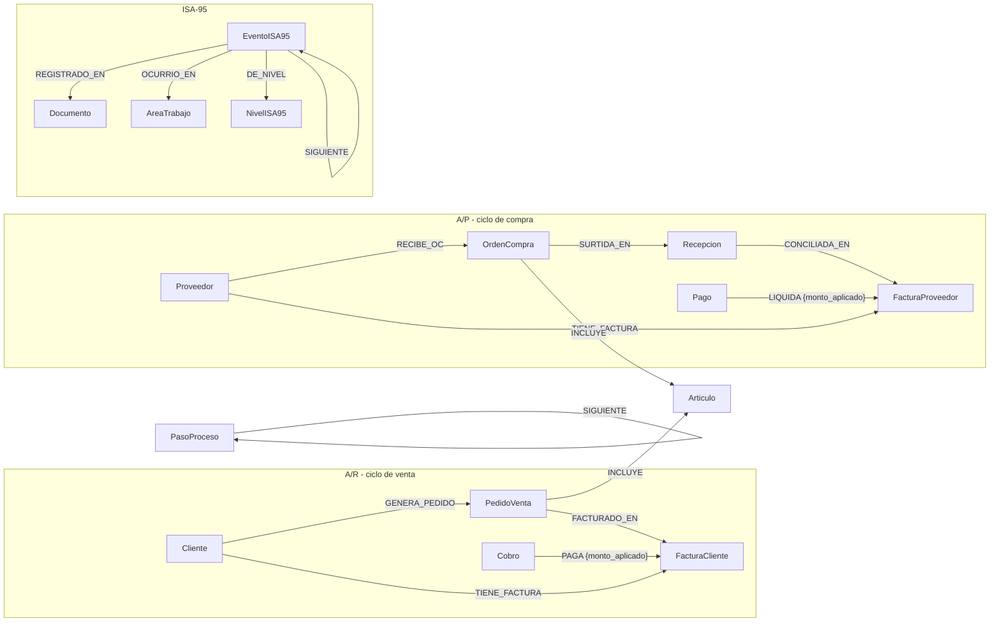

# Sincronizador PostgreSQL → Neo4j y Knowledge Graph A/R-A/P + ISA-95

**Matrícula:** 183800 · **Issue:** #257 · **Rama:** `feature/183800`
**Agente que lo usa:** Orquestador de Operaciones y Cadena de Suministro (y, con sus consultas, los agentes de Cobranza, Compras/Tesorería y Auditoría).

## 1. ¿Qué problema resuelve?

Los documentos de cuentas por cobrar (A/R) y por pagar (A/P) viven en PostgreSQL, y los eventos ISA-95 que cuentan qué pasó con cada uno están en archivos JSON sueltos. Para saber qué pasó con una orden de compra desde que se emitió hasta que se pagó había que encadenar muchas tablas y revisar los JSON a mano.

Este componente copia los documentos de PostgreSQL a un grafo en Neo4j, los conecta con sus eventos ISA-95 y deja un catálogo de consultas Cypher listo para los agentes.

## 2. Archivos

| Archivo | Para qué sirve |
|---|---|
| `schema_neo4j_arap.cypher` | Constraints de unicidad e índices del grafo (idempotente). |
| `extraccion_incremental.sql` | 14 consultas de lectura sobre PostgreSQL, con filtro incremental por `fecha_creacion`. |
| `sync_postgres_neo4j.py` | El sincronizador (ETL idempotente con `MERGE`). |
| `consultas_arap.cypher` | Catálogo de 13 consultas analíticas, cada una con su agente y decisión. |
| `ejecutar_consultas.py` | Corre el catálogo y lo muestra como tablas (para evidencias y para el CI). |
| `seed_arap_183800.sql` | Datos de prueba que coinciden con los folios de `Eventos_ISA95.json`. |
| `test_sync_183800.py` | Pruebas con pytest (22). |
| `../../.github/workflows/183800_sync_postgres_neo4j.yml` | GitHub Actions: levanta PostgreSQL y Neo4j, prueba y sincroniza dos veces. |

## 3. Modelo del grafo



- Todos los documentos llevan además la etiqueta `:Documento` (por ejemplo `(:FacturaCliente:Documento)`), así un evento se enlaza por folio sin importar el tipo.
- `CuentaContable` se copia como catálogo desde `miriam_contabilidad.sql`. La generación de asientos corresponde al componente de Automatización Contable.
- Estos nombres de relaciones son el estándar del equipo A/R-A/P.
- `TIENE_FACTURA` e `INCLUYE` se agregaron al diseño inicial: la primera permite sumar la deuda de un cliente aunque la factura no venga de un pedido, y la segunda conecta los artículos para detectar proveedores únicos.

## 4. Reglas de integridad

- **Unicidad:** `rfc` en Cliente y Proveedor, `folio` en cada tipo de documento, `eventId` en eventos (ver `schema_neo4j_arap.cypher`).
- **Idempotencia:** solo se usa `MERGE`. Ejecutar el sincronizador dos veces deja el grafo igual. Nunca se usa `CREATE` de nodos ni `DETACH DELETE`. Lo único que se elimina son relaciones `:SIGUIENTE` de eventos que dejaron de ser consecutivos (por ejemplo, cuando llega un evento intermedio).
- **Clave de cruce:** cada documento guarda su `id` de PostgreSQL y su `folio`.
- **Eventos ISA-95:** guardan `timestamp` ISO-8601 con zona, nivel (0–4), área de trabajo y el folio del documento origen. Los datos anidados quedan como JSON en la propiedad `datos`.
- **Eventos huérfanos:** si un evento declara un folio que no existe en PostgreSQL se marca `huerfano = true`. Si el documento aparece después, la siguiente corrida lo enlaza y lo marca `false`.
- **PostgreSQL es la fuente oficial:** el sincronizador solo lee de ahí.

### Decisiones sobre los datos de eventos

`Eventos_ISA95.json` junta tres archivos con formatos distintos, y el sincronizador lee los tres:

| Fuente | Formato | Observaciones |
|---|---|---|
| 181585 | `events` | Trae nivel, área y folio. Sus folios (`OC-4001`, `FC-2001`…) coinciden con `seed_arap_183800.sql`. |
| 181779 | `messages` | Folios como `PO-4001` o `APINV-6001`. Además de A/R-A/P trae eventos de MRP (producción, niveles 0 a 3). |
| 182028 | `eventos` | Describe el proceso por área; no trae folio ni nivel (se asigna nivel 4, ERP, y queda marcado `nivel_inferido`). |

- **No se hace equivalencia `PO-4001` = `OC-4001`.** Parecen el mismo documento, pero sus importes son distintos ($1,972,000 contra $580), así que son escenarios diferentes. Los eventos de 181779 quedan como huérfanos de A/R-A/P.
- Los eventos de MRP referencian órdenes de producción (`PRD-2001`) que no existen en las tablas A/R-A/P y quedan marcados como huérfanos. La consulta de calidad (Q10) los excluye filtrando `proceso IN ['AR','AP']`.
- Las marcas de tiempo sin zona se interpretan como UTC-06:00, que es la zona que declaran los archivos.
- `:SIGUIENTE` entre eventos se arma por fuente y proceso, ordenado por fecha.

## 5. Cómo ejecutarlo

### Variables de entorno

| Variable | Valor típico (local) |
|---|---|
| `POSTGRES_HOST` / `POSTGRES_PORT` / `POSTGRES_DB` | `localhost` / `5432` / `erpdb` |
| `POSTGRES_USER` / `POSTGRES_PASSWORD` | `erp` / `erp` |
| `NEO4J_HOST` / `NEO4J_PORT` (o `NEO4J_URI`) | `localhost` / `7687` |
| `NEO4J_USER` / `NEO4J_PASSWORD` | `neo4j` / `password` |

### Levantar las bases con Docker

```bash
docker run -d --name pg183800 -p 5432:5432 -e POSTGRES_DB=erpdb -e POSTGRES_USER=erp -e POSTGRES_PASSWORD=erp postgres:16
docker run -d --name neo4j183800 -p 7474:7474 -p 7687:7687 -e NEO4J_AUTH=neo4j/password neo4j:5.26-community
```

### Cargar las tablas y los datos de prueba (desde la raíz del repositorio)

```bash
for f in Tablas-Alexis.sql tablas.sql azul_ventas.sql miriam_contabilidad.sql 183800/seed_arap_183800.sql; do
  PGPASSWORD=erp psql -h localhost -U erp -d erpdb -f "AR&AP/$f"
done
```

`azul_ventas.sql` repite el nombre de dos índices de `tablas.sql` (`idx_factura_vencimiento` e `idx_factura_estatus`). PostgreSQL avisa del error, pero las tablas se crean bien.

### Sincronizar

```bash
pip install -r requirements.txt
python "AR&AP/183800/sync_postgres_neo4j.py"                    # completo
python "AR&AP/183800/sync_postgres_neo4j.py" --modo incremental  # solo lo nuevo
```

En PowerShell (Windows), las variables se definen así: `$env:POSTGRES_HOST="localhost"; $env:NEO4J_PASSWORD="password"`.

La segunda corrida seguida debe terminar con `Creados en esta corrida: 0 nodos, 0 relaciones`.

### Consultas

```bash
python "AR&AP/183800/ejecutar_consultas.py"               # las 13
python "AR&AP/183800/ejecutar_consultas.py" --solo Q3 Q5  # algunas
```

O copiar cualquier consulta de `consultas_arap.cypher` en Neo4j Browser (http://localhost:7474).

### Pruebas

```bash
pytest "AR&AP/183800" -v
```

| Nivel | Qué comprueba | Requiere |
|---|---|---|
| Unitarias (16) | Los 3 formatos de eventos, zonas horarias, cadena `:SIGUIENTE`, pasos del proceso, que toda escritura sea `MERGE` y nunca se borre la base, schema idempotente, consultas SQL y Cypher bien formadas. | Nada |
| PostgreSQL (4) | Extracción completa e incremental sobre un esquema temporal `test_183800`, claves de relación y que lo aplicado cuadre con los saldos. | PostgreSQL |
| PostgreSQL + Neo4j (2) | La segunda sincronización no crea nada; ciclos completos de venta y compra; eventos enlazados y huérfanos. | PostgreSQL y Neo4j |

Las pruebas que necesitan bases de datos se omiten solas si no las encuentran. Las de Neo4j escriben datos de prueba, así que conviene usar una base de desarrollo; solo borran los eventos que ellas mismas crean.

## 6. Relación con los agentes inteligentes

| Agente | Consulta | Decisión soportada |
|---|---|---|
| Orquestador de Operaciones y Cadena de Suministro | Q1, Q2: ciclo OC → recepción → factura → pago con eventos | Detectar en qué paso se detuvo un documento y reactivarlo |
| Orquestador de Operaciones y Cadena de Suministro | Q8, Q12, Q13: compras sin facturar, tiempos entre eventos, recorridos del proceso | Encontrar los pasos que más tardan |
| Riesgo Crediticio y Cobranza | Q3, Q5: demora de cobro y clientes con deuda vencida encadenada | Frenar nuevos pedidos o priorizar la cobranza |
| Compras y Tesorería | Q4, Q6, Q7: demora de pago, artículos con proveedor único, facturas vencidas | Buscar proveedores alternos y priorizar pagos |
| Auditor Contable | Q9, Q10: documentos sin eventos y eventos huérfanos | Marcar inconsistencias para revisión |

Ejemplo con los datos de prueba: Q5 devuelve a `C002` con 3 facturas vencidas por $3,060, es decir 102 % de su límite de crédito de $3,000. El agente de Cobranza usa ese resultado para bloquear nuevos pedidos.

## 7. Limitaciones conocidas

- **El modo incremental solo detecta documentos nuevos** (por `fecha_creacion`). Un cambio de estatus o saldo en un documento viejo no cambia esa fecha, así que se recoge corriendo el modo completo. Para detectarlo habría que agregar una columna `fecha_modificacion` a las tablas.
- Los catálogos (clientes, proveedores, cuentas) se leen completos en cada corrida porque no tienen fecha.
- Una factura de proveedor sin recepción asociada no genera la relación `CONCILIADA_EN`, solo `TIENE_FACTURA`.
- Los eventos no se enlazan automáticamente con los `PasoProceso` de `eventos_ap.json`; los pasos se cargan como flujo de referencia.

## 8. Evidencias para el Pull Request

Capturas recomendadas (marcar cuando estén listas):

- [ ] Primera corrida del sincronizador (nodos y relaciones creados)
- [ ] Segunda corrida con `Creados en esta corrida: 0 nodos, 0 relaciones`
- [ ] Neo4j Browser con el grafo: `MATCH (n) RETURN n LIMIT 150`
- [ ] Resultado de Q1 en Neo4j Browser (ciclo de la OC-4001 con sus eventos)
- [ ] Salida de `ejecutar_consultas.py` (Q3, Q5, Q6, Q9, Q10)
- [ ] Salida de `pytest "AR&AP/183800" -v`
- [ ] GitHub Actions en verde (pestaña Actions, workflow `183800 - Sincronizacion PostgreSQL a Neo4j`)
