# Mini ERP – Módulo A/R y A/P

## 1) Requerimientos funcionales

### Datos maestros
- Registrar, editar e inactivar clientes: código, razón social, RFC, dirección, contacto, condición de pago y límite de crédito.
- Registrar, editar e inactivar proveedores con los mismos datos.
- Administrar condiciones de pago (contado, 15, 30 o 60 días) e impuestos (IVA 16 %, 0 % o exento).

### A/R (cuentas por cobrar)
- Crear pedidos de venta.
- Generar la factura de cliente desde el pedido, completa o parcial.
- Calcular en automático subtotal, IVA, total y fecha de vencimiento.
- Registrar cobros y aplicarlos a una o varias facturas, incluidos pagos parciales.
- Emitir notas de crédito por devolución o descuento.
- Validar el límite de crédito del cliente al facturar.
- Consultar el estado de cuenta por cliente y la antigüedad de saldos.

### A/P (cuentas por pagar)
- Crear órdenes de compra.
- Registrar la recepción de mercancía desde la OC, completa o parcial.
- Registrar la factura de proveedor desde la recepción.
- Registrar pagos a proveedores y aplicarlos a una o varias facturas.
- Registrar notas de crédito de proveedor.
- Consultar las cuentas por pagar por vencimiento y el estado de cuenta por proveedor.

### Generales
- Cancelar documentos mediante un documento inverso.
- Generar el asiento contable de cada documento en automático.
- Controlar el acceso por rol: ventas, compras, cobranza, pagos y administrador.

## 2) Reglas de negocio
- El folio es consecutivo y único para cada tipo de documento.
- El estatus va de Abierto a Cerrado o Cancelado. Un documento cerrado o cancelado ya no se modifica.
- Cada documento se crea desde su documento base y guarda la referencia: Pedido → Factura, y OC → Recepción → Factura.
- No se puede facturar más de lo que queda pendiente en el documento base.
- IVA = subtotal × tasa. Total = subtotal + IVA.
- Vencimiento = fecha del documento + días de la condición de pago.
- Saldo = total − pagos aplicados − notas de crédito. Cuando el saldo llega a 0, la factura se cierra.
- Un pago no puede aplicarse por más del saldo de la factura. La suma de las aplicaciones debe ser igual al monto del pago.
- No se factura si el saldo abierto del cliente más la nueva factura pasa su límite de crédito.
- La factura de proveedor debe coincidir con la OC y la recepción en artículo, cantidad y precio (*3-way match*).
- Un documento contabilizado no se borra. Se cancela con un documento inverso.
- Un cliente o proveedor inactivo no puede usarse en documentos nuevos, y no se elimina si ya tiene documentos.
- En cada asiento, la suma de cargos es igual a la suma de abonos:
  - Factura de cliente: cargo a Clientes; abono a Ventas e IVA trasladado
  - Cobro: cargo a Bancos; abono a Clientes
  - Factura de proveedor: cargo a Inventario e IVA acreditable; abono a Proveedores
  - Pago: cargo a Proveedores; abono a Bancos
- Solo los roles de cobranza y pagos pueden registrar cobros y pagos.

## 3) Pruebas unitarias

| Función | Entrada | Resultado esperado |
|---|---|---|
| calcularTotal | 10 × $100 con IVA 16 % | Total $1,160 |
| calcularVencimiento | 03/11/2026 a 30 días | 03/12/2026 |
| aplicarPago | Saldo $1,160, pago $500 | Saldo $660 |
| aplicarPago | Saldo $660, pago $700 | Error: pago mayor al saldo |
| validarLimiteCredito | Límite $5,000, saldo $4,500, factura $1,160 | Rechaza |
| validarCantidad | Cantidad 0 | Rechaza |

## 4) Pruebas funcionales

| Escenario | Resultado esperado |
|---|---|
| Ciclo de venta: pedido → factura → cobro | Factura cerrada y saldo del cliente en 0 |
| Cobro parcial | La factura sigue abierta con el saldo restante |
| Factura que rebasa el límite de crédito | El sistema la bloquea |
| Ciclo de compra: OC → recepción → factura → pago | Factura cerrada e inventario actualizado |
| Factura de proveedor con precio distinto a la OC | No deja guardarla |
| Usuario de Ventas intenta registrar un pago | Acceso denegado |

## 5) Integridad de los datos
- **Entidad:** cada tabla tiene llave primaria, y el folio es único por tipo de documento: `UNIQUE(TipoDoc, Folio)`.
- **Referencial:** las llaves foráneas ligan documento con cliente o proveedor, línea con encabezado, aplicación de pago con factura y documento con su documento base. Usa `ON DELETE RESTRICT`, así no se borra un cliente que tiene documentos; en su lugar se inactiva.
- **Dominio:**
  - Usa `NOT NULL` en los campos obligatorios.
  - Usa `CHECK` para: cantidad > 0, precio ≥ 0, tasa de IVA en (0, 0.16), estatus en (A, C, X) y vencimiento ≥ fecha.
  - Guarda el dinero en `DECIMAL`, nunca en `FLOAT`.
- **Consistencia:** el total es igual a la suma de las líneas, saldo = total − pagos − notas de crédito, las aplicaciones suman el monto del pago y cada asiento cuadra.
- **Transacciones (ACID):** la factura, el movimiento de inventario y el asiento se guardan juntos. Si uno falla, se hace *rollback* de todo.
- **Concurrencia:** si dos usuarios cobran la misma factura al mismo tiempo, se usa bloqueo de fila (`SELECT … FOR UPDATE`) para que no se aplique dos veces.
- **Auditoría:** cada registro guarda `CreadoPor`, `FechaCreacion` y `ModificadoPor`, y hay una tabla de bitácora. Los documentos nunca se borran.
- **Respaldos:** se hacen respaldos periódicos y se prueba que la restauración funcione.

## Diagrama BPMN

```mermaid
flowchart LR
    subgraph ERP["Pool: Mini ERP – A/R y A/P"]
        subgraph AR["Lane: Ventas y Cobranza (A/R)"]
            direction LR
            R0(("Pedido del<br/>cliente")) --> R1("Crear pedido<br/>de venta")
            R1 --> RG1{"¿Cliente activo<br/>y dentro del límite<br/>de crédito?"}
            RG1 -->|No| RE1((("Rechazado")))
            RG1 -->|Sí| R2("Generar factura<br/>y asiento")
            R2 --> R3("Registrar cobro")
            R3 --> RG2{"¿Saldo = 0?"}
            RG2 -->|No| R3
            RG2 -->|Sí| R4("Cerrar factura")
            R4 --> RE2((("Factura<br/>cobrada")))
        end

        subgraph AP["Lane: Compras y Pagos (A/P)"]
            direction LR
            P0(("Necesidad<br/>de compra")) --> P1("Crear orden<br/>de compra")
            P1 --> P2("Registrar recepción<br/>y subir inventario")
            P2 --> P3("Registrar factura<br/>de proveedor")
            P3 --> PG1{"3-way match:<br/>¿OC, recepción y<br/>factura coinciden?"}
            PG1 -->|No| PE1((("Factura<br/>rechazada")))
            PG1 -->|Sí| P4("Registrar pago<br/>y asiento")
            P4 --> PG2{"¿Saldo = 0?"}
            PG2 -->|No| P4
            PG2 -->|Sí| P5("Cerrar factura")
            P5 --> PE2((("Factura<br/>pagada")))
        end

        subgraph CN["Lane: Usuario autorizado (cancelaciones)"]
            direction LR
            X0(("Cancelación<br/>o devolución")) --> XG1{"¿Rol autorizado<br/>y documento<br/>abierto?"}
            XG1 -->|No| XE1((("Denegado")))
            XG1 -->|Sí| X1("Crear documento inverso<br/>y asiento inverso")
            X1 --> XE2((("Documento<br/>cancelado")))
        end
    end

    classDef start fill:#D7F5DD,stroke:#1E8E3E,stroke-width:2px,color:#0B3D1A;
    classDef finish fill:#FADBD8,stroke:#C5221F,stroke-width:3px,color:#5A0E0B;
    classDef task fill:#E8F0FE,stroke:#1A73E8,color:#0B1F3A;
    classDef gate fill:#FFF9E6,stroke:#B06000,color:#3D2E00;
    class R0,P0,X0 start;
    class RE1,RE2,PE1,PE2,XE1,XE2 finish;
    class R1,R2,R3,R4,P1,P2,P3,P4,P5,X1 task;
    class RG1,RG2,PG1,PG2,XG1 gate;
```

