Francisco Javier Farfan Vazquez 181779 
## requirements

# **Requerimientos de integración MRP con A/P y A/R** 

El MRP solo necesita de A/P y A/R un maestro compartido de proveedores y clientes, y cinco intercambios de información con cada módulo; además, todos deben usar las mismas cuentas contables y el mismo método de costeo. 

## **Qué necesita de A/P** 

|Dato o función|Para qué lo usa el MRP|
|---|---|
|Maestro de proveedores (términos de pago, moneda, lead time, MOQ, estatus aprobado o bloqueado)|Elegir proveedor y calcular fechas y cantidades de compra|
|Precios pactados por artículo|Costear las órdenes de compra|
|Órdenes de compra abiertas|Se envían a A/P como compromiso de pago|
|Recepción de mercancía|Actualiza el inventario y permite a A/P conciliar la factura (orden, recepción, factura)|
|Factura conciliada y variaciones de precio|Ajusta el costo del inventario|

## **Qué necesita de A/R** 

|Dato o función|Para qué lo usa el MRP|
|---|---|
|Maestro de clientes (crédito, términos, direcciones de entrega, impuestos)|Capturar pedidos y definir condiciones de venta|
|Estatus de crédito (saldo vencido, límite excedido)|Retener pedidos o embarques bloqueados|
|Pedidos de venta|Son la demanda que el MRP planea|
|Confirmación de embarque|Descarga el inventario y genera la factura en A/R|
|Devoluciones y notas de crédito|Regresan el inventario con su costo|

## **Requerimientos funcionales** 

|ID|Requerimiento|Módulo|
|---|---|---|
|RF-01|Mantener un maestro único de proveedores compartido entre MRP y A/P|A/P|
|RF-02|Generar órdenes de compra desde las necesidades netas del MRPy|A/P|

|ID|Requerimiento|Módulo|
|---|---|---|
||enviarlas a A/P como compromiso de pago||
|RF-03|Registrar la recepción de mercancía y actualizar el inventario|A/P|
|RF-04|Conciliar orden de compra, recepción y factura antes de programar el pago|A/P|
|RF-05|Registrar variaciones de precio y costos adicionales en el costo del inventario|A/P|
|RF-06|Mantener un maestro único de clientes compartido entre MRP y A/R|A/R|
|RF-07|Convertir cada pedido de venta en demanda para el MRP|A/R|
|RF-08|Validar el crédito del cliente al capturar el pedido y antes del embarque|A/R|
|RF-09|Confirmar el embarque: descargar inventario y generar la factura|A/R|
|RF-10|Procesar devoluciones y notas de crédito regresando el inventario con su costo|A/R|

## **Reglas de negocio** 

|ID|Regla|Aplica a|
|---|---|---|
|RN-01|Solo se emiten órdenes de compra a proveedores con estatus aprobado|RF-01, RF-02|
|RN-02|La cantidad de compra respeta el lote mínimo (MOQ) y el múltiplo del proveedor|RF-02|
|RN-03|Una factura se programa para pago solo si cantidad y precio coinciden con la orden y la recepción, dentro de la tolerancia que defina finanzas|RF-04|
|RN-04|No se acepta una factura por más cantidad de la recibida|RF-04|
|RN-05|Un pedido de cliente con saldo vencido o límite de crédito excedido queda retenido hasta que alguien autorizado lo libere|RF-08|
|RN-06|Solo se factura lo embarcado|RF-09|
|RN-07|Una nota de crédito no puede exceder lo facturado; la devolución regresa el inventario al costo original|RF-10|
|RN-08|Quien crea una orden de compra no la aprueba ni registra su pago|RF-02, RF-04|

## **Pruebas unitarias** 

|ID|Prueba|Resultado esperado|Regla|
|---|---|---|---|
|PU-01|Cálculo de necesidad neta: demanda, inventario, órdenes en tránsito y stock de seguridad|Cantidad sugerida correcta|RF-02|
|PU-02|Crear orden de compra a proveedor bloqueado|Se rechaza con mensaje|RN-01|
|PU-03|Crear orden por debajo del MOQ|Se rechaza o se ajusta al MOQ, según configuración|RN-02|
|PU-04|Conciliar factura con diferencia de precio dentro de la tolerancia|Se aprueba para pago|RN-03|
|PU-05|Conciliar factura con diferencia de precio fuera de la tolerancia|Se bloquea el pago|RN-03|
|PU-06|Registrar factura por más cantidad de la recibida|Se rechaza|RN-04|
|PU-07|Capturar pedido de cliente que excede su límite de crédito|Queda retenido|RN-05|
|PU-08|Embarque parcial de un pedido|Se factura solo lo embarcado|RN-06|
|PU-09|Nota de crédito mayor que la factura|Se rechaza|RN-07|
|PU-10|Mismo usuario crea y aprueba una orden de compra|Se rechaza|RN-08|

## **Pruebas funcionales** 

|ID|Escenario de punta a punta|Resultado esperado|
|---|---|---|
|PF-01|Compra completa: necesidad del MRP, orden, recepción, factura y pago|El inventario sube, la cuenta por pagar se crea y se cancela al pagar, sin diferencias|
|PF-02|Compra con variación de precio|La variación queda registrada y el costo del inventario se ajusta|
|PF-03|Venta completa: pedido, demanda en MRP, embarque, factura y cobro|El inventario baja, la cuenta por cobrar se crea y se cancela al cobrar|
|PF-04|Pedido retenido por saldo vencido y luego liberado al pagar el cliente|El pedido se libera y continúa a embarque|
|PF-05|Devolución de un cliente|El inventario regresa al costo original y el saldo del cliente baja|
|PF-06|Devolución a un proveedor|El inventario baja y el saldo del proveedor se ajusta|

## **Integridad de los datos** 

- **Maestros únicos:** un proveedor o cliente no puede duplicarse; la llave es su identificador fiscal. 

- • **Documentos enlazados:** cada recepción referencia su orden, cada factura su recepción o embarque, sin documentos huérfanos. 

- **Transacciones completas:** una recepción o un embarque nunca queda sin su movimiento de inventario ni su efecto en A/P o A/R; si una parte falla, se revierte todo. 

- **Cuadre de saldos:** el inventario del MRP coincide con el contable, y los saldos de A/P y A/R coinciden con sus cuentas de control; se verifica en cada cierre. 

- **Validación de captura:** campos obligatorios, cantidades y precios no negativos, moneda y 

   - términos válidos. 

- **Bitácora:** cada cambio queda registrado con usuario y fecha. 

## Flowchart

```mermaid
flowchart TB
 
subgraph MRP["MRP"]
  M1("Calcular necesidad neta")
  M2("Generar orden de compra")
  G1{"¿Proveedor aprobado?"}
  M3("Aprobar OC")
  M4("Registrar recepción y subir inventario")
  M5("Ajustar costo del inventario")
  M6("Planear demanda del pedido")
  M7("Confirmar embarque y bajar inventario")
  M8("Regresar inventario al costo original")
  M9("Bajar inventario devuelto")
end
 
subgraph AP["A/P - Cuentas por pagar"]
  P1("Registrar compromiso de pago")
  P2("Conciliar orden, recepción y factura")
  G2{"¿Cantidad y precio dentro de tolerancia?"}
  P3("Bloquear pago")
  P4("Programar y realizar pago")
  P5("Ajustar saldo del proveedor")
end
 
subgraph AR["A/R - Cuentas por cobrar"]
  R1("Capturar pedido de venta")
  G3{"¿Crédito válido?"}
  R2("Retener pedido hasta liberación")
  R3("Generar factura de lo embarcado")
  R4("Registrar cobro")
  R5("Emitir nota de crédito")
end
 
S1(("Inicio compra"))
S2(("Inicio venta"))
S3(("Inicio devolución cliente"))
S4(("Inicio devolución proveedor"))
F1(("Fin: OC rechazada"))
F2(("Fin: pago bloqueado"))
F3(("Fin: compra pagada"))
F4(("Fin: venta cobrada"))
F5(("Fin: nota de crédito aplicada"))
F6(("Fin: saldo ajustado"))
 
%% Compra
S1 --> M1 --> M2 --> G1
G1 -->|"No"| F1
G1 -->|"Sí"| M3
M3 -.->|"OC abierta"| P1
P1 --> M4
M4 -.->|"Recepción"| P2
P2 --> G2
G2 -->|"No"| P3 --> F2
G2 -->|"Sí"| P4 --> F3
P2 -.->|"Variaciones de precio"| M5
 
%% Venta
S2 --> R1 --> G3
G3 -->|"No"| R2
R2 -->|"Liberado"| M6
G3 -->|"Sí"| M6
R1 -.->|"Pedido = demanda"| M6
M6 --> M7
M7 -.->|"Confirmación de embarque"| R3
R3 --> R4 --> F4
 
%% Devolución de cliente
S3 --> R5 --> F5
R5 -.->|"Devolución"| M8
 
%% Devolución a proveedor
S4 --> M9
M9 -.->|"Devolución"| P5 --> F6
 
```

