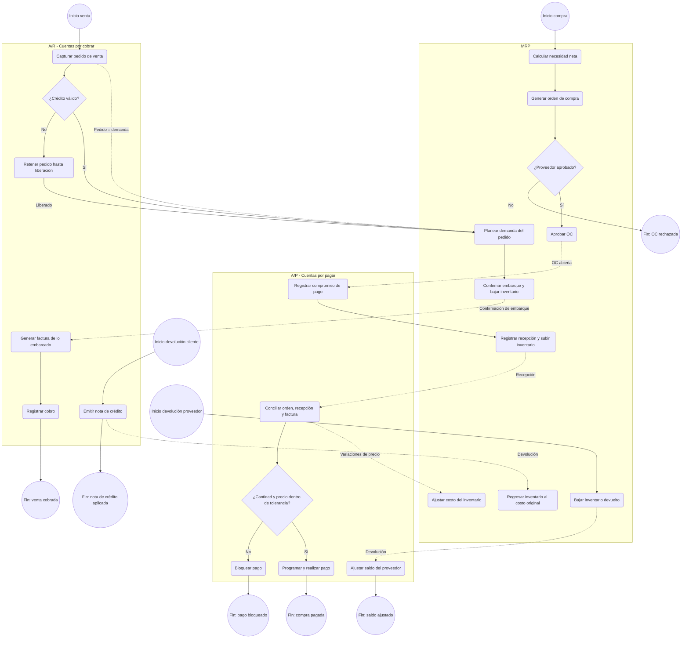
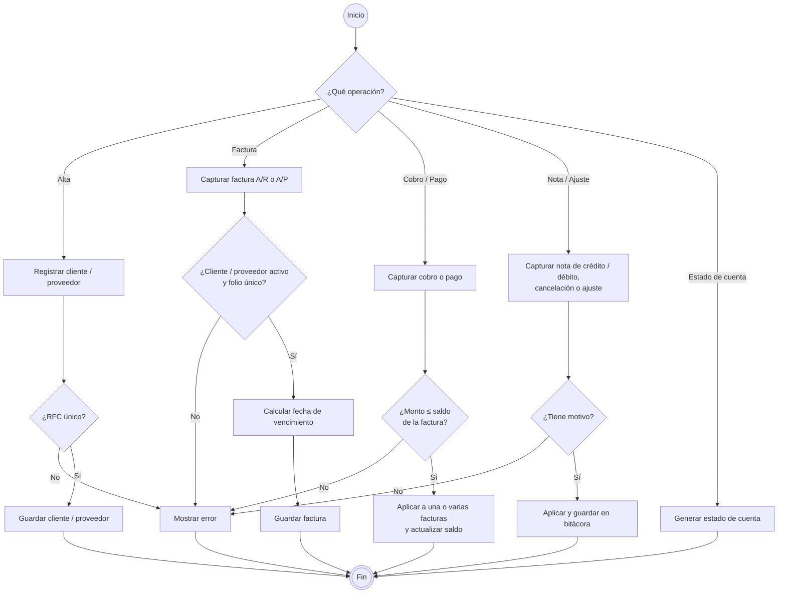

# Requerimientos y diagramas – A/R y A/P

| Matrícula | Archivo original |
|---|---|
| 181585 | AR&AP-Req.md |
| 181779 | Flowchart and requirements APAR 181779.md |
| 182028 | AR&AP.md |

---

## 181585

### 1) Requerimientos funcionales

#### Datos maestros
- Registrar, editar e inactivar clientes: código, razón social, RFC, dirección, contacto, condición de pago y límite de crédito.
- Registrar, editar e inactivar proveedores con los mismos datos.
- Administrar condiciones de pago (contado, 15, 30 o 60 días) e impuestos (IVA 16 %, 0 % o exento).

#### A/R (cuentas por cobrar)
- Crear pedidos de venta.
- Generar la factura de cliente desde el pedido, completa o parcial.
- Calcular en automático subtotal, IVA, total y fecha de vencimiento.
- Registrar cobros y aplicarlos a una o varias facturas, incluidos pagos parciales.
- Emitir notas de crédito por devolución o descuento.
- Validar el límite de crédito del cliente al facturar.
- Consultar el estado de cuenta por cliente y la antigüedad de saldos.

#### A/P (cuentas por pagar)
- Crear órdenes de compra.
- Registrar la recepción de mercancía desde la OC, completa o parcial.
- Registrar la factura de proveedor desde la recepción.
- Registrar pagos a proveedores y aplicarlos a una o varias facturas.
- Registrar notas de crédito de proveedor.
- Consultar las cuentas por pagar por vencimiento y el estado de cuenta por proveedor.

#### Generales
- Cancelar documentos mediante un documento inverso.
- Generar el asiento contable de cada documento en automático.
- Controlar el acceso por rol: ventas, compras, cobranza, pagos y administrador.

### 2) Reglas de negocio
- El folio es consecutivo y único para cada tipo de documento.
- El estatus va de Abierto a Cerrado o Cancelado. Un documento cerrado o cancelado ya no se modifica.
- Cada documento se crea desde su documento base y guarda la referencia: Pedido → Factura, y OC → Recepción → Factura.
- No se puede facturar más de lo que queda pendiente en el documento base.
- IVA = subtotal × tasa. Total = subtotal + IVA.
- Vencimiento = fecha del documento + días de la condición de pago.
- Saldo = total − pagos aplicados − notas de crédito. Cuando el saldo llega a 0, la factura se cierra.
- Un pago no puede aplicarse por más del saldo de la factura. La suma de las aplicaciones debe ser igual al monto del pago.
- No se factura si el saldo abierto del cliente más la nueva factura pasa su límite de crédito.
- La factura de proveedor debe coincidir con la OC y la recepción en artículo, cantidad y precio (*3-way match*).
- Un documento contabilizado no se borra. Se cancela con un documento inverso.
- Un cliente o proveedor inactivo no puede usarse en documentos nuevos, y no se elimina si ya tiene documentos.
- En cada asiento, la suma de cargos es igual a la suma de abonos:
  - Factura de cliente: cargo a Clientes; abono a Ventas e IVA trasladado
  - Cobro: cargo a Bancos; abono a Clientes
  - Factura de proveedor: cargo a Inventario e IVA acreditable; abono a Proveedores
  - Pago: cargo a Proveedores; abono a Bancos
- Solo los roles de cobranza y pagos pueden registrar cobros y pagos.

### 3) Pruebas unitarias

| Función | Entrada | Resultado esperado |
|---|---|---|
| calcularTotal | 10 × $100 con IVA 16 % | Total $1,160 |
| calcularVencimiento | 03/11/2026 a 30 días | 03/12/2026 |
| aplicarPago | Saldo $1,160, pago $500 | Saldo $660 |
| aplicarPago | Saldo $660, pago $700 | Error: pago mayor al saldo |
| validarLimiteCredito | Límite $5,000, saldo $4,500, factura $1,160 | Rechaza |
| validarCantidad | Cantidad 0 | Rechaza |

### 4) Pruebas funcionales

| Escenario | Resultado esperado |
|---|---|
| Ciclo de venta: pedido → factura → cobro | Factura cerrada y saldo del cliente en 0 |
| Cobro parcial | La factura sigue abierta con el saldo restante |
| Factura que rebasa el límite de crédito | El sistema la bloquea |
| Ciclo de compra: OC → recepción → factura → pago | Factura cerrada e inventario actualizado |
| Factura de proveedor con precio distinto a la OC | No deja guardarla |
| Usuario de Ventas intenta registrar un pago | Acceso denegado |

### 5) Integridad de los datos
- **Entidad:** cada tabla tiene llave primaria, y el folio es único por tipo de documento: `UNIQUE(TipoDoc, Folio)`.
- **Referencial:** las llaves foráneas ligan documento con cliente o proveedor, línea con encabezado, aplicación de pago con factura y documento con su documento base. Usa `ON DELETE RESTRICT`, así no se borra un cliente que tiene documentos; en su lugar se inactiva.
- **Dominio:**
  - Usa `NOT NULL` en los campos obligatorios.
  - Usa `CHECK` para: cantidad > 0, precio ≥ 0, tasa de IVA en (0, 0.16), estatus en (A, C, X) y vencimiento ≥ fecha.
  - Guarda el dinero en `DECIMAL`, nunca en `FLOAT`.
- **Consistencia:** el total es igual a la suma de las líneas, saldo = total − pagos − notas de crédito, las aplicaciones suman el monto del pago y cada asiento cuadra.
- **Transacciones (ACID):** la factura, el movimiento de inventario y el asiento se guardan juntos. Si uno falla, se hace *rollback* de todo.
- **Concurrencia:** si dos usuarios cobran la misma factura al mismo tiempo, se usa bloqueo de fila (`SELECT … FOR UPDATE`) para que no se aplique dos veces.
- **Auditoría:** cada registro guarda `CreadoPor`, `FechaCreacion` y `ModificadoPor`, y hay una tabla de bitácora. Los documentos nunca se borran.
- **Respaldos:** se hacen respaldos periódicos y se prueba que la restauración funcione.

### Diagrama BPMN

```mermaid
flowchart LR
    subgraph ERP["Pool: Mini ERP – A/R y A/P"]
        subgraph AR["Lane: Ventas y Cobranza (A/R)"]
            direction LR
            R0(("Pedido del<br/>cliente")) --> R1("Crear pedido<br/>de venta")
            R1 --> RG1{"¿Cliente activo<br/>y dentro del límite<br/>de crédito?"}
            RG1 -->|No| RE1((("Rechazado")))
            RG1 -->|Sí| R2("Generar factura<br/>y asiento")
            R2 --> R3("Registrar cobro")
            R3 --> RG2{"¿Saldo = 0?"}
            RG2 -->|No| R3
            RG2 -->|Sí| R4("Cerrar factura")
            R4 --> RE2((("Factura<br/>cobrada")))
        end

        subgraph AP["Lane: Compras y Pagos (A/P)"]
            direction LR
            P0(("Necesidad<br/>de compra")) --> P1("Crear orden<br/>de compra")
            P1 --> P2("Registrar recepción<br/>y subir inventario")
            P2 --> P3("Registrar factura<br/>de proveedor")
            P3 --> PG1{"3-way match:<br/>¿OC, recepción y<br/>factura coinciden?"}
            PG1 -->|No| PE1((("Factura<br/>rechazada")))
            PG1 -->|Sí| P4("Registrar pago<br/>y asiento")
            P4 --> PG2{"¿Saldo = 0?"}
            PG2 -->|No| P4
            PG2 -->|Sí| P5("Cerrar factura")
            P5 --> PE2((("Factura<br/>pagada")))
        end

        subgraph CN["Lane: Usuario autorizado (cancelaciones)"]
            direction LR
            X0(("Cancelación<br/>o devolución")) --> XG1{"¿Rol autorizado<br/>y documento<br/>abierto?"}
            XG1 -->|No| XE1((("Denegado")))
            XG1 -->|Sí| X1("Crear documento inverso<br/>y asiento inverso")
            X1 --> XE2((("Documento<br/>cancelado")))
        end
    end

    classDef start fill:#D7F5DD,stroke:#1E8E3E,stroke-width:2px,color:#0B3D1A;
    classDef finish fill:#FADBD8,stroke:#C5221F,stroke-width:3px,color:#5A0E0B;
    classDef task fill:#E8F0FE,stroke:#1A73E8,color:#0B1F3A;
    classDef gate fill:#FFF9E6,stroke:#B06000,color:#3D2E00;
    class R0,P0,X0 start;
    class RE1,RE2,PE1,PE2,XE1,XE2 finish;
    class R1,R2,R3,R4,P1,P2,P3,P4,P5,X1 task;
    class RG1,RG2,PG1,PG2,XG1 gate;
```

---

## 181779

### Requerimientos de integración MRP con A/P y A/R

El MRP solo necesita de A/P y A/R un maestro compartido de proveedores y clientes, y cinco intercambios de información con cada módulo; además, todos deben usar las mismas cuentas contables y el mismo método de costeo. 

### Qué necesita de A/P

|Dato o función|Para qué lo usa el MRP|
|---|---|
|Maestro de proveedores (términos de pago, moneda, lead time, MOQ, estatus aprobado o bloqueado)|Elegir proveedor y calcular fechas y cantidades de compra|
|Precios pactados por artículo|Costear las órdenes de compra|
|Órdenes de compra abiertas|Se envían a A/P como compromiso de pago|
|Recepción de mercancía|Actualiza el inventario y permite a A/P conciliar la factura (orden, recepción, factura)|
|Factura conciliada y variaciones de precio|Ajusta el costo del inventario|

### Qué necesita de A/R

|Dato o función|Para qué lo usa el MRP|
|---|---|
|Maestro de clientes (crédito, términos, direcciones de entrega, impuestos)|Capturar pedidos y definir condiciones de venta|
|Estatus de crédito (saldo vencido, límite excedido)|Retener pedidos o embarques bloqueados|
|Pedidos de venta|Son la demanda que el MRP planea|
|Confirmación de embarque|Descarga el inventario y genera la factura en A/R|
|Devoluciones y notas de crédito|Regresan el inventario con su costo|

### Requerimientos funcionales

|ID|Requerimiento|Módulo|
|---|---|---|
|RF-01|Mantener un maestro único de proveedores compartido entre MRP y A/P|A/P|
|RF-02|Generar órdenes de compra desde las necesidades netas del MRP y enviarlas a A/P como compromiso de pago|A/P|
|RF-03|Registrar la recepción de mercancía y actualizar el inventario|A/P|
|RF-04|Conciliar orden de compra, recepción y factura antes de programar el pago|A/P|
|RF-05|Registrar variaciones de precio y costos adicionales en el costo del inventario|A/P|
|RF-06|Mantener un maestro único de clientes compartido entre MRP y A/R|A/R|
|RF-07|Convertir cada pedido de venta en demanda para el MRP|A/R|
|RF-08|Validar el crédito del cliente al capturar el pedido y antes del embarque|A/R|
|RF-09|Confirmar el embarque: descargar inventario y generar la factura|A/R|
|RF-10|Procesar devoluciones y notas de crédito regresando el inventario con su costo|A/R|

### Reglas de negocio

|ID|Regla|Aplica a|
|---|---|---|
|RN-01|Solo se emiten órdenes de compra a proveedores con estatus aprobado|RF-01, RF-02|
|RN-02|La cantidad de compra respeta el lote mínimo (MOQ) y el múltiplo del proveedor|RF-02|
|RN-03|Una factura se programa para pago solo si cantidad y precio coinciden con la orden y la recepción, dentro de la tolerancia que defina finanzas|RF-04|
|RN-04|No se acepta una factura por más cantidad de la recibida|RF-04|
|RN-05|Un pedido de cliente con saldo vencido o límite de crédito excedido queda retenido hasta que alguien autorizado lo libere|RF-08|
|RN-06|Solo se factura lo embarcado|RF-09|
|RN-07|Una nota de crédito no puede exceder lo facturado; la devolución regresa el inventario al costo original|RF-10|
|RN-08|Quien crea una orden de compra no la aprueba ni registra su pago|RF-02, RF-04|

### Pruebas unitarias

|ID|Prueba|Resultado esperado|Regla|
|---|---|---|---|
|PU-01|Cálculo de necesidad neta: demanda, inventario, órdenes en tránsito y stock de seguridad|Cantidad sugerida correcta|RF-02|
|PU-02|Crear orden de compra a proveedor bloqueado|Se rechaza con mensaje|RN-01|
|PU-03|Crear orden por debajo del MOQ|Se rechaza o se ajusta al MOQ, según configuración|RN-02|
|PU-04|Conciliar factura con diferencia de precio dentro de la tolerancia|Se aprueba para pago|RN-03|
|PU-05|Conciliar factura con diferencia de precio fuera de la tolerancia|Se bloquea el pago|RN-03|
|PU-06|Registrar factura por más cantidad de la recibida|Se rechaza|RN-04|
|PU-07|Capturar pedido de cliente que excede su límite de crédito|Queda retenido|RN-05|
|PU-08|Embarque parcial de un pedido|Se factura solo lo embarcado|RN-06|
|PU-09|Nota de crédito mayor que la factura|Se rechaza|RN-07|
|PU-10|Mismo usuario crea y aprueba una orden de compra|Se rechaza|RN-08|

### Pruebas funcionales

|ID|Escenario de punta a punta|Resultado esperado|
|---|---|---|
|PF-01|Compra completa: necesidad del MRP, orden, recepción, factura y pago|El inventario sube, la cuenta por pagar se crea y se cancela al pagar, sin diferencias|
|PF-02|Compra con variación de precio|La variación queda registrada y el costo del inventario se ajusta|
|PF-03|Venta completa: pedido, demanda en MRP, embarque, factura y cobro|El inventario baja, la cuenta por cobrar se crea y se cancela al cobrar|
|PF-04|Pedido retenido por saldo vencido y luego liberado al pagar el cliente|El pedido se libera y continúa a embarque|
|PF-05|Devolución de un cliente|El inventario regresa al costo original y el saldo del cliente baja|
|PF-06|Devolución a un proveedor|El inventario baja y el saldo del proveedor se ajusta|

### Integridad de los datos

- **Maestros únicos:** un proveedor o cliente no puede duplicarse; la llave es su identificador fiscal. 

- **Documentos enlazados:** cada recepción referencia su orden, cada factura su recepción o embarque, sin documentos huérfanos. 

- **Transacciones completas:** una recepción o un embarque nunca queda sin su movimiento de inventario ni su efecto en A/P o A/R; si una parte falla, se revierte todo. 

- **Cuadre de saldos:** el inventario del MRP coincide con el contable, y los saldos de A/P y A/R coinciden con sus cuentas de control; se verifica en cada cierre. 

- **Validación de captura:** campos obligatorios, cantidades y precios no negativos, moneda y términos válidos. 

- **Bitácora:** cada cambio queda registrado con usuario y fecha. 

### Flowchart

---

## 182028

### Descripción
Cuentas por Cobrar y por Pagar
- A/R, Accounts Receivable
- A/P, Accounts Payable

### Funcionalidades principales
- Catálogo de clientes y proveedores
- Registro de facturas de venta (A/R) y facturas de compra (A/P).
- Registro y aplicación de cobros (A/R) y pagos (A/P), totales o parciales
- Notas de crédito y notas de débito
- Cálculo de fechas de vencimiento
- Estado de cuenta por cliente/proveedor.
- Integración con otros módulos

### Reglas de negocio
- Toda factura pertenece a un cliente/proveedor activo
- El folio es único por cliente/proveedor
- Un pago no puede exceder el saldo de la factura
- Un pago puede aplicarse a varias facturas del mismo cliente/proveedor
- Toda cancelación o ajuste requiere motivo y queda en bitácora

### Integridad de los datos
- Llaves primarias en todas las tablas; RFC único; (proveedor + folio) único

### Requerimientos no funcionales
- **Rendimiento:** registrar una factura o un pago responde en menos de 2 s.
- **Disponibilidad:** disponible 99% del tiempo en horario laboral.
- **Usabilidad:** mensajes de error claros y validaciones en pantalla.

### Pruebas funcionales
- Alta de cliente
- Registrar factura A/R
- Registrar factura A/P
- Dos usuarios pagan la misma factura a la vez

### Diagrama

