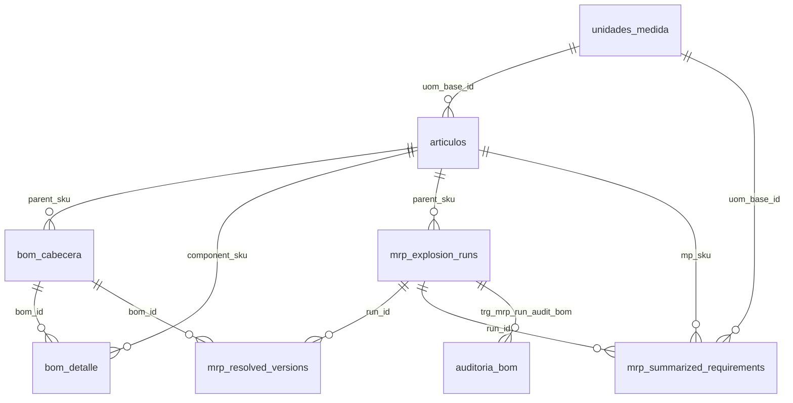
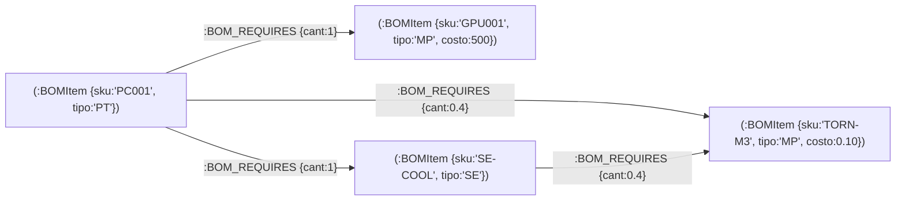

# Motor Analítico MRP, Explosión Aplanada y Cost Roll-up

* **Matrícula:** `184027`
* **Issue de referencia:** `#269` — `[Plan de Trabajo] Motor Analítico MRP, Explosión Aplanada y Cost Roll-up - 184027`
* **Rol en equipo BOM:** Integrante 4
* **Agente soportado:** `BOM Graph & Explosion Reasoning Agent` (`BOMGraphExplosionAgent`)

---

## 1. Propósito y Relación con el Agente Inteligente

Este componente traslada la lógica analítica del agente `BOMGraphExplosionAgent` a una capa persistente y optimizada sobre **PostgreSQL** y **Neo4j**, integrada directamente con el esquema oficial `BOM/BD/schema.sql`.

* **Eventos ISA-95 integrados:**
  * **Consumidos:** `EVT-MRP-201` (*ExplosionMateriales_MRP*) y `BOM.WhereUsedQueried`.
  * **Soportados / Emitidos:** `BOM.Exploded`, `BOM.VersionResolved`, `BOM.ExplosionRejected` y `BOM.ValidationFailed`.
* **Reglas de negocio garantizadas:**
  * **RN01 / RN-15:** Rechazo de artículos inactivos, cabeceras sin líneas o Materias Primas (`MP`) como padre.
  * **RN03 / RN-13:** Salvaguarda anti-ciclos en `WITH RECURSIVE` mediante rastreo de ruta (`ARRAY[sku]`).
  * **RN06 / RN07 / PU08:** Selección única de versión `ACTIVO` vigente en `[fecha_inicio, fecha_fin)`.
  * **RN08:** Fórmula de necesidad bruta con `cantidad_base`, conversión de UOM y `scrap_merma` en $[0, 1)$:
    $$Q_{\text{bruta}}(m) = \left\lceil D \cdot \sum_{p \in \text{Rutas}(m)} \prod_{(u,v) \in p} \frac{q_{uv}}{B_u \cdot (1 - \text{merma}_{uv})} \right\rceil$$
  * **PU09:** Aplicación del redondeo techo (`CEIL`) únicamente al final de la consolidación de todas las ramas para artículos discretos (`es_discreto = TRUE`).
* **Decisión soportada:** Permite al agente autorizar órdenes de compra/producción con costos estándar y cantidades consolidadas exactas, o abortar atómicamente ante vigencias faltantes o errores de dominio sin emitir requerimientos parciales.

---

## 2. Interdependencia del Equipo BOM (Issues 1 al 5)

| Issue | Componente | Integración bidireccional con Issue #269 |
| :--- | :--- | :--- |
| **Issue 1** | Catálogos Maestros, UOM y Dominio | Consume `articulos`, `unidades_medida` y `conversiones_uom`; valida artículos activos, costos y prohíbe `MP` como padre. |
| **Issue 2** | Estructura Relacional BOM y Vigencias | Consume `bom_cabecera` y `bom_detalle`; aporta índices de rendimiento (`idx_bom_cabecera_activo_vigencia`, `idx_bom_detalle_bom_comp_inc`) y validación estricta `PU08`. |
| **Issue 3** | PostgreSQL-Neo4j y Knowledge Graph DAG | Se apoya en la aciclicidad DAG y aporta consultas Cypher de explosión ponderada, *Cost Roll-up* y sensibilidad *Where-Used* verificando paridad contra SQL. |
| **Issue 5** | Trazabilidad, Snapshots y Auditoría JSONB | Registra cada corrida vía trigger en `auditoria_bom` y entrega el payload JSONB `BOM.Exploded` + `versiones_resueltas` listo para `orden_bom_snapshots`. |

---

## 3. Modelo Entidad-Relación y Knowledge Graph

### 3.1. Diagrama ER (Integración con `BOM/BD/schema.sql`)

### 3.2. Modelo del Grafo (Neo4j)

---

## 4. Objetos Implementados

* **Tablas (`sql/01_mrp_schema_indexes.sql`):** `mrp_explosion_runs`, `mrp_resolved_versions`, `mrp_summarized_requirements`.
* **Índices (`sql/01_mrp_schema_indexes.sql`):** `idx_bom_cabecera_activo_vigencia`, `idx_bom_detalle_bom_comp_inc`, `idx_mrp_runs_parent_fecha`, `idx_mrp_req_run_id`, `idx_mrp_resolved_bom_id`.
* **Funciones PL/pgSQL (`sql/02_mrp_functions_views.sql`):** `fn_obtener_factor_uom`, `fn_resolver_version_vigente`, `fn_explode_bom_summarized`, `fn_ejecutar_corrida_mrp`, `fn_bom_cost_rollup`, `fn_trg_auditar_mrp_run`.
* **Vistas (`sql/02_mrp_functions_views.sql`):** `v_bom_cost_rollup`.
* **Triggers (`sql/02_mrp_functions_views.sql`):** `trg_mrp_run_audit_bom` (registra `INSERT`/`UPDATE` de corridas MRP en `auditoria_bom` en formato JSONB).
* **Cypher (`cypher/`):** `01_load_bom_graph.cypher` y `02_mrp_explosion_rollup.cypher`.

---

## 5. Resumen de Pruebas y Evidencias

* **`evidencias/sql_analytical_results.txt`:** Explosión `PC001` (`TORN-M3`: 2 rutas, `0.8000 -> ceil = 1`, total `$500.10`), explosión `PC-PRO` con merma y conversión `G -> KG` (`$1002.40`), auditoría previa de vigencias y `EXPLAIN (ANALYZE, BUFFERS)` confirmando `Index Only Scan using idx_bom_detalle_bom_comp_inc` en `0.106 ms`.
* **`evidencias/cypher_mrp_results.txt`:** Paridad exacta en Neo4j para explosión aplanada, *Cost Roll-up* y sensibilidad *Where-Used* (`+15%` en `GPU001`: `$150.00` en `PC-PRO` y `$75.00` en `PC001`).
* **`evidencias/pytest_results.txt`:** Suite automatizada `tests/test_mrp_parity.py` con **7/7 pruebas aprobadas** validando paridad de 3 vías (Agente vs PostgreSQL vs Neo4j), rechazos `BOM.ExplosionRejected` (`PU08`), `BOM.ValidationFailed` (`RN01`/`RN-15`) y auditoría automática.
