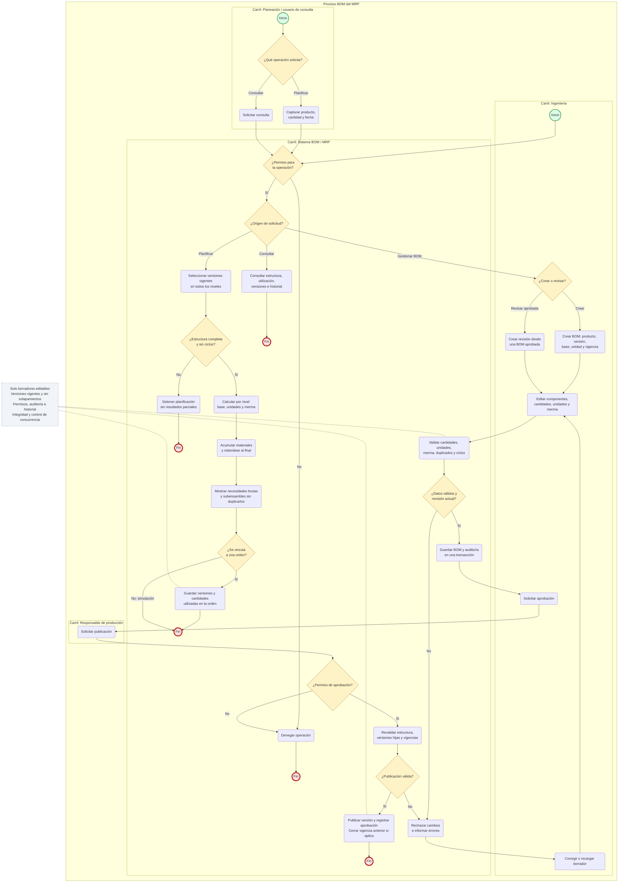

# Lista de materiales (BOM) de un MRP

*Especificación funcional, propuesta de pruebas y diagrama del proceso para un sistema construido desde cero*

**Universidad Politécnica de San Luis Potosí**

- **Materia:** CNO VI ERP
- **Actividad:** Primera Entrega Proyecto
- **Parcial:** Tercer Parcial
- **Nombre:** Yael Quintanilla Ramírez
- **Matrícula:** 181914
- **Fecha:** 03 de noviembre de 2026

---

## Índice

1. [Definición de requerimientos funcionales](#1-definición-de-requerimientos-funcionales)
2. [Descripción de las reglas de negocio](#2-descripción-de-las-reglas-de-negocio)
3. [Pruebas unitarias](#3-pruebas-unitarias)
4. [Pruebas funcionales](#4-pruebas-funcionales)
5. [Integridad de los datos](#5-integridad-de-los-datos)
6. [Diagrama del proceso](#6-diagrama-del-proceso)

---

## 1 Definición de requerimientos funcionales

La lista de materiales, conocida como Bill of Materials o BOM, define los componentes y cantidades necesarios para fabricar un producto. Dentro de un MRP, esta estructura permite transformar una demanda de productos en necesidades de materiales. Su confiabilidad depende de controlar las versiones, validar las relaciones y conservar la información usada en cada orden.

El alcance propuesto comprende BOM multinivel, cantidades base, unidades de medida, merma, vigencia, aprobación y consulta. El cálculo de compras, inventario disponible, rutas y capacidad de producción pertenecen a otros módulos; la BOM les entrega la estructura y las cantidades brutas.

### Usuarios y responsabilidades

Ingeniería crea y modifica borradores; el responsable de producción aprueba versiones; planeación consulta y explota la BOM; administración gestiona permisos. Un usuario de consulta no puede modificar ni aprobar información.

| ID | Requerimiento y criterio de aceptación |
|---|---|
| RF01 | Crear una BOM para un artículo fabricable con código, versión, cantidad base, unidad, estado y vigencia. El sistema asigna un identificador único. |
| RF02 | Agregar, modificar y retirar componentes de un borrador. Cada línea registra artículo, cantidad, unidad y merma; los errores se muestran antes de guardar. |
| RF03 | Visualizar la estructura multinivel y los productos que utilizan un componente. La consulta identifica la versión y el estado de cada estructura. |
| RF04 | Validar cantidades, unidades compatibles, duplicados y ciclos directos o indirectos. Una estructura inválida no puede aprobarse. |
| RF05 | Aprobar una versión válida y seleccionar la versión aplicable por producto y fecha. Si no existe una versión válida, la planificación se detiene con un mensaje. |
| RF06 | Crear una nueva revisión a partir de una aprobada. La versión anterior permanece disponible para consulta histórica. |
| RF07 | Explotar la BOM para una cantidad y fecha de demanda, acumular componentes compartidos y mostrar cantidades brutas con sus unidades. |
| RF08 | Registrar quién creó, cambió y aprobó la BOM. Las órdenes conservan la versión exacta usada, aunque se publique una revisión posterior. |

---

## 2 Descripción de las reglas de negocio

Estas reglas definen el comportamiento propuesto del módulo. Deben aplicarse en el servicio de negocio y complementarse con restricciones de base de datos; la validación de pantalla por sí sola no es suficiente.

### RN01 Identificación y contenido
Cada combinación de producto y código de versión es única. Solo artículos de fabricación pueden tener una BOM. Una BOM debe contener al menos un componente para aprobarse; los artículos de compra son hojas de la estructura.

### RN02 Cantidades y unidades
La cantidad base y la cantidad de cada componente deben ser mayores que cero. Las conversiones deben existir y pertenecer a la misma dimensión: por ejemplo, gramos a kilogramos. No se permite convertir piezas a kilogramos sin una equivalencia específica autorizada.

### RN03 Ausencia de ciclos
Un producto no puede contenerse a sí mismo, ni mediante una cadena de subensambles. Antes de aprobar, el sistema recorre la estructura completa y rechaza cualquier ciclo.

### RN04 Componentes repetidos
Dentro de una misma versión, un componente aparece una sola vez. Si se necesita más cantidad, se actualiza su línea. Un material sí puede aparecer en ramas diferentes y sus necesidades se acumulan al explotar.

### RN05 Estados y cambios
Los estados son borrador, aprobada y obsoleta. Solo el borrador es editable. Una aprobada se corrige mediante una nueva versión. Marcar una versión como obsoleta impide nuevas selecciones, pero conserva sus referencias históricas.

### RN06 Vigencia
La vigencia se interpreta como inicio incluido y fin excluido. Una fecha final vacía significa vigencia indefinida. Para un mismo producto no puede haber dos versiones aprobadas con periodos superpuestos. Publicar una sucesora y cerrar la anterior debe hacerse de forma atómica.

### RN07 Selección multinivel
La fecha de demanda determina la versión vigente de cada subensamble. Si falta una versión aprobada de un artículo fabricable, se rechaza toda la explosión. La orden guarda las versiones resueltas de todos los niveles.

### RN08 Merma y redondeo
La merma se expresa como fracción entre 0 y un valor menor que 1 y representa pérdida de material de entrada. La necesidad bruta es cantidad teórica / (1 − merma). Se trabaja con decimales y se redondea hacia arriba al final de la acumulación de cada material, según su unidad mínima.

### RN09 Permisos y trazabilidad
Crear, editar, aprobar y consultar requieren permisos específicos. Toda modificación registra usuario, fecha y valores anteriores y nuevos. Las versiones referenciadas por órdenes no se eliminan físicamente.

---

## 3 Pruebas unitarias

Las pruebas unitarias verifican funciones aisladas, como validadores, selección de versiones y cálculo de cantidades. Se utilizan datos controlados y dobles de prueba para repositorios y permisos. Los casos siguientes son una especificación; no representan pruebas ejecutadas sobre un sistema existente.

### Datos de referencia y resultado de cálculo

Una BOM de MESA tiene base de 1 pieza y requiere 1 TABLERO, 4 PATAS y 1 KIT. El KIT tiene base de 1 pieza y contiene 8 TORNILLOS. Para fabricar 10 MESAS se requieren 10 TABLEROS, 40 PATAS y 10 KITS; al descomponer los KITS se obtienen 80 TORNILLOS. El KIT se muestra como subensamble, sin contabilizarlo otra vez como materia prima.

Si el TABLERO tiene 10 % de merma, la necesidad es 10 / 0.90 = 11.111… piezas. Con unidad mínima de una pieza, el requerimiento final es 12 TABLEROS. Si la base de una BOM fuese 5 piezas, sus cantidades se multiplicarían por demanda / 5.

| ID | Función y entrada | Resultado esperado |
|---|---|---|
| PU01 | Validar base 0 o cantidad −2. | Rechazo por cantidad no positiva; no se persiste. |
| PU02 | Detectar A → A y A → B → C → A. | Ambas estructuras se rechazan por ciclo. |
| PU03 | Insertar dos líneas del mismo artículo en una versión. | Error de componente duplicado. |
| PU04 | Explosión de 10 MESAS con los datos de referencia. | 10 TABLEROS, 40 PATAS y 80 TORNILLOS sin merma; KIT identificado como subensamble. |
| PU05 | Base 5 piezas, componente 20 kg y demanda 10 piezas. | 40 kg de componente antes de merma. |
| PU06 | Aplicar merma 0.10 a 10 piezas; probar merma 1 y negativa. | 12 piezas finales; valores 1 y negativos rechazados. |
| PU07 | Convertir 500 g a kg; intentar convertir kg a m. | 0.5 kg; conversión incompatible rechazada. |
| PU08 | V1 termina el 1 de febrero; V2 inicia ese día. | El 1 de febrero se selecciona V2. Sin versión válida se devuelve error. |
| PU09 | Dos ramas aportan 0.4 piezas del mismo material. | Se acumula 0.8 y se redondea a 1 pieza; no a 2. |
| PU10 | Editar versión aprobada o aprobar sin permiso. | Operación denegada y datos sin cambios. |

### Criterio de aprobación

Cada prueba debe afirmar el valor devuelto y los efectos permitidos. Deben pasar todos los casos críticos de cálculo, ciclos, vigencias y permisos. Las pruebas se repiten con cada cambio del módulo y no dependen de datos reales de producción.

---

## 4 Pruebas funcionales

Las pruebas funcionales recorren el módulo desde la interfaz o API hasta la base de datos. Verifican que los usuarios completen sus tareas y que los módulos conectados reciban información consistente. Se realizan en un entorno de prueba con catálogos y usuarios conocidos.

### PF01 Alta y aprobación de una BOM
**Precondición:** MESA, TABLERO, PATA y KIT existen; KIT tiene versión aprobada.
**Pasos:** ingeniería crea el borrador, agrega cantidades, guarda y solicita aprobación; producción aprueba.
**Resultado esperado:** versión aprobada con sus líneas completas, aprobador y fecha registrados.
**Cubre:** RF01, RF02 y RF05.

### PF02 Captura inválida
**Pasos:** intentar guardar cantidad cero, unidad incompatible, componente repetido y estructura cíclica.
**Resultado esperado:** cada operación se rechaza con un mensaje específico; no quedan cambios parciales.
**Cubre:** RF02 y RF04.

### PF03 Explosión multinivel
**Precondición:** estructura del ejemplo de pruebas unitarias, sin merma.
**Pasos:** planeación solicita 10 MESAS para una fecha válida.
**Resultado esperado:** 10 TABLEROS, 40 PATAS y 80 TORNILLOS como hojas; la vista permite identificar los 10 KITS y las versiones utilizadas.
**Cubre:** RF03 y RF07.

### PF04 Revisión e historial
**Pasos:** crear una orden con V1, copiar V1 a V2, cambiar una cantidad y aprobar V2 con vigencia posterior.
**Resultado esperado:** la orden original conserva V1; una nueva demanda dentro de la vigencia de V2 usa la nueva cantidad.
**Cubre:** RF06 y RF08.

### PF05 Límites de vigencia y estructura incompleta
**Pasos:** consultar un instante anterior, uno igual y uno posterior al cambio de versión; repetir con un subensamble sin versión aprobada.
**Resultado esperado:** una sola versión aplicable por instante; la estructura incompleta detiene la planificación sin emitir requerimientos parciales.
**Cubre:** RF05 y RF07.

### PF06 Permisos y concurrencia
**Pasos:** un usuario de consulta intenta editar y aprobar; dos editores guardan cambios sobre la misma revisión; dos aprobadores intentan publicar vigencias superpuestas.
**Resultado esperado:** acceso denegado, detección de edición desactualizada y una sola publicación válida.
**Cubre:** RF04, RF05 y RF08.

### PF07 Consulta de utilización y auditoría
**Pasos:** buscar los productos que contienen TORNILLO y revisar el historial de cambios de la BOM.
**Resultado esperado:** MESA aparece mediante KIT; el historial identifica usuario, fecha, acción y valores modificados.
**Cubre:** RF03 y RF08.

### Evidencia y criterio de salida

Por caso se registra versión del sistema, datos usados, pasos, resultado observado, captura o respuesta de API y estado aprobado o fallido. El módulo se acepta cuando pasan los escenarios críticos, se corrigen los defectos que alteran cantidades o historial y se verifica nuevamente cada corrección.

---

## 5 Integridad de los datos

La integridad de datos garantiza que la BOM permanezca válida desde su captura hasta su uso en planificación. Se protege mediante restricciones de base de datos, validaciones de negocio, transacciones y conservación del historial.

### Modelo mínimo de información

| Entidad | Datos y restricciones principales |
|---|---|
| Artículo | Identificador, código único, tipo compra o fabricación, unidad base y estado activo. |
| Versión de BOM | Identificador, producto, versión, cantidad base, unidad, estado, inicio, fin, creador, aprobador y número de revisión para concurrencia. Producto y versión forman una clave única. |
| Detalle de BOM | Identificador de versión, artículo componente, cantidad, unidad y merma. Clave única por versión y componente; referencias obligatorias a artículos y unidades. |
| Unidad y conversión | Código de unidad, dimensión, factor y precisión. Factores positivos; conversiones compatibles y controladas. |
| Referencia de orden | Orden y versiones de BOM resueltas en todos los niveles. Conserva cantidades utilizadas o una instantánea inmutable para reproducir el cálculo. |
| Auditoría | Entidad afectada, acción, usuario, fecha y valores anteriores y nuevos. Acceso restringido y registro sin edición ordinaria. |

### Controles de persistencia

- **Integridad de entidad y referencial.** Las claves primarias son únicas y no nulas; las claves foráneas impiden líneas huérfanas. Se bloquea la eliminación de artículos o versiones referenciadas. Los campos obligatorios no admiten valores nulos.
- **Integridad de dominio.** Cantidad base > 0, cantidad de componente > 0, 0 ≤ merma < 1 y fin > inicio cuando exista fin. Se utilizan tipos decimales de precisión definida, sin coma flotante binaria para cantidades de negocio. Los límites máximos y la escala se validan antes de persistir.
- **Integridad transaccional.** Guardar cabecera y líneas constituye una operación atómica. La aprobación valida ciclos, versiones hijas y vigencias en la misma transacción. El bloqueo o aislamiento adecuado evita que dos operaciones concurrentes introduzcan superposiciones. Una revisión de concurrencia impide sobrescribir cambios ajenos.
- **Integridad histórica.** Las versiones aprobadas y sus conversiones utilizadas son inmutables o quedan capturadas en la orden. El cálculo recorre una lectura consistente: no mezcla versiones publicadas durante la misma ejecución. La auditoría conserva fechas con zona horaria definida.

### Verificación y recuperación

Se deben probar rechazos de claves duplicadas, referencias inexistentes y rangos inválidos directamente contra la base de datos; simular una falla al guardar una línea y comprobar la reversión completa; y repetir aprobaciones concurrentes para verificar que solo una versión resulte válida.

Los respaldos deben incluir BOM, catálogos, conversiones, referencias de órdenes y auditoría. Una restauración de prueba debe recuperar sus relaciones y reproducir el cálculo de una orden histórica. El criterio de integridad es que no existan huérfanos, ciclos utilizables ni versiones ambiguas y que las cantidades puedan reconstruirse.

---

## 6 Diagrama del proceso

### Introducción

La lista de materiales (BOM) define los componentes y las cantidades necesarios para fabricar un producto. En un sistema MRP, permite transformar la demanda en necesidades brutas de materiales.

El siguiente diagrama representa la creación, revisión, aprobación y consulta de las BOM, así como su descomposición multinivel para calcular materiales. Organiza las responsabilidades de Ingeniería, Producción, Planeación y el Sistema, e incluye validaciones, permisos y conservación del historial.

### Diagrama

Se utiliza Mermaid para aproximar la notación BPMN: los círculos representan el inicio y el fin; los cuadros redondeados, las actividades; los rombos, las decisiones; y los carriles, los responsables.

