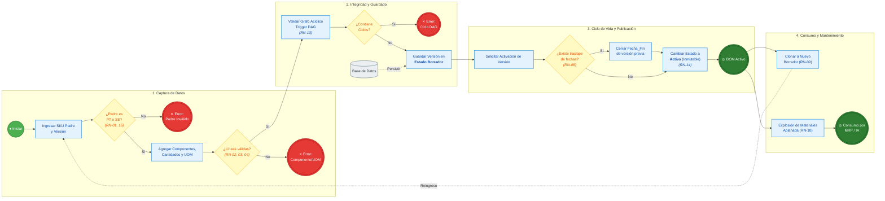

# Modulo Bill Of Material

## Descripción
El Bill of Materials (BOM) es el registro estructurado y formal que detalla exhaustivamente todos los componentes, materias primas, subensambles intermedios, piezas y consumibles necesarios para fabricar, ensamblar o reparar un producto terminado, incluyendo las cantidades exactas y la unidad de medida de cada uno.

En el contexto de la manufactura y los sistemas de planificación de recursos empresariales (ERP / MRP), el BOM funciona como el "plano lógico" o la "receta industrial" del producto. Es la pieza central sobre la que descansan la explosión de requerimientos de materiales, el cálculo de costos de producción y la programación de compras.

## Funciones Principales en un Sistema de Manufactura
- **Cálculo de Requerimientos Netos (MRP):** Permite realizar la explosión de materiales (BOM Explosion). Cuando entra una orden de producción por $N$ unidades de producto terminado, el MRP multiplica las cantidades del BOM por $N$, compara el resultado contra el inventario disponible y en tránsito, y genera órdenes de compra o de ensamble de forma automática.
- **Costeo del Producto (Standard Costing):** Suma el costo individual de cada componente, más factores de desperdicio (scrap) y costos asociados de ensamblaje (cuando se integra con la hoja de ruta o Routing), determinando el costo de fabricación estándar.
- **Control y Trazabilidad de Inventarios:** Define qué elementos deben descontarse del almacén de materias primas cuando se reporta el cierre de una orden de producción (mecanismo conocido como Backflushing o deducción automática).
- **Control de Cambios y Versiones (Engineering Change Orders - ECO):** Permite gestionar la evolución del producto (por ejemplo, reemplazar un módulo de memoria RAM descontinuado por uno equivalente) sin perder el historial de lo que se fabricó en versiones anteriores.

## Especificación de Requerimientos Funcionales (RF)

### RF-01: Gestión y Alta de Estructuras BOM
- **RF-01.1 (Creación de Encabezado):** El sistema debe permitir registrar una nueva lista de materiales asociándola obligatoriamente a un SKU padre catalogado como Producto Terminado (PT) o Subensamble (SE).
- **RF-01.2 (Asignación de Componentes):** El sistema debe permitir agregar múltiples componentes hijos a la estructura, requiriendo para cada uno:
  - SKU del componente hijo (debe existir previamente en el catálogo maestro).
  - Cantidad estándar por ensamble (valor numérico positivo).
  - Unidad de medida (UOM), heredada o validada contra el catálogo.
  - Porcentaje estimado de merma/scrap (opcional, por defecto $0\%$).
- **RF-01.3 (Soporte Multinivel Recursivo):** El sistema debe permitir agregar un Subensamble (SE) como componente hijo dentro de otro BOM, construyendo una estructura jerárquica de $N$ niveles.

### RF-02: Control de Versiones y Ciclo de Vida
- **RF-02.1 (Versionamiento Formal):** El sistema debe permitir asignar un identificador de versión (ej. v1.0, v1.1, v2.0) y registrar notas de cambio/ingeniería para cada estructura creada.
- **RF-02.2 (Transición de Estados):** El sistema debe gestionar el ciclo de vida del BOM bajo los siguientes estados: Borrador, Activo, Inactivo y Obsoleto.
- **RF-02.3 (Vigencia Temporal):** El sistema debe permitir definir rangos de vigencia (`Fecha_Inicio` y `Fecha_Fin`) para programar la entrada en vigor o descontinuación de una versión.
- **RF-02.4 (Clonación / Duplicado de BOM):** El sistema debe permitir duplicar una versión existente de un BOM hacia una nueva versión en estado Borrador para facilitar modificaciones sin alterar el histórico.

### RF-03: Motores de Consulta, Vistas y Explosión de Materiales
- **RF-03.1 (Aplanamiento a Materias Primas Puras):** El sistema debe ofrecer una vista "aplanada" (Indented vs. Summarized BOM) que agrupe y sume todas las materias primas (MP) finales requeridas, colapsando subensambles intermedios para facilitar la compra.
- **RF-03.2 (Visualización en Árbol Jerárquico):** El sistema debe mostrar visualmente la estructura del producto en formato de árbol desplegable, indicando nivel numérico (Nivel 0, Nivel 1, Nivel 2...), código de parte, descripción, cantidad y costo unitario acumulado.
- **RF-03.3 (Consulta Inversa / Implosión / Where-Used):** Dado un SKU de componente (ej. un tornillo o un disipador), el sistema debe listar todos los subensambles y productos terminados donde dicho componente es utilizado actualmente.

### RF-04: Validaciones y Restricciones de Integridad
- **RF-04.1 (Validación de Referencias Circulares):** El sistema debe ejecutar una validación de grafo acíclico dirigido (DAG) antes de persistir cambios, bloqueando cualquier asignación que resulte en que un producto sea ancestro y descendiente de sí mismo.
- **RF-04.2 (Restricción de Modificación en BOM Activo):** El sistema debe bloquear la edición directa de componentes o cantidades en una versión que se encuentre en estado Activo o vinculada a órdenes de producción abiertas; cualquier cambio debe exigir el congelamiento o clonación a una nueva versión.
- **RF-04.3 (Control de Tipo de Artículo):** El sistema debe impedir que un artículo catalogado como Materia Prima (MP) sea configurado como producto padre de una lista de materiales.

## Reglas de Negocio (RN)

### Mapeo a RF-01: Gestión y Alta de Estructuras BOM
- **RN-01 (Elegibilidad de Producto Padre RF-01.1):** Todo encabezado de BOM debe estar vinculado de manera obligatoria a un artículo previamente registrado en el catálogo maestro cuyo tipo sea estrictamente PT (Producto Terminado) o SE (Subensamble). El sistema no permitirá la creación de un encabezado huérfano o asociado a un SKU inexistente.
- **RN-02 (Integridad y Existencia de Componentes - RF-01.2):** Cada línea de detalle debe apuntar a un SKU hijo existente y activo en el catálogo maestro. Un mismo SKU hijo no puede repetirse como línea independiente dentro de la misma versión de BOM; si se requiere modificar el consumo, se debe actualizar la cantidad de la línea existente.
- **RN-03 (Positividad de Cantidades Base y Rango de Merma RF-01.2):**
  - La cantidad estándar requerida por ensamble debe ser un valor numérico estrictamente mayor a cero ($Cantidad > 0$).
  - El porcentaje de merma (scrap) es opcional; si no se especifica, tomará el valor por defecto de $0\%$. En caso de ingresarse, debe cumplir con $0\% \le Scrap < 100\%$.
- **RN-04 (Coherencia de Unidad de Medida RF-01.2):** La unidad de medida (UOM) asignada a la línea de ensamble debe ser idéntica o dimensionalmente convertible (misma familia métrica) a la unidad de medida base registrada en el catálogo de materiales para ese SKU hijo.
- **RN-05 (Jerarquía y Tipología en Ensamble Multinivel RF-01.3):** Para que un componente hijo actúe como un nodo intermedio (subensamble) dentro de un árbol multinivel, debe estar clasificado como SE. La presencia de un hijo tipo SE exige que dicho subensamble cuente con su propia versión de BOM activa o en borrador para permitir el despliegue recursivo del árbol.

### Mapeo a RF-02: Control de Versiones y Ciclo de Vida
- **RN-06 (Formato y Unicidad de Versión RF-02.1):** El identificador de versión debe seguir una nomenclatura estructurada alfanumérica única por producto padre. Dos versiones del mismo SKU padre no pueden compartir el mismo código de versión.
- **RN-07 (Matriz de Transición de Estados RF-02.2):** Los estados permitidos para una versión de BOM son únicamente: Borrador, Activo, Inactivo y Obsoleto. Las transiciones válidas son:
  - Borrador -> Activo
  - Activo -> Inactivo u Obsoleto
  - Inactivo -> Activo u Obsoleto
  - Obsoleto es un estado terminal (no puede transicionar a ningún otro).
- **RN-08 (Unicidad Temporal de Versión Activa RF-02.3):** Un producto padre solo puede tener una única versión en estado Activo para una fecha determinada. Los rangos definidos por `Fecha_Inicio` y `Fecha_Fin` de dos versiones activas de un mismo SKU no pueden traslaparse cronológicamente. Si `Fecha_Fin` es nula, se asume vigencia indefinida hasta la activación de una versión sucesora.
- **RN-09 (Comportamiento de Clonación - RF-02.4):** Al duplicar o clonar un BOM existente (sin importar si el origen está Activo, Inactivo u Obsoleto), la nueva estructura resultante se creará forzosamente con un nuevo identificador de versión, en estado Borrador, con fecha de inicio igual a la fecha de clonación y fecha de fin nula, copiando exactamente las líneas de componentes y cantidades del origen.

### Mapeo a RF-03: Motores de Consulta, Vistas y Explosión de Materiales
- **RN-10 (Cálculo de Consolidación y Aplanamiento - RF-03.1):** En la vista aplanada (Summarized BOM), el sistema debe resolver recursivamente todos los subensambles intermedios hasta llegar exclusivamente a ítems tipo MP (Materia Prima). Si una misma materia prima aparece en múltiples ramas o subensambles del árbol, el motor debe sumarizar el requerimiento total bajo un único registro consolidado.
- **RN-11 (Regla de Profundidad y Costeo en Árbol - RF-03.2):** La visualización jerárquica debe asignar $Nivel = 0$ al producto padre raíz, incrementando el índice de nivel en $+1$ por cada salto hacia abajo en la jerarquía. El costo unitario acumulado de cada nodo padre debe ser calculado en tiempo real como la suma de los costos unitarios de sus componentes hijos multiplicados por sus cantidades base.
- **RN-12 (Alcance de la Consulta Inversa / Where-Used - RF-03.3):** La consulta inversa de un componente debe evaluar tanto usos directos (el ítem es hijo inmediato de un ensamble) como indirectos (el ítem es materia prima dentro de un subensamble de nivel inferior). La búsqueda debe permitir filtrar únicamente sobre versiones en estado Activo o incluir el histórico completo según el parámetro de consulta.

### Mapeo a RF-04: Validaciones y Restricciones de Integridad
- **RN-13 (Acyclicidad Estricta / Grafo DAG RF-04.1):** El árbol del BOM debe cumplir la propiedad matemática de Grafo Acíclico Dirigido. Queda prohibida cualquier asignación donde un SKU sea ancestro y descendiente de sí mismo. La validación recursiva debe ejecutarse antes del commit o confirmación de guardado en la base de datos; si se detecta un ciclo, la transacción debe abortarse.
- **RN-14 (Inmutabilidad de Estructuras Activas o Comprometidas - RF-04.2):** Una versión de BOM en estado Activo, o que esté vinculada a una orden de producción existente (abierta o histórica), queda bloqueada contra operaciones de actualización (UPDATE) o eliminación (DELETE) en su encabezado y líneas de detalle. Cualquier ajuste en componentes, cantidades o mermas obliga a clonar la estructura hacia una nueva versión en estado Borrador.
- **RN-15 (Restricción Absoluta de Paternidad sobre Materia Prima RF-04.3):** Ningún artículo catalogado como MP (Materia Prima) puede ser asignado como `parent_sku` o encabezado de un BOM. El sistema debe lanzar una excepción de negocio y rechazar la creación a nivel de interfaz y mediante restricción/trigger en la base de datos si el tipo de ítem es MP.

## Pruebas Unitarias (PU)

Las pruebas unitarias validan la lógica aislada de los métodos, funciones y restricciones del módulo (capa de servicios/backend y procedimientos de validación) antes de interactuar con la interfaz de usuario, garantizando el cumplimiento de cada Requerimiento Funcional (RF) y Regla de Negocio (RN).

### Mapeo a RF-01/RN-01 a RN-05: Gestión y Alta de Estructuras BOM
- **PU-BOM-001: Validación de tipo de ítem para SKU padre (RN-01)**
  - **Función evaluada:** `validar_sku_padre(sku, tipo_item)`
  - **Datos de entrada:** `sku = "MP-CPU-R7"`, `tipo_item = "MP"`
  - **Resultado esperado:** Retorna excepción `TipoItemInvalidoException` ("Una Materia Prima no puede ser producto padre de un BOM").
- **PU-BOM-002: Aceptación de ítem válido para SKU padre (RN-01)**
  - **Función evaluada:** `validar_sku_padre(sku, tipo_item)`
  - **Datos de entrada:** `sku = "PT-PC-GAMER"`, `tipo_item = "PT"`
  - **Resultado esperado:** Retorna booleano `True` y permite continuar el registro.
- **PU-BOM-003: Rechazo de SKU hijo duplicado en la misma estructura (RN-02)**
  - **Función evaluada:** `agregar_componente_detalle(lista_componentes, nuevo_componente)`
  - **Datos de entrada:** `lista_componentes = [{"sku": "MP-RAM-16GB", "cant": 1}]`, `nuevo_componente = {"sku": "MP-RAM-16GB", "cant": 1}`
  - **Resultado esperado:** Retorna excepción `ComponenteDuplicadoException` ("El componente ya existe en la versión de BOM; actualice la cantidad de la línea").
- **PU-BOM-004: Rechazo de cantidad menor o igual a cero (RN-03)**
  - **Función evaluada:** `validar_cantidad_base(cantidad)`
  - **Datos de entrada:** `cantidad = 0` (y caso alterno con `cantidad = -1.5`)
  - **Resultado esperado:** Retorna excepción `CantidadInvalidaException` ("La cantidad estándar por ensamble debe ser mayor a cero").
- **PU-BOM-005: Validación de rango de porcentaje de scrap (RN-03)**
  - **Función evaluada:** `validar_porcentaje_scrap(scrap)`
  - **Datos de entrada:** `scrap = 100.0` (y caso alterno con `scrap = -5.0`)
  - **Resultado esperado:** Retorna excepción `RangoScrapInvalidoException` ("El porcentaje de scrap debe estar en el intervalo [0, 100)").
- **PU-BOM-006: Asignación por defecto de scrap nulo (RN-03)**
  - **Función evaluada:** `normalizar_scrap(scrap=None)`
  - **Datos de entrada:** `scrap = None`
  - **Resultado esperado:** Retorna `0.0`.
- **PU-BOM-007: Rechazo de unidad de medida incompatible (RN-04)**
  - **Función evaluada:** `validar_uom_componente(sku_uom_base, linea_uom)`
  - **Datos de entrada:** `sku_uom_base = "PZA"` (Módulo de RAM), `linea_uom = "KG"`
  - **Resultado esperado:** Retorna excepción `IncompatibilidadUOMException` ("La unidad KG no es dimensionalmente convertible con PZA").
- **PU-BOM-008: Verificación de BOM preexistente en componente de tipo Subensamble (RN-05)**
  - **Función evaluada:** `validar_subensamble_hijo(sku_hijo, tipo_item)`
  - **Datos de entrada:** `sku_hijo = "SE-KIT-REFRIGERACION"`, `tipo_item = "SE"` (sin ningún BOM registrado en base de datos)
  - **Resultado esperado:** Retorna excepción `SubensambleSinBOMException` ("El subensamble debe contar con una estructura de BOM previa").

### Mapeo a RF-02/RN-06 a RN-09: Control de Versiones y Ciclo de Vida
- **PU-BOM-009: Rechazo de código de versión duplicado para el mismo SKU padre (RN-06)**
  - **Función evaluada:** `validar_codigo_version(sku_padre, version_id)`
  - **Datos de entrada:** `sku_padre = "PT-PC-GAMER"`, `version_id = "v1.0"` (existiendo ya un registro con ese identificador para ese SKU)
  - **Resultado esperado:** Retorna excepción `VersionDuplicadaException`.
- **PU-BOM-010: Validación de transiciones válidas de estado (RN-07)**
  - **Función evaluada:** `transicionar_estado(estado_actual, nuevo_estado)`
  - **Datos de entrada:** `estado_actual = "Borrador"`, `nuevo_estado = "Activo"`
  - **Resultado esperado:** Ejecución exitosa; el objeto actualiza su estado a "Activo".
- **PU-BOM-011: Bloqueo de transición no permitida (RN-07)**
  - **Función evaluada:** `transicionar_estado(estado_actual, nuevo_estado)`
  - **Datos de entrada:** `estado_actual = "Obsoleto"`, `nuevo_estado = "Activo"`
  - **Resultado esperado:** Retorna excepción `TransicionEstadoInvalidaException` ("El estado Obsoleto es terminal").
- **PU-BOM-012: Detección de solapamiento de fechas entre versiones activas (RN-08)**
  - **Función evaluada:** `validar_traslape_vigencias(sku_padre, nueva_fecha_inicio, nueva_fecha_fin)`
  - **Datos de entrada:** Versión v1.0 activa (2026-01-01 a null); intento de activar v2.0 con `nueva_fecha_inicio = 2026-06-01` sin cerrar v1.0.
  - **Resultado esperado:** Retorna excepción `TraslapeVigenciaException` ("Ya existe una versión activa para el rango indicado").
- **PU-BOM-013: Generación correcta de atributos al clonar BOM (RN-09)**
  - **Función evaluada:** `clonar_bom(bom_origen_id, nuevo_version_id)`
  - **Datos de entrada:** `bom_origen_id = "BOM-001"` (Estado "Activo", 4 componentes), `nuevo_version_id = "v1.1"`
  - **Resultado esperado:** Objeto clonado con `version = "v1.1"`, `estado = "Borrador"`, `fecha_fin = null`, y exactamente las 4 líneas de detalle copiadas con sus cantidades.

### Mapeo a RF-03/RN-10 a RN-12: Motores de Consulta, Vistas y Explosión
- **PU-BOM-014: Consolidación y aplanamiento de requerimientos brutos (RN-10)**
  - **Función evaluada:** `calcular_vista_aplanada(bom_arbol, lote_produccion)`
  - **Datos de entrada:** `lote_produccion = 10`. Árbol donde MP-TORNILLO-M3 aparece en dos ramas: Rama A requiere 4 piezas por unidad; Rama B (dentro de un subensamble) requiere 2 piezas por unidad.
  - **Resultado esperado:** Retorna lista sumarizada con un único registro para MP-TORNILLO-M3 con $cantidad\_total = 60 \ (10 \times (4 + 2))$.
- **PU-BOM-015: Cálculo de factor de scrap acumulado en aplanamiento (RN-10)**
  - **Función evaluada:** `calcular_requerimiento_materia_prima(cant_padre, cant_base, scrap_pct)`
  - **Datos de entrada:** `cant_padre = 5`, `cant_base = 2`, `scrap_pct = 10.0`
  - **Resultado esperado:** Retorna 11.0 unidades requeridas ($5 \times 2 \times 1.10$)
- **PU-BOM-016: Cálculo recursivo de costo unitario acumulado en árbol (RN-11)**
  - **Función evaluada:** `calcular_costo_acumulado_nodo(nodo_bom)`
  - **Datos de entrada:** Subensamble compuesto por Componente 1 ($Costo = \$50, Cant = 2$) y Componente 2 ($Costo = \$100, Cant = 1$).
  - **Resultado esperado:** Retorna costo total del subensamble $= \$200.00$.
- **PU-BOM-017: Asignación de nivel jerárquico incremental (RN-11)**
  - **Función evaluada:** `asignar_niveles_arbol(nodo_actual, nivel_actual)`
  - **Datos de entrada:** Árbol de 3 niveles: PC (raíz) → Subensamble Placa → Procesador.
  - **Resultado esperado:** PC con $Nivel = 0$, Subensamble Placa con $Nivel = 1$, Procesador con $Nivel = 2$.
- **PU-BOM-018: Consulta Where-Used directa e indirecta (RN-12)**
  - **Función evaluada:** `obtener_usos_componente(sku_componente, solo_activos)`
  - **Datos de entrada:** `sku_componente = "MP-PASTA-TERMICA"`, `solo_activos = True`
  - **Resultado esperado:** Retorna colección con los IDs de todos los subensambles y ensambles finales activos que contienen dicho SKU.

### Mapeo a RF-04/RN-13 a RN-15: Validaciones y Restricciones de Integridad
- **PU-BOM-019: Detección y bloqueo de autoreferencia directa (RN-13)**
  - **Función evaluada:** `validar_ciclos_grafo(sku_padre, sku_hijo)`
  - **Datos de entrada:** `sku_padre = "SE-CHASIS"`, `sku_hijo = "SE-CHASIS"`
  - **Resultado esperado:** Retorna excepción `CicloDetectadoException` ("Un componente no puede asignarse a sí mismo").
- **PU-BOM-020: Detección de ciclo indirecto multinivel (RN-13)**
  - **Función evaluada:** `validar_ciclos_grafo(sku_padre, sku_hijo)`
  - **Datos de entrada:** Cadena existente $A \rightarrow B \rightarrow C$; intento de agregar A como hijo de C.
  - **Resultado esperado:** Retorna excepción `CicloDetectadoException` tras recorrer el grafo y detectar recursión infinita.
- **PU-BOM-021: Bloqueo de modificación de líneas en versión activa (RN-14)**
  - **Función evaluada:** `modificar_linea_bom(bom_id, linea_id, nueva_cantidad)`
  - **Datos de entrada:** `bom_id` perteneciente a una versión con estado = "Activo".
  - **Resultado esperado:** Retorna excepción `EstructuraBloqueadaException` ("No se pueden alterar los componentes de una versión activa; clone hacia un borrador").
- **PU-BOM-022: Bloqueo de eliminación física de BOM con dependencias (RN-14)**
  - **Función evaluada:** `eliminar_bom(bom_id)`
  - **Datos de entrada:** `bom_id` vinculado a una orden de producción existente.
  - **Resultado esperado:** Retorna excepción `IntegridadReferencialException` ("El BOM no puede ser eliminado físicamente; proceda a inactivar o marcar como obsoleto").
- **PU-BOM-023: Rechazo de inserción de cabecera BOM con SKU tipo MP (RN-15)**
  - **Función evaluada:** `crear_encabezado_bom(sku_padre, version_id)`
  - **Datos de entrada:** `sku_padre = "MP-DISIPADOR-COBRE"` (registrado como Materia Prima en catálogo)
  - **Resultado esperado:** Retorna excepción `TipoArticuloInvalidoException` antes de persistir la cabecera.

## Pruebas Funcionales (PF)

### Mapeo a RF-01: Gestión y Alta de Estructuras BOM
- **PF-BOM-001: Alta integral de BOM multinivel para ensamble de PC**
  - **Objetivo:** Comprobar que el usuario puede crear una estructura jerárquica completa de varios niveles sin inconsistencias.
  - **Precondiciones:** Existen en el catálogo maestro los artículos: PT-PC-OFICINA (PT), SE-MOTHER-COMBO (SE), MP-CPU-I5 (MP), MP-RAM-8GB (MP), MP-FUENTE-500W (MP) y MP-GABINETE (MP).
  - **Pasos de ejecución:**
    1. Acceder al submódulo BOM y crear la estructura para el subensamble SE-MOTHER-COMBO agregando MP-CPU-I5 (cant: 1) y MP-RAM-8GB (cant: 2). Guardar y activar.
    2. Crear una nueva lista de materiales para el producto terminado PT-PC-OFICINA.
    3. Asignar como componentes hijos: SE-MOTHER-COMBO (cant: 1), MP-FUENTE-500W (cant: 1) y MP-GABINETE (cant: 1).
    4. Guardar la estructura en estado Borrador.
  - **Criterio de aceptación:** El sistema almacena la cabecera y el detalle en las tablas correspondientes, genera los identificadores únicos y permite visualizar la estructura en dos niveles jerárquicos.
- **PF-BOM-002: Rechazo de alta de BOM sobre Materia Prima**
  - **Objetivo:** Validar que la interfaz y las restricciones bloqueen la creación de una lista de materiales para un ítem que no sea ensamble.
  - **Precondiciones:** El artículo MP-SSD-1TB está clasificado estrictamente como MP.
  - **Pasos de ejecución:**
    1. Ir a la opción "Nueva Lista de Materiales".
    2. Intentar seleccionar o ingresar manualmente el SKU MP-SSD-1TB en el campo "Producto Padre".
  - **Criterio de aceptación:** El selector no muestra el SKU o el sistema arroja un mensaje de error explícito: "Operación no permitida: Las Materias Primas (MP) no pueden tener una lista de materiales asociada".

### Mapeo a RF-02: Control de Versiones y Ciclo de Vida
- **PF-BOM-003: Clonación y modificación controlada mediante versión Borrador**
  - **Objetivo:** Comprobar que una estructura en uso puede actualizarse mediante un nuevo borrador sin romper el histórico previo.
  - **Precondiciones:** Existe el BOM PT-PC-GAMER en versión v1.0 con estado Activo.
  - **Pasos de ejecución:**
    1. Consultar el BOM v1.0 activo de PT-PC-GAMER.
    2. Hacer clic en la acción "Clonar / Crear Nueva Versión".
    3. Definir como nueva versión v1.1 e indicar motivo de cambio: "Sustitución de memoria RAM por nuevo proveedor".
    4. Cambiar el componente MP-RAM-DDR4 por MP-RAM-DDR5 y ajustar cantidad.
    5. Guardar.
  - **Criterio de aceptación:** Se crea un nuevo registro con identificador v1.1 en estado Borrador. La versión v1.0 permanece intacta en estado Activo y las órdenes existentes siguen apuntando a la versión v1.0.
- **PF-BOM-004: Activación y control de traslape de vigencia temporal**
  - **Objetivo:** Asegurar que dos versiones de un mismo producto no queden activas simultáneamente en la misma ventana de tiempo.
  - **Precondiciones:** Existe versión v1.0 activa con `Fecha_Inicio = 2026-01-01` y `Fecha_Fin = NULL`.
  - **Pasos de ejecución:**
    1. Tomar la versión v1.1 en estado Borrador.
    2. Solicitar cambio de estado a Activo estableciendo `Fecha_Inicio = 2026-11-01`.
    3. Confirmar la operación.
  - **Criterio de aceptación:** El sistema solicita confirmar el cierre de la versión previa o actualiza automáticamente la `Fecha_Fin` de v1.0 a `2026-10-31 23:59:59`, evitando colisión temporal. Solo una versión figura activa para la fecha de consulta.

### Mapeo a RF-03: Motores de Consulta, Vistas y Explosión de Materiales
- **PF-BOM-005: Visualización de estructura multinivel en árbol jerárquico y cálculo de costos**
  - **Objetivo:** Verificar la representación gráfica desplegable y la agregación de costos en tiempo real.
  - **Precondiciones:** Estructura multinivel configurada donde cada componente individual tiene costo unitario definido en el catálogo (ej. CPU: \$200, Cooler: \$50, Pasta: \$5).
  - **Pasos de ejecución:**
    1. Abrir la vista "Árbol de Estructura" para el producto PT-PC-GAMER.
    2. Expandir el nodo principal (Nivel 0) y los nodos intermedios (Nivel 1).
  - **Criterio de aceptación:** El sistema despliega correctamente la sangría/árbol por niveles (0, 1, 2...). El costo unitario mostrado en cada nodo intermedio equivale a la suma ponderada del costo de sus hijos inmediatos.
- **PF-BOM-006: Generación de vista aplanada (Summarized BOM) para compra consolidada**
  - **Objetivo:** Validar que el sistema descomponga todos los subensambles y consolide materias primas repetidas.
  - **Precondiciones:** Un ensamble final utiliza un subensamble de chasis (con 8 tornillos MP-TORNILLO-M3) y un kit de ventiladores (con 4 tornillos MP-TORNILLO-M3). Lote a simular: 10 computadoras.
  - **Pasos de ejecución:**
    1. Seleccionar la opción "Explosión / Vista Aplanada de Materiales".
    2. Ingresar cantidad a producir: 10 unidades.
    3. Ejecutar cálculo.
  - **Criterio de aceptación:** La vista muestra exclusivamente ítems tipo MP (ningún subensamble SE intermedio) y agrupa MP-TORNILLO-M3 en una sola fila con cantidad requerida exactamente igual a 120 piezas ($10 \times (8 + 4)$).
- **PF-BOM-007: Rastreo de uso de componentes (Consulta Inversa / Where-Used)**
  - **Objetivo:** Identificar el impacto de obsolescencia o desabasto de una pieza en los ensambles finales.
  - **Precondiciones:** El procesador MP-CPU-R5 se utiliza en tres modelos de computadoras distintas y en dos subensambles.
  - **Pasos de ejecución:**
    1. Ingresar a la herramienta "Where-Used / Consulta Inversa".
    2. Introducir el SKU MP-CPU-R5.
    3. Filtrar por versiones "Solo Activas".
  - **Criterio de aceptación:** El sistema retorna la lista exacta de los productos terminados y subensambles activos donde interviene el procesador, indicando la cantidad consumida en cada uno.

### Mapeo a RF-04: Validaciones y Restricciones de Integridad
- **PF-BOM-008: Detección y prevención de ciclo cerrado en edición multinivel**
  - **Objetivo:** Garantizar que el usuario o un procedimiento no generen una recursión infinita.
  - **Precondiciones:** Existe el ensamble PT-PC-A que contiene el subensamble SE-COMBO-B.
  - **Pasos de ejecución:**
    1. Editar el subensamble SE-COMBO-B en estado borrador.
    2. Intentar agregar como componente hijo al producto PT-PC-A.
    3. Presionar el botón "Guardar".
  - **Criterio de aceptación:** La base de datos/aplicación intercepta la operación, rechaza el guardado (ROLLBACK) y notifica al usuario: "Error de dependencia circular: El producto no puede ser hijo de uno de sus propios descendientes".
- **PF-BOM-009: Bloqueo de modificación directa en BOM Activo**
  - **Objetivo:** Asegurar la inmutabilidad de especificaciones de manufactura activas.
  - **Precondiciones:** El BOM de PT-LAPTOP-STD se encuentra en estado Activo.
  - **Pasos de ejecución:**
    1. Ingresar al formulario de detalle del BOM activo.
    2. Intentar editar la cantidad de una línea o eliminar un componente de la tabla.
  - **Criterio de aceptación:** Los campos de edición se encuentran deshabilitados (solo lectura) y cualquier petición directa vía servicio/API devuelve un código de error de negocio impidiendo la modificación.

## Pruebas de Integración con Equipos de Base de Datos e IA

- **PF-BOM-010: Consulta recursiva de requerimientos para Agente de IA**
  - **Objetivo:** Validar que el agente de IA de simulación pueda consumir la explosión de materiales para simular descuentos de inventario.
  - **Precondiciones:** El equipo de Base de Datos implementó la vista o procedimiento recursivo de explosión. Un agente de IA simula un pedido de venta de 15 computadoras.
  - **Pasos de ejecución:**
    1. El agente de IA emite una consulta solicitando los materiales para PT-PC-GAMER, cantidad: 15.
    2. El sistema procesa la consulta sobre la versión activa a la fecha actual.
  - **Criterio de aceptación:** La base de datos responde con la lista consolidada de materiales en menos de 500 ms; el agente interpreta los códigos y cantidades de materia prima sin errores de parsing y procede a simular la reserva o decremento de inventario.

## Integridad de los Datos

### 1. Integridad de Dominio (Domain Integrity)
Garantiza que los valores almacenados en cada columna pertenezcan a los tipos y rangos de datos permitidos por la lógica de manufactura.
- **Tipos de Artículos Permitidos:** La columna de tipo de producto en el catálogo maestro debe restringirse a un dominio estricto: `CHECK (tipo_item IN ('PT', 'SE', 'MP'))` (Producto Terminado, Subensamble, Materia Prima).
- **Positividad de Cantidades:** La cantidad estándar requerida por ensamble no puede ser nula, negativa ni cero: `CHECK (cantidad > 0)`.
- **Rango de Merma/Scrap:** El factor de merma debe modelarse como un valor porcentual o factor decimal dentro del intervalo semiabierto [0,100): `CHECK (porcentaje_scrap >= 0 AND porcentaje_scrap < 100)`.
- **Estados Válidos del Ciclo de Vida:** El estado de la versión del BOM debe coincidir exclusivamente con los estados definidos: `CHECK (estado IN ('Borrador', 'Activo', 'Inactivo', 'Obsoleto'))`.
- **Integridad Temporal de Vigencia:** Si se define una fecha de fin de vigencia, esta debe ser posterior a la fecha de inicio: `CHECK (fecha_fin IS NULL OR fecha_fin > fecha_inicio)`.

### 2. Integridad de Entidad (Entity Integrity)
Garantiza que cada registro de cabecera y detalle sea unívocamente identificable y no contenga llaves primarias nulas o ambiguas.
- **Identificador de Cabecera:** Cada versión de una estructura de producto debe contar con una clave primaria única (`bom_header_id`), ya sea mediante un entero secuencial (`BIGINT GENERATED ALWAYS AS IDENTITY`) o un identificador universal único (UUID).
- **Unicidad de Versión por Artículo Padre:** No pueden existir dos versiones con el mismo código identificador para el mismo producto: `UNIQUE (parent_sku, version_id)`.
- **Identificador de Línea de Detalle:** Cada fila de la tabla de componentes (`BOM_Detail`) debe tener su propia llave primaria (`bom_detail_id`).
- **Unicidad de Componente por Estructura:** Para evitar líneas duplicadas del mismo insumo en una misma versión, se debe aplicar una restricción de unicidad compuesta: `UNIQUE (bom_header_id, component_sku)`.

### 3. Integridad Referencial (Referential Integrity)
Regula las relaciones de parentesco entre tablas y protege la consistencia relacional ante operaciones de inserción, actualización y borrado.
- **Existencia en Catálogo Maestro:** `parent_sku` y `component_sku` deben ser claves foráneas (`FOREIGN KEY`) que referencien estrictamente a la tabla maestra `Items(sku)`.
- **Relación Cabecera-Detalle:** La tabla `BOM_Detail` debe referenciar a `BOM_Header(bom_header_id)` con política de borrado en cascada controlada únicamente en estado borrador (`ON DELETE CASCADE`), o restricción estricta (`ON DELETE RESTRICT`) si la estructura está activa o histórica.
- **Restricción de Borrado Físico (No Orphaned Records):** Ningún registro de la tabla maestra `Items` puede ser eliminado (`ON DELETE RESTRICT / NO ACTION`) si su `sku` está siendo referenciado como padre en `BOM_Header` o como componente en `BOM_Detail`.
- **Protección contra Eliminación de Estructuras Vinculadas:** Un `bom_header_id` referenciado por tablas de transacciones externas (órdenes de producción, reservas generadas por agentes de IA o movimientos de inventario) tiene bloqueada la eliminación física (`ON DELETE RESTRICT`).

### 4. Integridad Jerárquica y de Negocio (Acyclicidad y Paternidad)
Mecanismos específicos para la naturaleza recursiva del BOM que trascienden las restricciones SQL estándar.
- **Restricción Declarativa contra Autoreferencia Inmediata:** A nivel de fila en la tabla de detalle, se debe prohibir que el producto padre sea idéntico al componente hijo: `CHECK (parent_sku <> component_sku)`.
- **Validación de Grafo Acíclico (DAG) por Trigger / Procedimiento:** Dado que SQL declarativo no detecta ciclos indirectos multinivel ($A \rightarrow B \rightarrow C \rightarrow A$), la base de datos debe implementar un disparador (`BEFORE INSERT OR UPDATE ON BOM_Detail`) que ejecute una consulta recursiva (`WITH RECURSIVE`). Si la consulta detecta que el `parent_sku` ya figura como descendiente del `component_sku`, la transacción debe abortarse lanzando un error (`RAISE EXCEPTION`).
- **Restricción de Tipo para Ítem Padre:** Mediante un trigger de validación cruzada (`BEFORE INSERT OR UPDATE ON BOM_Header`), se debe consultar la tabla `Items` para garantizar que el `parent_sku` posea `tipo_item IN ('PT', 'SE')`. Si el ítem es 'MP', la inserción debe ser rechazada.
- **Exclusión de Traslapes Temporales en Versiones Activas:** No pueden coexistir dos versiones en estado 'Activo' para el mismo `parent_sku` cuyos intervalos de fechas se solapen. Esto se implementa en motores como PostgreSQL mediante restricciones de exclusión de rangos: `EXCLUDE USING gist (parent_sku WITH =, daterange(fecha_inicio, COALESCE(fecha_fin, 'infinity'), '[]') WITH &&) WHERE (estado = 'Activo')`.

### 5. Integridad de Concurrencia y Transaccionalidad (ACID)
Garantiza la consistencia del catálogo cuando múltiples usuarios del ERP o agentes de IA interactúan simultáneamente.
- **Atomicidad en la Clonación y Explosión:** Las operaciones de duplicado de estructuras (cabecera y todas sus líneas de detalle) deben ejecutarse dentro de una transacción explícita (`BEGIN... COMMIT`). Si falla la inserción de una línea de componente, toda la operación debe revertirse (`ROLLBACK`).
- **Inmutabilidad y Bloqueo Optimista/Pesimista:** Para evitar modificaciones concurrentes sobre un BOM que está pasando de Borrador a Activo, o que está siendo leído por un agente de IA para emitir consumos, se debe emplear bloqueo de lectura/escritura (`SELECT ... FOR UPDATE`) o un campo de control de concurrencia optimista (`version_lock/row_version`).
- **Aislamiento en Explosión de Materiales:** Las lecturas recursivas de explosión ejecutadas por los agentes de IA deben operar bajo nivel de aislamiento consistente (`READ COMMITTED` o `REPEATABLE READ`) para asegurar que una orden de producción consuma una fotografía exacta y completa del árbol estructural sin lecturas fantasma.

## Modelo de Procesos de Negocio (BPMN) - Módulo Bill of Materials (BOM)
Este modelo BPMN ha sido simplificado y organizado de manera secuencial (izquierda a derecha) para facilitar su lectura y comprensión. Se 
desglosa en **cuatro fases claras**:
1. **Fase 1: Entrada y Validación de Datos (Ingeniería y Backend)**
2. **Fase 2: Verificación de Integridad y Guardado (Base de Datos)**
3. **Fase 3: Ciclo de Vida y Activación**
4. **Fase 4: Consumo Externo (Explosión MRP / Agente IA)**
---
### 1. Diagrama de Proceso Principal (Secuencial y Simplificado)

---
### 2. Descripción Paso a Paso del Flujo
1. **Captura y Validación de Encabezado (RN-01, RN-15):**
* El usuario define el producto padre (`parent_sku`).
* El sistema verifica que sea **Producto Terminado (PT)** o **Subensamble (SE)**. Si es Materia Prima (`MP`), la operación se cancela de 
inmediato.
2. **Validación de Líneas de Componentes (RN-02, RN-03, RN-04, RN-05):**
* Se comprueba que cada componente exista, que la cantidad sea mayor a cero ($>0$), que el porcentaje de scrap esté en el rango $[0, 100)$ 
y que la Unidad de Medida (UOM) sea compatible.
* Si un componente es un Subensamble (`SE`), se verifica que ya cuente con una estructura BOM registrada.
3. **Integridad de Red / Grafo Acíclico (RN-13):**
* Antes de almacenar los cambios, un disparador en base de datos evalúa la estructura jerárquica para certificar que ningún producto sea 
ancestro y descendiente de sí mismo (evita recursión infinita $A \rightarrow B \rightarrow C \rightarrow A$).
4. **Publicación y Bloqueo de Inmutabilidad (RN-07, RN-08, RN-14):**

* La estructura se crea primero como **Borrador**.
* Al solicitar el cambio a **Activo**, el sistema valida la no coexistencia de rangos de fechas activas para el mismo producto padre.
* Una vez **Activo**, el registro queda inmutable. Para modificar componentes, se debe **clonar** la estructura a un nuevo borrador.
5. **Consumo por MRP y Agentes de Inteligencia Artificial (RN-10, RN-11):**
* Los motores de consulta ejecutan la explosión jerárquica aplanada (sumarizando materias primas puras) para que los agentes de planeación 
o IA calculen requerimientos de inventario en tiempo real.
## Glosario de Términos y Abreviaciones

### Abreviaciones y Siglas
- **ACID (Atomicity, Consistency, Isolation, Durability):** Conjunto de propiedades que garantizan que las transacciones en una base de datos relacional se procesen de forma confiable sin pérdida ni corrupción de información.
- **API (Application Programming Interface):** Interfaz de comunicación mediante la cual los agentes de software (como los agentes de IA) interactúan con la lógica del ERP para consultar o procesar datos.
- **BOM (Bill of Materials):** Lista de Materiales; estructura formal y jerárquica de componentes necesarios para ensamblar un producto.
- **DAG (Directed Acyclic Graph):** Grafo Acíclico Dirigido; modelo matemático de nodos y aristas con dirección donde es imposible partir de un nodo y volver a él siguiendo las flechas (ausencia total de bucles o ciclos infinitos).
- **ECO (Engineering Change Order):** Orden de Cambio de Ingeniería; registro documental y formal que autoriza la modificación o sustitución de componentes en un BOM.
- **ERP (Enterprise Resource Planning):** Sistema de Planificación de Recursos Empresariales; plataforma de software integrada que administra los procesos operativos y de negocio de una organización.
- **MP (Materia Prima):** Elemento o componente básico comprado a proveedores externos que no requiere ensamble previo dentro de la planta (ej. procesador, memoria RAM, tornillo).
- **MRP (Material Requirements Planning):** Planificación de Requerimientos de Materiales; algoritmo y sistema computarizado que calcula la cantidad neta y las fechas en que deben ordenarse o fabricarse los insumos a partir de la demanda y el BOM.
- **PF (Prueba Funcional):** Validación orientada al flujo de negocio de extremo a extremo y a la interacción entre módulos desde la perspectiva del usuario final o sistemas externos.
- **PT (Producto Terminado):** Artículo final completamente ensamblado, probado y empaquetado, listo para su venta o entrega al cliente (ej. Computadora de Escritorio, Laptop).
- **PU (Prueba Unitaria):** Validación aislada de métodos, funciones o restricciones de código para comprobar que producen los resultados esperados ante entradas específicas.
- **RF (Requerimiento Funcional):** Declaración formal de un servicio, función, cálculo o comportamiento operativo que el sistema debe ejecutar.
- **RN (Regla de Negocio):** Directriz, política o restricción lógica que rige y condiciona la operación de la empresa en el software.
- **SE (Subensamble):** Unidad o módulo intermedio ensamblado internamente a partir de materias primas u otros componentes, el cual se incorpora posteriormente a un producto final (ej. Kit de Tarjeta Madre con CPU y disipador).
- **SKU (Stock Keeping Unit):** Número de referencia único asignado a un artículo en el catálogo maestro para su seguimiento inequívoco en inventarios y transacciones.
- **UOM (Unit of Measure):** Unidad de Medida; estándar de cuantificación con el que se almacena y consume un artículo (ej. Pieza [PZA], Gramo [GR], Metro [M]).
- **UUID (Universally Unique Identifier):** Identificador Universal Único; estándar de identificador de 128 bits utilizado comúnmente como clave primaria para garantizar unicidad global sin depender de contadores secuenciales.

### Términos Conceptuales de Manufactura y Datos
- **Backflushing (Deducción Automática de Inventario):** Mecanismo contable y operativo mediante el cual los materiales se descuentan automáticamente del inventario al momento de registrar la terminación del ensamble final, multiplicando las unidades produidas por los coeficientes definidos en el BOM.
- **CTE Recursivo (Common Table Expression):** Consulta relacional jerárquica en SQL (comúnmente iniciada con `WITH RECURSIVE`) utilizada para recorrer árboles multinivel de profundidad variable, como las estructuras de componentes del BOM.
- **Engineering BOM (EBOM):** Lista de materiales formulada por el área de diseño e ingeniería que describe el producto según sus planos conceptuales y esquemas técnicos.
- **Explosión de Materiales (BOM Explosion):** Proceso de cálculo descendente que desglosa un producto terminado en todos sus componentes y subensambles intermedios, calculando los requerimientos brutos para una cantidad de ensamble determinada.
- **Implosión / Consulta Inversa (Where-Used):** Proceso de cálculo ascendente que, a partir de un componente o materia prima específica, identifica y lista todos los subensambles y productos finales en los que este interviene.
- **Manufacturing BOM (MBOM):** Lista de materiales adaptada a la planta de fabricación real, considerando consumibles de proceso, empaques, mermas y secuencias operativas de la línea de producción.
- **Merma / Scrap:** Porcentaje estimado de desperdicio o daño de material inherente al proceso de ensamble o manejo, el cual debe compensarse incrementando proporcionalmente la cantidad bruta calculada en el MRP.
- **Producto Padre (Parent Item):** Artículo de nivel superior (PT o SE) que agrupa y consume otros elementos para su conformación física dentro de la lista de materiales.
- **Subensamble Fantasma (Phantom Assembly):** Componente intermedio no inventariable que se define con fines organizativos de ingeniería, pero que en la línea de montaje se ensambla de forma continua sin ingresar a un almacén intermedio.
- **Summarized BOM (BOM Aplanado / Resumido):** Reporte o vista que consolida y totaliza exclusivamente las materias primas puras (MP) necesarias para fabricar un producto terminado, eliminando la jerarquía visual intermedia para simplificar las compras.
