# Documentación del Módulo: Bill of Materials (BOM)

## 📌 1. Descripción General
El módulo de **Bill of Materials (BOM)** para una empresa de hardware y equipo de cómputo gestiona la estructura jerárquica de componentes necesarios para ensamblar productos terminados (como estaciones de trabajo, servidores o computadoras de escritorio).

### 🎯 Propósito en el MRP
Al recibir pedidos de computadoras, el sistema MRP analiza las estructuras BOM para:
* Planificar compras de componentes (procesadores, memorias, almacenamiento).
* Optimizar el nivel de *stock* en las líneas de ensamblaje.
* Asegurar el cumplimiento de tiempos de producción.

---

## 🛠️ 2. Requerimientos Funcionales

| ID | Requerimiento | Descripción |
| :--- | :--- | :--- |
| **RF-01** | **Gestión Multinivel (CRUD)** | Permite crear, consultar, modificar y dar de baja estructuras de BOM reflejando niveles jerárquicos: • **Nivel 0:** Producto Terminado (Ej. PC Escritorio Modelo Alpha). • **Nivel 1:** Subensamblajes (Ej. Placa madre con CPU integrado, Chasis con fuente). • **Nivel 2:** Componentes individuales y tornillería (Ej. RAM 32GB, SSD NVMe, Tornillos). |
| **RF-02** | **Cálculo Automático de Costos (*Cost Roll-up*)** | Calcula dinámicamente el costo total de producción del Producto Terminado (Nivel 0) sumando el costo de subensamblajes (Nivel 1) y componentes individuales (Nivel 2), reflejando costos estándar e históricos. |
| **RF-03** | **Duplicar / Clonar BOM** | Permite copiar la estructura completa de una BOM existente (ej. *Alpha-1*) como base para un modelo nuevo (*Alpha-2*), modificando únicamente las diferencias sin capturar la información desde cero. |
| **RF-04** | **Gestión de Cantidades y Unidades** | Registra la cantidad exacta necesaria de cada insumo para fabricar una unidad padre, respetando la Unidad de Medida (UOM) base de inventario. |

---

## 📜 3. Reglas de Negocio

* **RN-01: Validación de Existencia Previa (*Item Master*)**  
  Ningún componente electrónico, subensamblaje o tornillo puede incluirse en una BOM sin estar previamente registrado, aprobado y activo en el **Maestro de Artículos**.
* **RN-02: Compatibilidad de Unidades de Medida (UOM)**  
  La UOM utilizada en la BOM debe ser compatible con la UOM base del inventario (ej. si un tornillo se maneja por *Piezas*, la BOM no puede registrar *Kilos* sin una tabla de conversión validada).
* **RN-03: Control de Insumos Indivisibles**  
  Componentes discretos (tarjetas, discos, procesadores) solo se registran en **cantidades enteras positivos** ($\mathbb{Z}^+$). Insumos consumibles o líquidos (pasta térmica, cable por metro) permiten **cantidades decimales** ($\mathbb{R}^+$).

---

## 🔒 4. Integridad de Datos

### 4.1. Integridad Referencial
* **Claves Foráneas (FK):** Restricciones relacionales en cascada controlada que impiden la eliminación de artículos del catálogo si forman parte activa de una BOM vigente.

### 4.2. Unicidad de Componentes
* **Llave Única Compuesta:** Restricción a nivel de base de datos formada por `(ID_Padre, ID_Componente, Nivel)`, evitando duplicar un mismo componente bajo el mismo padre en un mismo nivel.

### 4.3. Integridad de Dominio y Validaciones
* **Cantidades Positivas:** Validación `CHECK (Cantidad > 0)`. Ceros y valores negativos quedan estrictamente prohibidos.
* **Tipos de Datos según UOM:** Condicionamiento estricto de enteros vs. decimales según el tipo de ítem (Discreto vs. Consumible).

### 4.4. Integridad Estructural y Prevención de Ciclos
* **Detección de Referencias Circulares:** Validación recursiva en grafo antes de persistir una BOM para evitar que un componente de Nivel 1 o 2 contenga a su producto padre de Nivel 0 (previendo ciclos infinitos $A \to B \to A$).

### 4.5. Integridad de Versiones e Inmutabilidad
* **Bloqueo por Órdenes de Producción:** Si una versión (ej. *Rev A*) está vinculada a una Orden de Producción (OP) *Liberada* o *En Proceso*, la estructura se **congela automáticamente**.
* **Orden de Cambio de Ingeniería (ECO):** Toda modificación posterior exige generar una nueva revisión (*Rev B*), preservando la trazabilidad de lotes fabricados con versiones anteriores.

---

## 🧪 5. Pruebas de Software

### 5.1. Pruebas Unitarias

| Código | Caso de Prueba | Detalle de Ejecución | Resultado Esperado |
| :---: | :--- | :--- | :--- |
| **TU-01** | **Código de Parte Inexistente** | Registrar un componente cuyo ID no existe en el *Item Master*. | **Rechazado:** Error por violación de clave foránea / referencia inválida. |
| **TU-02** | **Referencias Circulares** | Intentar asignar una BOM Nivel 0 como subcomponente de su Nivel 2. | **Rechazado:** Motor de validación detecta el ciclo estructural y bloquea el guardado. |
| **TU-03** | **Edición con OP Activa** | Intentar modificar directamente una BOM asociada a una OP Liberada. | **Rechazado:** Bloqueo de edición directa y requerimiento de nueva revisión (ECO). |
| **TU-04** | **Clonación de BOM** | Ejecutar acción "Duplicar BOM" desde el modelo *Alpha-1*. | **Exitoso:** Generación de nueva BOM idéntica en estado *Borrador* vinculada al modelo *Alpha-2*. |
| **TU-05** | **Incompatibilidad UOM** | Asignar UOM "Litros" a un módulo RAM cuya UOM base es "Piezas". | **Rechazado:** Error de inconsistencia de unidades entre BOM e Inventario. |

---

### 5.2. Pruebas Funcionales

#### 🧪 Caso Funcional 1: Modificación de Revisión Activa con OP en Curso
* **Escenario:** Cambio de proveedor de discos duros en la BOM mientras existen órdenes de producción activas.
* **Resultado Esperado:** 
  1. El sistema **bloquea la modificación directa** de la versión vinculada a la OP en proceso.
  2. Obliga a generar la **Revisión B** para las nuevas órdenes de producción.
  3. Las OP en proceso finalizan usando la **Revisión A** original sin alteraciones.

#### 🧪 Caso Funcional 2: Generación de Lista de Materiales para Ensamble (*Picking List*)
* **Objetivo:** Validar el cálculo exacto de materiales que el almacén debe entregar a la línea de ensamblaje.
* **Precondiciones:**
  * Orden de Producción creada por un lote de **50 Computadoras de Escritorio**.
  * Consumo por unidad (BOM): `1 Placa Madre`, `2 Módulos RAM`, `4 Tornillos de Chasis`.
* **Pasos:**
  1. Autorizar y liberar la Orden de Producción por **50 unidades**.
  2. Generar el reporte de *Picking List* para Almacén.
* **Resultado Esperado:**
  * $\text{Placas Madre} = 50 \times 1 = \mathbf{50\text{ unidades}}$
  * $\text{Módulos RAM} = 50 \times 2 = \mathbf{100\text{ unidades}}$
  * $\text{Tornillos de Chasis} = 50 \times 4 = \mathbf{200\text{ unidades}}$

---

## 📊 6. Diagrama de Flujo de Procesos (BPMN)

```mermaid
graph TD
    %% Estilos BPMN
    classDef startEvent fill:#85e3b5,stroke:#2e7d32,stroke-width:2px;
    classDef endEvent fill:#ffab91,stroke:#c62828,stroke-width:2px;
    classDef task fill:#e3f2fd,stroke:#1565c0,stroke-width:1.5px;
    classDef gateway fill:#fff59d,stroke:#f57f17,stroke-width:1.5px;
    classDef errorEvent fill:#ffe0b2,stroke:#ef6c00,stroke-width:1.5px;

    %% --- EVENTOS DE INICIO Y RUTEO ---
    Start_New([Inicio: Registro / Edición de BOM]):::startEvent --> Gw_Origen{¿Tipo de operación?}:::gateway
    Start_Clone([Inicio: Clonar BOM Existente]):::startEvent --> Task_Clone

    Gw_Origen -- Clonación --> Task_Clone[Seleccionar BOM Origen ej. Alpha-1 y copiar en modo Borrador]:::task
    Task_Clone --> Task_EditClone[Modificar componentes/cantidades del nuevo modelo ej. Alpha-2]:::task --> Gw_Existencia

    Gw_Origen -- Crear / Editar --> Sub_Existencia[Consultar Item Master para el componente]:::task --> Gw_Existencia

    %% --- BLOQUE 1: VALIDACIONES EN ITEM MASTER Y DOMINIO ---
    subgraph Sub_Val_Basicas ["1. Validaciones de Inventario y Dominio"]
        Gw_Existencia{¿Existe y está activo en Item Master?}:::gateway
        Gw_Existencia -- No --> Err_ItemInexistente[Error: Componente inexistente o inactivo]:::errorEvent --> End_Fail1([Fin: Inserción Rechazada]):::endEvent
        
        Gw_Existencia -- Sí --> Sub_UOM[Validar compatibilidad de UOM]:::task
        Sub_UOM --> Gw_UOM{¿UOM compatible con inventario base?}:::gateway
        Gw_UOM -- No --> Err_UOM[Error: UOM Incompatible]:::errorEvent --> End_Fail2([Fin: Inserción Rechazada]):::endEvent

        Gw_UOM -- Sí --> Sub_CantPositive[Validar regla CHECK Cantidad > 0]:::task
        Sub_CantPositive --> Gw_CantPositive{¿Cantidad > 0?}:::gateway
        Gw_CantPositive -- No --> Err_CantPos[Error: Cantidad inválida <= 0]:::errorEvent --> End_Fail3([Fin: Inserción Rechazada]):::endEvent

        Gw_CantPositive -- Sí --> Sub_Indivisible[Validar tipo de insumo: Discreto vs Consumible]:::task
        Sub_Indivisible --> Gw_Indivisible{¿Es componente discreto / indivisible?}:::gateway
        
        Gw_Indivisible -- Sí --> Gw_IsEntero{¿Es cantidad entera?}:::gateway
        Gw_IsEntero -- No --> Err_Decimal[Error: Componente discreto no admite decimales]:::errorEvent --> End_Fail4([Fin: Inserción Rechazada]):::endEvent
        Gw_IsEntero -- Sí --> Sub_Circular
        
        Gw_Indivisible -- No (Consumible) --> Sub_Circular
    end

    %% --- BLOQUE 2: INTEGRIDAD ESTRUCTURAL Y CONTROL DE VERSIONES ---
    subgraph Sub_Val_Estructural ["2. Integridad Estructural y Versiones (ECO)"]
        Sub_Circular[Ejecutar validación en grafo para detectar bucles]:::task
        Sub_Circular --> Gw_Circular{¿Existe referencia circular? ej. A -> B -> A}:::gateway
        Gw_Circular -- Sí --> Err_Circular[Error: Referencia Circular Detectada]:::errorEvent --> End_Fail5([Fin: Estructura Rechazada]):::endEvent

        Gw_Circular -- No --> Sub_Unicidad[Validar restricción: ID_Padre + ID_Componente + Nivel]:::task
        Sub_Unicidad --> Gw_Unicidad{¿Componente único en el nivel?}:::gateway
        Gw_Unicidad -- No --> Err_Duplicado[Error: Componente duplicado en el nivel]:::errorEvent --> End_Fail6([Fin: Estructura Rechazada]):::endEvent

        Gw_Unicidad -- Sí --> Sub_OPCheck[Verificar estado de Órdenes de Producción asociadas]:::task
        Sub_OPCheck --> Gw_OPState{¿Existen OP Liberadas / En Proceso vinculadas?}:::gateway

        Gw_OPState -- Sí --> Sub_ECOReq[Bloquear edición directa y exigir Cambio de Ingeniería ECO]:::task
        Sub_ECOReq --> Sub_SaveNewRev[Generar nueva revisión Rev B manteniendo Rev A congelada]:::task
        
        Gw_OPState -- No --> Sub_SaveDirect[Guardar/Actualizar versión actual directamente]:::task
    end

    %% --- BLOQUE 3: CÁLCULO DE COSTOS Y PRODUCCIÓN ---
    Sub_SaveNewRev --> Sub_CostRollup[Ejecutar Cost Roll-up: Calcular costo Nivel 0 sumando Nivel 1 y 2]:::task
    Sub_SaveDirect --> Sub_CostRollup

    Sub_CostRollup --> Task_BOMActive[BOM Activa y Disponible para MRP / Producción]:::task
    
    Task_BOMActive --> Start_OP([Inicio: Crear y Autorizar Orden de Producción]):::startEvent
    Start_OP --> Task_LiberarOP[Liberar Orden de Producción por lote de N unidades]:::task
    Task_LiberarOP --> Task_FreezeBOM[Congelar versión de la BOM vinculada a la OP]:::task
    Task_FreezeBOM --> Task_GenPicking[Generar reporte de Picking List desglosando cantidades totales]:::task
    Task_GenPicking --> Task_DeliverAlmacen[Emitir Picking List al Almacén para surtimiento]:::task
    Task_DeliverAlmacen --> End_Success([Fin: Proceso de Producción e Insumos Surtidos]):::endEvent
```

