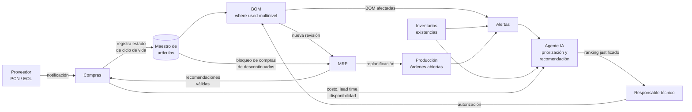

# 1. Análisis del proceso empresarial

**Proceso:** gestión de componentes descontinuados y sustitución de materiales en la BOM
**Matrícula:** 181914 · **Issue:** #239
**Contexto:** ERP inteligente para la gestión, planeación y fabricación de equipos de cómputo

---

## 1.1 Descripción del problema

Una empresa que ensambla equipos de cómputo depende de componentes que los fabricantes retiran del mercado con frecuencia: tarjetas madre, procesadores, memorias RAM y fuentes de poder cambian de generación cada pocos años. Un componente puede dejar de fabricarse mientras sigue registrado en varias listas de materiales (BOM) activas.

**Escenario hipotético.** La tarjeta madre `MB-B550-PLUS` se usa:

- directamente en la BOM de la estación de trabajo `PC-WS-300`;
- en el subensamble `ENS-BASE-AM4` (tarjeta madre + CPU), que a su vez forma parte de `PC-OFI-100` y `PC-GAM-200`.

El proveedor la descontinúa el 20/11/2026. El ERP no conoce esta situación, así que el MRP recomienda comprar 28 piezas para cubrir un pedido de 30 `PC-OFI-100` y 10 `PC-WS-300`. El problema se descubre cuando el comprador intenta colocar la orden. Para entonces, dos órdenes de fabricación ya están comprometidas.

Consecuencias:

| Consecuencia | Efecto en el escenario |
|---|---|
| Recomendaciones de compra imposibles de surtir | 1 de 4 recomendaciones del MRP (25 %) corresponde al componente descontinuado. |
| Estructuras afectadas que nadie identifica | 4 de 5 BOM activas (80 %) contienen el componente en algún nivel. Dos de ellas lo contienen solo de forma indirecta, a través del subensamble. |
| Retrasos en producción | 2 de 4 órdenes abiertas (50 %) quedan detenidas por falta del componente. |
| Búsqueda manual de sustitutos | No hay criterios registrados y se corre el riesgo de elegir una placa incompatible, por ejemplo de socket AM5 o de factor de forma mATX. |
| Falta de trazabilidad | No queda registro de quién autorizó el cambio, cuándo se hizo ni qué versión de la BOM usó cada orden. |

## 1.2 Objetivo

Diseñar y documentar un proceso inteligente que **identifique, evalúe y sustituya** componentes descontinuados en las listas de materiales. El ERP se integra con un agente de inteligencia artificial para:

1. detectar la descontinuación en el momento en que se registra, en lugar de descubrirla al comprar;
2. identificar de forma automática las BOM afectadas, incluidas las multinivel;
3. impedir que el MRP recomiende compras de componentes que ya no se comercializan;
4. recomendar sustitutos compatibles con un criterio objetivo y explicable;
5. aplicar la sustitución solo con autorización y conservar el historial;
6. medir el desempeño del proceso con KPIs.

## 1.3 Actores involucrados

| Actor | Tipo | Responsabilidad en el proceso |
|---|---|---|
| Responsable de BOM | Humano | Administra las listas de materiales, crea la nueva revisión y aplica la sustitución autorizada. |
| Comprador | Humano | Registra la notificación del proveedor (PCN/EOL), verifica la disponibilidad y el costo de los sustitutos y gestiona la compra de última vez. |
| Proveedor | Externo | Notifica la descontinuación, la fecha de última compra y las alternativas sugeridas. |
| Almacén | Humano / ERP | Mantiene las existencias disponibles y reservadas del componente original y de los sustitutos. |
| Producción | Humano | Evalúa el impacto sobre las órdenes de fabricación: conservar o replanificar. |
| Responsable técnico | Humano | Valida la compatibilidad técnica y **autoriza o rechaza** la sustitución. |
| Agente inteligente | Sistema (IA) | Analiza el impacto, prioriza alertas, evalúa candidatos y genera recomendaciones justificadas. No modifica datos maestros. |
| ERP (BOM, MRP, Inventarios, Compras, Producción) | Sistema | Registra el ciclo de vida, ejecuta las reglas de negocio, genera alertas y recalcula necesidades. |

## 1.4 Flujo actual (AS-IS)

Se considera el escenario hipotético sin un mecanismo automatizado:

1. Se registra una lista de materiales para fabricar un equipo de cómputo.
2. Se genera un pedido de cliente que requiere la fabricación del producto.
3. El MRP calcula las necesidades de materiales con la BOM correspondiente.
4. El sistema genera una recomendación de compra de los componentes faltantes.
5. El comprador consulta con el proveedor la disponibilidad de los componentes.
6. El proveedor informa que uno de los componentes fue descontinuado.
7. El responsable de BOM identifica manualmente las listas de materiales afectadas.
8. Se investigan posibles sustitutos y se verifica su compatibilidad.
9. Se autoriza y actualiza la lista de materiales correspondiente.
10. Se ejecuta nuevamente el MRP para actualizar las necesidades de materiales.
11. Se continúa con el aprovisionamiento y la producción.

El diagrama BPMN del flujo actual está en [03_Diagramas_BPMN.md](03_Diagramas_BPMN.md#31-proceso-actual-as-is).

## 1.5 Problemas identificados

| # | Problema | Causa raíz en el AS-IS | Paso |
|---|---|---|---|
| P1 | Detección tardía de componentes descontinuados | El ERP no registra el ciclo de vida; la información llega solo cuando se intenta comprar. | 5–6 |
| P2 | Recomendaciones de compra de componentes que ya no se comercializan | El MRP no distingue entre componentes activos y descontinuados. | 4 |
| P3 | Retrasos en las órdenes de fabricación | El faltante aparece cuando la orden ya está comprometida. | 6–10 |
| P4 | Identificación manual de las BOM afectadas | No hay una consulta de uso (where-used) multinivel; los subensambles ocultan el uso indirecto. | 7 |
| P5 | Riesgo de seleccionar sustitutos incompatibles | No existen especificaciones técnicas estructuradas ni criterios de compatibilidad. | 8 |
| P6 | Falta de trazabilidad | La BOM se edita directamente y no se registran la autorización, la versión anterior ni las órdenes afectadas. | 9 |
| P7 | Incremento de costos operativos | Hay trabajo manual repetido, compras urgentes con sobreprecio y reprocesos. | 7–10 |
| P8 | Incumplimiento de fechas de entrega | Es consecuencia de P1–P3. | 11 |

## 1.6 Investigación

### 1.6.1 Ciclo de vida de componentes electrónicos

En la industria electrónica, la obsolescencia se gestiona con estados y notificaciones formales:

| Concepto | Significado | Uso en el proceso propuesto |
|---|---|---|
| **Activo** | El componente se fabrica y se comercializa con normalidad. | Se puede comprar y usar sin restricciones. |
| **NRND** (*Not Recommended for New Designs*) / **EOL anunciado** | El fabricante anuncia el fin de vida; aún se puede comprar, pero no se recomienda para diseños nuevos. | Estado `PROXIMO_A_DESCONTINUAR`: genera una alerta preventiva y el agente penaliza al componente como sustituto. |
| **LTB** (*Last Time Buy*) | Fecha límite para la última compra. | Campo `fecha_ultima_compra`: habilita la compra de última vez (tipo `ULTIMA_COMPRA`). |
| **Descontinuado / obsoleto** | El componente ya no se fabrica. | Estado `DESCONTINUADO`: bloquea las compras ordinarias. |
| **PCN / PDN** (*Product Change / Discontinuance Notification*) | Aviso formal del proveedor. Se rige por estándares como JEDEC JESD48 (*Product Discontinuance*) y J-STD-046. | Es la fuente que el comprador registra (campo `fuente`). |

La norma **IEC 62402** (*Obsolescence management*) recomienda una gestión **proactiva**: vigilar el ciclo de vida, evaluar el impacto y planear la resolución, que puede ser una compra de última vez, un sustituto o un rediseño. La alternativa reactiva consiste en esperar a que falte el componente. El proceso TO-BE adopta el enfoque proactivo.

### 1.6.2 Sustitución de materiales en sistemas ERP

Los ERP comerciales resuelven el problema con mecanismos similares, que sirven como referencia:

- **Indicador de discontinuación y material de seguimiento.** En SAP S/4HANA, la vista MRP del material admite un indicador de discontinuación, una fecha efectiva de salida y un *follow-up material*. Cuando se agotan las existencias del original, el MRP traslada las necesidades al sucesor. Esta es la política que aquí se llama **"agotar existencias"**.
- **Componentes alternativos o grupos de sustitución** en la BOM, con prioridad o porcentaje de uso.
- **Gestión de cambios de ingeniería (ECM/ECO).** Las modificaciones a la BOM se hacen por número de cambio, con fecha efectiva y aprobación, y generan una nueva revisión en lugar de editar la vigente.

Lecciones para el diseño: (a) separar el ciclo de vida del componente de la estructura de la BOM; (b) no editar BOM aprobadas, sino crear revisiones; (c) dejar que el MRP decida entre consumir el stock del original o pasar al sustituto.

### 1.6.3 Integración entre módulos

| Módulo | Entrega al proceso | Recibe del proceso |
|---|---|---|
| **Compras** | Notificación del proveedor, costo, tiempo de entrega y disponibilidad de los sustitutos. | Recomendaciones de compra válidas y compras de última vez. |
| **BOM** | Estructuras activas y consulta where-used. | Nuevas revisiones con el sustituto y el historial del cambio. |
| **Inventarios** | Existencias disponibles y reservadas. | Autorización de consumo del stock del descontinuado. |
| **MRP** | Necesidades brutas y netas. | Regla de bloqueo, política de agotar existencias y recálculo. |
| **Producción** | Órdenes abiertas y su estado. | Decisión por orden: conservar o replanificar. |

### 1.6.4 Criterios de compatibilidad en equipos de cómputo

La compatibilidad de un sustituto depende de la categoría del componente. Se distinguen atributos que deben ser **iguales** y atributos que deben **igualar o superar** al original:

| Categoría | Debe ser igual | Debe igualar o superar | Riesgo si no se valida |
|---|---|---|---|
| Tarjeta madre | Socket, tipo de memoria, factor de forma | Generación PCIe, ranuras M.2 | La CPU o la RAM no encajan, la placa no cabe en el gabinete o se pierden funciones. |
| Procesador | Socket, TDP | Núcleos | Placa incompatible o disipador insuficiente. |
| Memoria RAM | Tipo (DDR4/DDR5), capacidad | Velocidad | No arranca o cambia la especificación vendida. |
| Fuente de poder | Factor de forma | Potencia, certificación | Potencia insuficiente para GPU o CPU. |

Estos criterios se almacenan como datos (tabla `criterios_compatibilidad`) y no en el código, para que el responsable técnico pueda mantenerlos.

## 1.7 Propuesta de mejora (resumen)

Se propone un proceso de **gestión inteligente del ciclo de vida de los componentes**:

1. **Registro del ciclo de vida.** Cada componente tiene un estado (`ACTIVO`, `PROXIMO_A_DESCONTINUAR` o `DESCONTINUADO`) con historial. El comprador lo actualiza al recibir el PCN.
2. **Detección automática.** Al cambiar el estado, el ERP ejecuta una consulta where-used recursiva y genera una alerta con las BOM afectadas (y su nivel y ruta), las existencias, las órdenes abiertas y la demanda.
3. **Priorización.** La alerta se clasifica como `CRITICA`, `ALTA`, `MEDIA` o `BAJA` según su impacto en producción y la cobertura de inventario.
4. **Bloqueo en MRP.** El componente descontinuado deja de generar compras ordinarias. Su stock se puede consumir si está autorizado, y el faltante se reporta como "bloqueado: requiere sustitución".
5. **Recomendación del agente.** Primero se filtran los candidatos por compatibilidad técnica y después se ordenan con una puntuación ponderada (inventario, proveedor, costo, tiempo de entrega, ciclo de vida e impacto). Cada recomendación incluye su justificación.
6. **Autorización.** Solo el responsable técnico puede aprobar. Sin autorización no hay cambio.
7. **Aplicación.** Se crean nuevas revisiones de las BOM con uso directo y la versión anterior pasa a `OBSOLETO`. Las órdenes en proceso conservan su versión y las planificadas se replanifican. Todo queda en el historial.
8. **Recálculo de MRP** con la política "agotar existencias": primero se consume el stock autorizado del original y después el del sustituto.

El detalle está en los documentos 02 a 08. Los resultados del escenario muestran que las recomendaciones inválidas bajan de 25 % a 0 %, las órdenes afectadas de 50 % a 0 % y la detección ocurre en 0.25 h (ver [06_KPIs.md](06_KPIs.md)).
