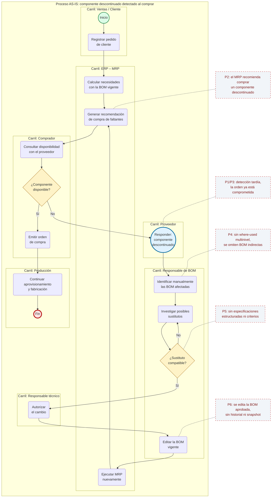
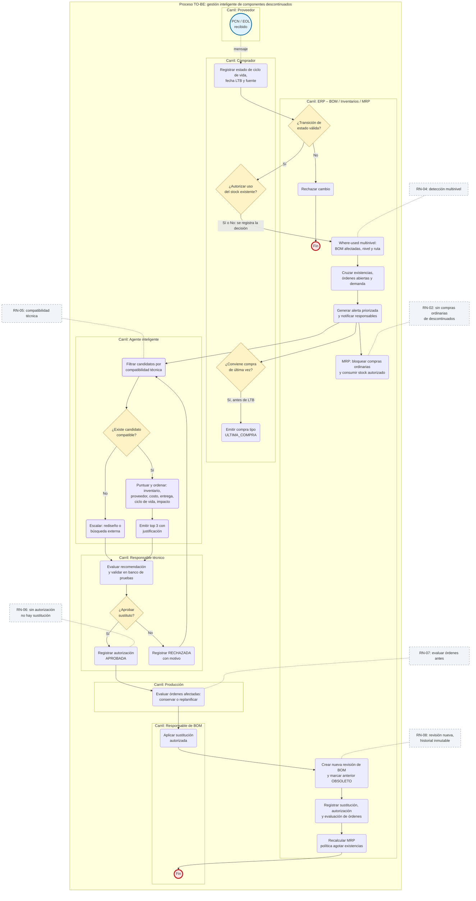

# 3. Diagramas BPMN

Igual que en `BOM/ERP/BOM requeriments.md`, se usa Mermaid para aproximar la notación BPMN 2.0:

| Elemento BPMN | Representación |
|---|---|
| Evento de inicio | Círculo verde |
| Evento de fin | Círculo rojo de borde grueso |
| Evento intermedio de mensaje o temporizador | Círculo doble |
| Tarea | Rectángulo redondeado |
| Compuerta exclusiva | Rombo |
| Carril (*lane*) | Subgráfico con el nombre del actor |
| Flujo de mensaje entre participantes | Flecha punteada |
| Problema identificado (anotación) | Nota gris punteada |

---

## 3.1 Proceso actual (AS-IS)

Sin gestión del ciclo de vida, la descontinuación se descubre **después** de que el MRP emitió la compra, y la identificación de BOM y sustitutos es manual.

**Lectura del diagrama.** El ciclo `REC → CONS → DISP(No) → … → RECALC → REC` es el **retrabajo** que causa los retrasos. Mientras se recorre, las órdenes de fabricación esperan. Las anotaciones rojas relacionan cada actividad con los problemas P1–P6 de [01_Analisis_del_Proceso.md](01_Analisis_del_Proceso.md#15-problemas-identificados).

---

## 3.2 Proceso propuesto (TO-BE)

La descontinuación se registra **en cuanto el proveedor la notifica**. El ERP detecta el impacto, bloquea las compras inválidas y el agente recomienda sustitutos. El responsable técnico autoriza y el ERP aplica el cambio por revisión, con historial.

> **Nota.** Después de `ALERTA`, el bloqueo en MRP, la evaluación de la compra de última vez y el análisis del agente ocurren **en paralelo**, como en una compuerta paralela BPMN. Mermaid no tiene un símbolo propio para ella, por eso se dibujan tres flujos que salen del mismo nodo.

---

## 3.3 Comparación AS-IS vs TO-BE

| Aspecto | AS-IS | TO-BE |
|---|---|---|
| Momento de detección | Al intentar comprar (después del MRP) | Al registrar el PCN; alerta en ≤ 15 min |
| Fuente de la información | Llamada al proveedor | Estado de ciclo de vida en el maestro de artículos |
| Identificación de BOM afectadas | Manual, solo de uso directo | CTE recursiva con nivel y ruta |
| Compras del MRP | Incluye componentes descontinuados | Bloqueadas por trigger y por regla del MRP |
| Uso del stock existente | Sin control | Autorizado explícitamente; se agota antes del sustituto |
| Selección de sustituto | Investigación ad hoc | Filtro de compatibilidad + ranking explicable |
| Autorización | Informal | Rol `RESPONSABLE_TECNICO`, registro inmutable |
| Cambio en la BOM | Edición de la versión vigente | Nueva revisión; la anterior pasa a `OBSOLETO` |
| Órdenes en curso | No se evalúan | Se decide conservar o replanificar cada una |
| Trazabilidad | Ninguna | Alerta → recomendación → autorización → sustitución |
| Retrabajo | Ciclo MRP → compra → MRP | Sin ciclo: el MRP se recalcula una sola vez |
