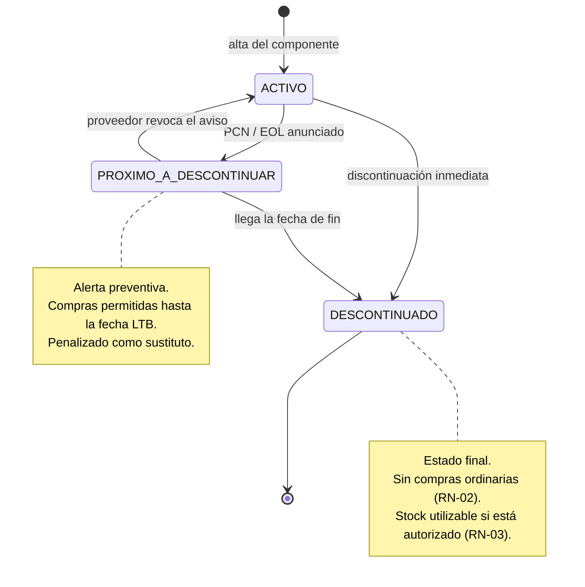
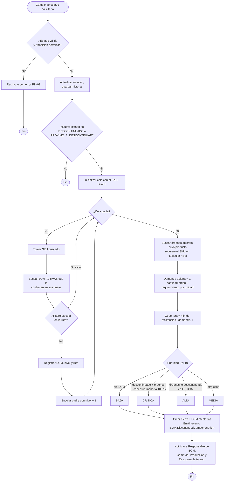
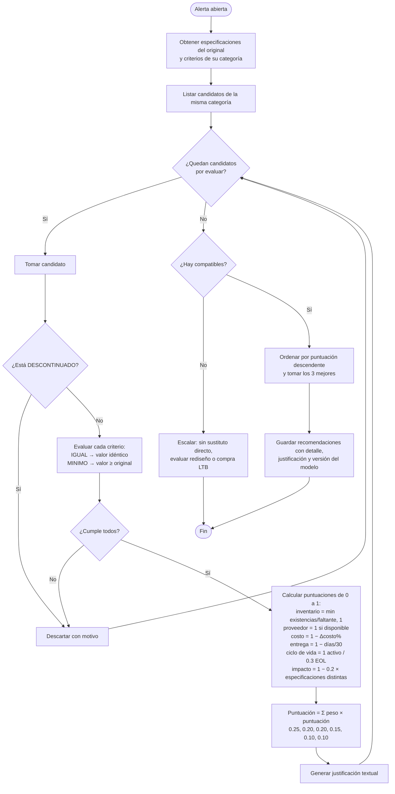
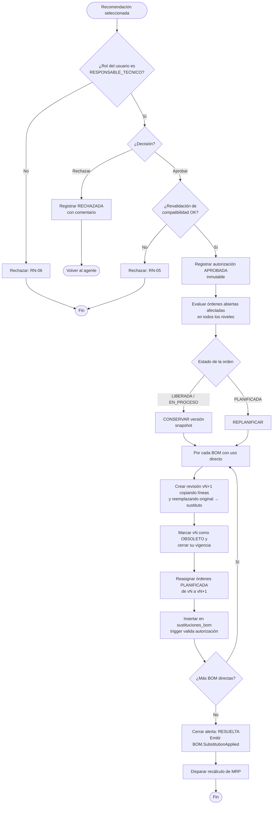
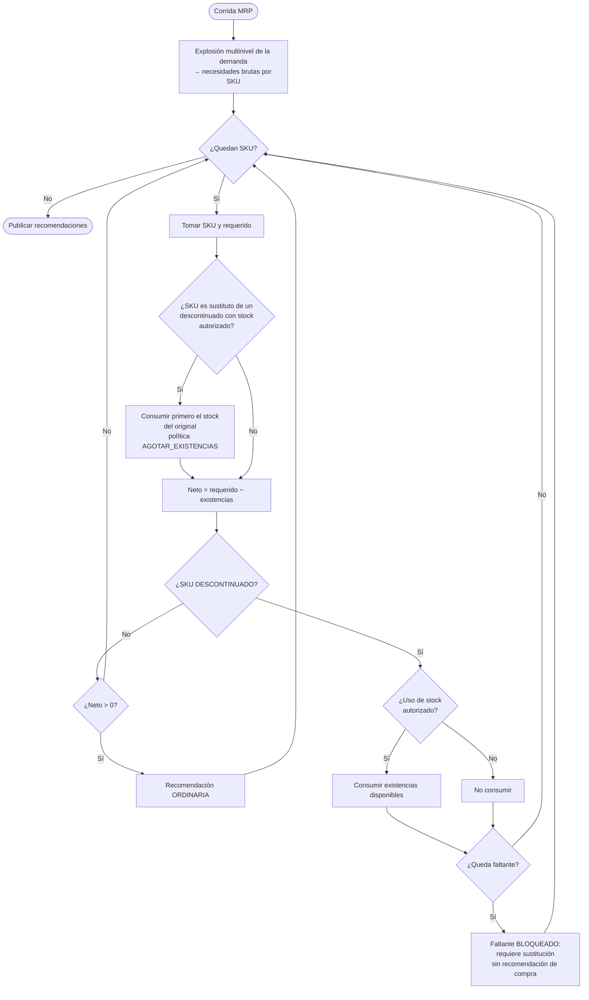

# 4. Diagramas de flujo

Estos diagramas describen la **lógica** de cada etapa: detección, evaluación, autorización y sustitución. Cada uno corresponde a una función de `gestor_descontinuados.py` y a un objeto de `sql/schema_descontinuados.sql`.

---

## 4.1 Máquina de estados del ciclo de vida (RN-01)

---

## 4.2 Detección y generación de la alerta

Funciones: `ERP.cambiar_estado`, `ERP.boms_afectadas`, `ERP.generar_alerta`, `ERP.priorizar`. En SQL: `trg_ciclo_vida_cambio` y `fn_boms_afectadas`.

**Ejemplo del escenario:** `MB-B550-PLUS` → 4 BOM (2 de nivel 1 y 2 de nivel 2), 3 órdenes abiertas, demanda de 45, existencias de 12, cobertura de 27 % → prioridad **CRITICA**.

---

## 4.3 Evaluación y recomendación de sustitutos (agente)

Funciones: `ERP.es_compatible`, `ERP.recomendar_sustitutos`.

**Resultado en el escenario:**

| Pos. | Candidato | Puntuación | Observación |
|---|---|---|---|
| 1 | `MB-B550-PRO` | 0.9620 | Igual especificación, +6.5 % de costo, 40 en stock |
| 2 | `MB-B550-LEGACY` | 0.8800 | Compatible pero con EOL anunciado (penalizado) |
| 3 | `MB-X570-ELITE` | 0.6578 | +56.5 % de costo, stock de 10 para un faltante de 28 |
| — | `MB-A520M-LITE` | descartado | factor de forma mATX, PCIe 3, una sola ranura M.2 |
| — | `MB-B650-AURA` | descartado | socket AM5, memoria DDR5 |

---

## 4.4 Autorización y aplicación de la sustitución

Funciones: `ERP.autorizar`, `ERP.aplicar_sustitucion`. En SQL: `trg_validar_sustitucion` y `trg_*_inmutables`.

> Las BOM de nivel superior (por ejemplo `PC-OFI-100`) **no se versionan**. Referencian al subensamble `ENS-BASE-AM4` y, al explotarse, toman su revisión vigente (`v2`). Así se evita multiplicar revisiones innecesarias.

Todo el bloque de E a N se ejecuta en **una transacción** (RNF-02): si falla un paso, no se aplica ninguno.

---

## 4.5 Regla del MRP para componentes descontinuados

Función: `ERP.mrp`. En SQL: `trg_bloquear_compra_descontinuado`.

**Escenario (pedido de 30 `PC-OFI-100` + 10 `PC-WS-300`):**

| Momento | `MB-B550-PLUS` | `MB-B550-PRO` | Otras compras |
|---|---|---|---|
| AS-IS | **Compra 28** (inválida) | — | RAM 20, SSD 30, PSU 25 |
| TO-BE, sustitución pendiente | Consume 12; **28 bloqueadas** | — | RAM 20, SSD 30, PSU 25 |
| TO-BE, sustitución aplicada | Consume 12 (agotar existencias) | 28 desde stock (40) → sin compra | RAM 20, SSD 30, PSU 25 |
