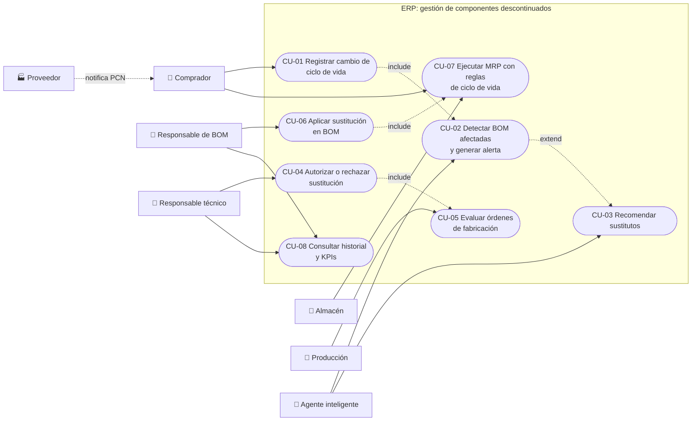
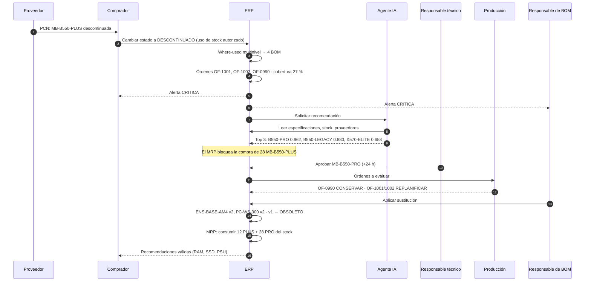

# 5. Casos de uso

## 5.1 Diagrama de casos de uso

Relaciones: CU-01 **incluye** CU-02, porque todo cambio a un estado de riesgo dispara la detección. CU-03 **extiende** CU-02 cuando la alerta afecta al menos una BOM. CU-04 incluye CU-05 y CU-06 incluye CU-07.

---

## 5.2 Especificación de casos de uso

### CU-01 Registrar cambio de ciclo de vida

| Campo | Descripción |
|---|---|
| **Actor principal** | Comprador |
| **Actores secundarios** | Proveedor (origen del PCN) |
| **Objetivo** | Registrar en el ERP que un componente está próximo a descontinuarse o ya está descontinuado. |
| **Precondiciones** | El componente existe en el maestro de artículos. El comprador recibió una notificación formal del proveedor. |
| **Disparador** | Llega un PCN/PDN o un aviso EOL. |
| **Flujo principal** | 1. El comprador busca el componente. 2. Selecciona el nuevo estado. 3. Captura la fecha de descontinuación, la fecha LTB, la fuente y si autoriza el uso del stock. 4. El ERP valida la transición (RN-01). 5. El ERP guarda el estado y el historial. 6. Se ejecuta CU-02. |
| **Flujos alternos** | 4a. Transición inválida (por ejemplo, `DESCONTINUADO → ACTIVO`): el ERP rechaza el cambio y muestra el motivo. 3a. El comprador no autoriza el uso del stock: el MRP no lo consumirá (RN-03). |
| **Postcondiciones** | Estado actualizado, historial registrado y alerta generada si aplica. |
| **Reglas** | RN-01, RN-03 |
| **Evidencia** | `test_transicion_invalida_desde_descontinuado`, `test_cambio_de_estado_queda_en_historial` |

### CU-02 Detectar BOM afectadas y generar alerta

| Campo | Descripción |
|---|---|
| **Actor principal** | ERP (automático) |
| **Actores secundarios** | Agente inteligente (priorización); Responsable de BOM, Compras, Producción y Responsable técnico (notificados) |
| **Objetivo** | Identificar el impacto de la descontinuación y avisar a los responsables. |
| **Precondiciones** | CU-01 concluyó con el estado `DESCONTINUADO` o `PROXIMO_A_DESCONTINUAR`. |
| **Flujo principal** | 1. El ERP ejecuta el where-used recursivo sobre las BOM activas. 2. Registra cada BOM con su nivel y su ruta. 3. Obtiene las órdenes abiertas afectadas y calcula la demanda. 4. Consulta las existencias y calcula la cobertura. 5. Asigna la prioridad (RN-10). 6. Crea la alerta y notifica. |
| **Flujos alternos** | 1a. Sin BOM activas que usen el componente: alerta `BAJA` solo informativa. 1b. Se detecta un ciclo en la estructura: se corta el recorrido en ese punto y se registra la advertencia. |
| **Postcondiciones** | Alerta `ABIERTA` con BOM afectadas; evento `BOM.DiscontinuedComponentAlert`. |
| **Reglas** | RN-04, RN-10 |
| **Evidencia** | `test_where_used_multinivel`, `test_alerta_critica_con_ordenes_y_cobertura_insuficiente`, `test_componente_sin_uso_genera_alerta_baja`; consulta SQL "BOM afectadas" |

### CU-03 Recomendar sustitutos

| Campo | Descripción |
|---|---|
| **Actor principal** | Agente inteligente |
| **Objetivo** | Proponer los mejores sustitutos compatibles, con justificación. |
| **Precondiciones** | Existe una alerta abierta con al menos una BOM afectada. Las especificaciones y los criterios de la categoría están registrados. |
| **Flujo principal** | 1. El agente obtiene las especificaciones del original y los criterios. 2. Evalúa cada candidato de la misma categoría. 3. Descarta los incompatibles y anota el motivo. 4. Puntúa los compatibles con seis criterios ponderados. 5. Ordena y guarda los 3 mejores con su justificación y la versión del modelo. |
| **Flujos alternos** | 3a. Ningún candidato es compatible: se escala al responsable técnico para evaluar un rediseño o una compra de última vez. 4a. Falta información de costo o proveedor: el criterio puntúa 0 y la justificación lo indica. |
| **Postcondiciones** | Recomendaciones registradas; la alerta pasa a `EN_EVALUACION`. |
| **Reglas** | RN-05, RN-09 |
| **Evidencia** | `test_recomendacion_ordenada_y_filtrada`, `test_proximo_a_descontinuar_penalizado`; consulta SQL "Candidatos y criterios incumplidos" |

### CU-04 Autorizar o rechazar sustitución

| Campo | Descripción |
|---|---|
| **Actor principal** | Responsable técnico |
| **Objetivo** | Validar técnicamente la recomendación y decidir si se aplica. |
| **Precondiciones** | Hay recomendaciones registradas. El usuario tiene el rol `RESPONSABLE_TECNICO`. |
| **Flujo principal** | 1. Revisa el ranking, el detalle por criterio y la justificación. 2. Valida el sustituto (hoja de datos o banco de pruebas). 3. Aprueba con comentario. 4. El ERP revalida la compatibilidad y registra la autorización. 5. Se ejecuta CU-05. |
| **Flujos alternos** | 3a. Rechaza: registra `RECHAZADA` con su motivo y puede elegir otro candidato. 4a. El usuario no tiene el rol: el ERP rechaza la operación. 4b. Se intenta aprobar un candidato incompatible: el ERP rechaza la operación (RN-05). |
| **Postcondiciones** | Autorización inmutable registrada. |
| **Reglas** | RN-05, RN-06, RN-08 |
| **Evidencia** | `test_solo_responsable_tecnico_autoriza`, `test_no_se_autoriza_sustituto_incompatible` |

### CU-05 Evaluar órdenes de fabricación

| Campo | Descripción |
|---|---|
| **Actor principal** | Producción |
| **Objetivo** | Decidir qué pasa con cada orden abierta antes del cambio. |
| **Precondiciones** | Autorización `APROBADA`. |
| **Flujo principal** | 1. El ERP lista las órdenes abiertas afectadas en todos los niveles. 2. Propone `CONSERVAR` para `LIBERADA`/`EN_PROCESO` y `REPLANIFICAR` para `PLANIFICADA`. 3. Producción confirma. |
| **Flujos alternos** | 2a. Una orden en proceso no tiene stock suficiente del original: Producción puede solicitar el cambio a `REPLANIFICAR` con autorización adicional. |
| **Postcondiciones** | Decisiones guardadas en `sustitucion_evaluacion_ordenes`. |
| **Reglas** | RN-07 |
| **Evidencia** | `test_sustitucion_crea_revision_y_conserva_historial` (OF-0990 se conserva; OF-1001 y OF-1002 se replanifican); consulta SQL "Evaluación de órdenes" |

### CU-06 Aplicar sustitución en BOM

| Campo | Descripción |
|---|---|
| **Actor principal** | Responsable de BOM |
| **Objetivo** | Reflejar la sustitución autorizada en las listas de materiales. |
| **Precondiciones** | Autorización `APROBADA` y CU-05 concluido. |
| **Flujo principal** | 1. El ERP obtiene las BOM con uso directo. 2. Para cada una crea la revisión `vN+1` con el sustituto. 3. Marca `vN` como `OBSOLETO` y cierra su vigencia. 4. Reasigna las órdenes planificadas. 5. Registra la sustitución y su política. 6. Cierra la alerta. 7. Se ejecuta CU-07. |
| **Flujos alternos** | 1a. Sin autorización aprobada: el trigger rechaza la operación y no se modifica nada. 2a. Error en cualquier paso: se revierte toda la transacción. |
| **Postcondiciones** | Nuevas revisiones activas, historial inmutable, alerta `RESUELTA`. |
| **Reglas** | RN-06, RN-07, RN-08 |
| **Evidencia** | `test_no_se_aplica_sin_autorizacion_aprobada`, `test_sustitucion_crea_revision_y_conserva_historial`; NOTICE `OK RN-06` y `OK RN-08` en la salida SQL |

### CU-07 Ejecutar MRP con reglas de ciclo de vida

| Campo | Descripción |
|---|---|
| **Actor principal** | ERP – MRP (programado) |
| **Actores secundarios** | Comprador, Almacén |
| **Objetivo** | Calcular las necesidades sin recomendar compras de componentes descontinuados. |
| **Flujo principal** | 1. Explota la demanda en varios niveles. 2. Para los sustitutos, consume primero el stock autorizado del original. 3. Calcula las necesidades netas. 4. Para los descontinuados, consume el stock autorizado y reporta el faltante como bloqueado. 5. Emite recomendaciones ordinarias solo para componentes no descontinuados. |
| **Flujos alternos** | 4a. El comprador decide hacer una compra de última vez: registra una recomendación de tipo `ULTIMA_COMPRA`, permitida por el trigger. |
| **Postcondiciones** | Recomendaciones válidas; faltantes bloqueados visibles. |
| **Reglas** | RN-02, RN-03 |
| **Evidencia** | `test_mrp_as_is_recomienda_comprar_descontinuado`, `test_mrp_no_compra_descontinuado_y_usa_stock`, `test_mrp_sin_uso_de_stock_autorizado`; NOTICE `OK RN-02` |

### CU-08 Consultar historial y KPIs

| Campo | Descripción |
|---|---|
| **Actores** | Responsable de BOM, Responsable técnico, Gerencia |
| **Objetivo** | Reconstruir la trazabilidad de un cambio y medir el desempeño. |
| **Flujo principal** | 1. Selecciona un componente o un periodo. 2. El ERP muestra la cadena alerta → recomendaciones → autorización → sustitución → órdenes. 3. Calcula los seis KPIs. |
| **Reglas** | RN-08 |
| **Evidencia** | `test_escenario_completo_kpis`; consultas "KPI 1"–"KPI 6" de `sql/escenario_y_consultas.sql` |

---

## 5.3 Secuencia de interacción del escenario

