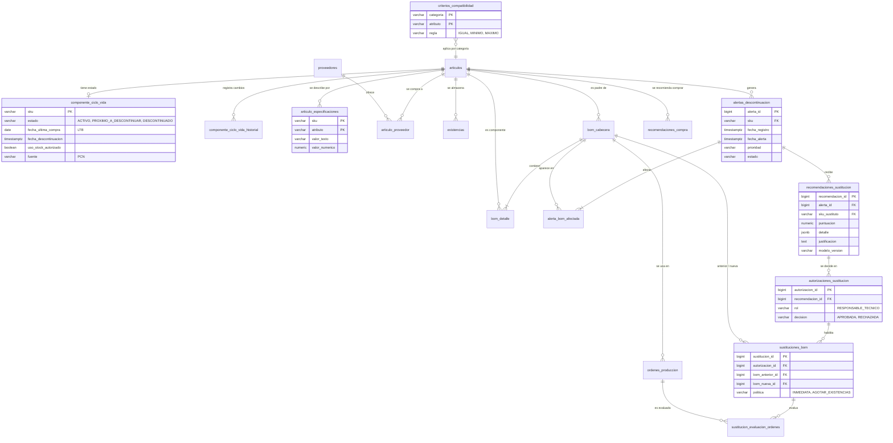

# 7. Requerimientos de bases de datos e inteligencia artificial

## 7.1 Bases de datos

### 7.1.1 Enfoque

Se **extiende** el esquema relacional existente (`BOM/BD/schema.sql`, PostgreSQL) en lugar de reemplazarlo. El script `sql/schema_descontinuados.sql` se ejecuta después y agrega:

- tablas para el ciclo de vida, las especificaciones, el abastecimiento, las alertas, las recomendaciones, las autorizaciones y el historial;
- una función recursiva para el where-used multinivel;
- triggers que aplican en la base de datos las reglas RN-01, RN-02, RN-05, RN-06 y RN-08.

Se eligió PostgreSQL porque el proceso exige **integridad transaccional** (RNF-01, RNF-02) y consultas recursivas (`WITH RECURSIVE`). El grafo de BOM también se podría replicar en Neo4j para análisis exploratorio, como hacen otros módulos del repositorio, pero la fuente de verdad sigue siendo relacional.

### 7.1.2 Modelo entidad-relación

`articulos`, `bom_cabecera`, `bom_detalle` y `ordenes_produccion` ya existían en `schema.sql`; las demás son nuevas.

### 7.1.3 Requerimientos de almacenamiento

| Necesidad del issue | Tabla(s) | Restricciones clave |
|---|---|---|
| Estado del ciclo de vida de los componentes | `componente_ciclo_vida`, `componente_ciclo_vida_historial` | `CHECK` de estados; la fecha de descontinuación es obligatoria si el estado es `DESCONTINUADO`; el historial es inmutable. |
| Características y especificaciones técnicas | `articulos.categoria`, `articulo_especificaciones`, `criterios_compatibilidad` | Un solo tipo de valor por atributo; la regla de comparación se restringe por `CHECK`. |
| Componentes sustitutos | `recomendaciones_sustitucion` | Sustituto distinto del original; puntuación entre 0 y 1; posición única por alerta; detalle en `JSONB`. |
| Existencias disponibles | `existencias` | Cantidades no negativas; disponible − reservado = utilizable. |
| Listas de materiales afectadas | `alerta_bom_afectada` (+ `fn_boms_afectadas`) | Nivel ≥ 1; ruta completa; PK (alerta, BOM). |
| Historial de sustituciones | `sustituciones_bom`, `sustitucion_evaluacion_ordenes` | Inmutables; la BOM anterior es distinta de la nueva; política explícita. |
| Autorizaciones de cambios | `autorizaciones_sustitucion` | `CHECK rol = 'RESPONSABLE_TECNICO'`; inmutable. |
| (KPIs) Recomendaciones de compra y retrasos | `recomendaciones_compra`, `ordenes_produccion.fecha_fin_real/causa_retraso` | Trigger que bloquea las compras `ORDINARIA` de descontinuados. |

### 7.1.4 Consultas requeridas

| Consulta | Implementación | Uso |
|---|---|---|
| Where-used multinivel de un SKU | `fn_boms_afectadas(sku)`: CTE recursiva sobre BOM `ACTIVO` con nivel, ruta y control de ciclos (`visitados`) | CU-02, KPI 3 |
| Órdenes abiertas afectadas | `ordenes_produccion` filtrada por las BOM de `fn_boms_afectadas` | CU-02, CU-05 |
| Candidatos compatibles y atributos incumplidos | `escenario_y_consultas.sql` §3.2: `criterios_compatibilidad` × `articulo_especificaciones` con `bool_and` | CU-03 |
| Cobertura de inventario | `Σ(cantidad_disponible − cantidad_reservada)` frente a la demanda abierta | Prioridad |
| Trazabilidad de una sustitución | `sustituciones_bom` ⋈ `bom_cabecera` (anterior y nueva) ⋈ `autorizaciones_sustitucion` | CU-08 |
| KPIs 1–6 | `escenario_y_consultas.sql` §4 | CU-08 |

### 7.1.5 Reglas aplicadas por la base de datos

| Objeto | Regla | Comportamiento |
|---|---|---|
| `trg_ciclo_vida_cambio` | RN-01, RN-04, RN-10 | Rechaza salir de `DESCONTINUADO`, guarda el historial y genera la alerta con las BOM afectadas. |
| `trg_bloquear_compra_descontinuado` | RN-02 | `RAISE EXCEPTION` si se intenta insertar una compra `ORDINARIA` de un descontinuado. |
| `trg_validar_sustitucion` | RN-05, RN-06 | Exige una autorización `APROBADA` que coincida con el par recomendado y un sustituto no descontinuado. |
| `trg_sustituciones_inmutables`, `trg_autorizaciones_inmutables`, `trg_ciclo_vida_historial_inmutable` | RN-08 | Bloquean `UPDATE` y `DELETE`. |

> **Relación con la auditoría de `feedback_181914.md`.** Esta extensión atiende parte de los hallazgos sobre `schema.sql`: la ALTA 6 (historial con usuario y fecha, inmutable), la MEDIA 8 (where-used recursivo en SQL) y la MEDIA 9 (eventos con un tipo definido). La protección general de BOM aprobadas (CRÍTICA 4) queda fuera de este alcance. Aquí se respeta por diseño, porque nunca se editan líneas de una BOM aprobada.

### 7.1.6 Eventos de integración

Siguen la convención de `BOM/ERP/events_181914.json` (ISO 8601 UTC, verbos ISA-95):

| Evento | Verbo ISA-95 | Dirección | Disparador |
|---|---|---|---|
| `Component.LifecycleChanged` | Change | Compras → ERP | CU-01 |
| `BOM.DiscontinuedComponentAlert` | Notify | ERP → BOM, Compras, Producción | CU-02 |
| `BOM.SubstitutionDecision` | Change | ERP → BOM | CU-04 |
| `BOM.SubstitutionApplied` | Sync | ERP → MES / MRP | CU-06 |

---

## 7.2 Inteligencia artificial

### 7.2.1 Papel del agente

El agente es un **asistente de decisión con supervisión humana** (*human in the loop*). Tiene permisos de **solo lectura** sobre el maestro de artículos, las BOM, las existencias, los proveedores y las órdenes, y de **escritura únicamente** en `recomendaciones_sustitucion` (RN-09).

```mermaid
flowchart LR
    subgraph ENTRADAS["Entradas (solo lectura)"]
        E1[Alerta y BOM afectadas]
        E2[Especificaciones y criterios]
        E3[Existencias]
        E4[Costo, lead time y<br/>disponibilidad del proveedor]
        E5[Órdenes abiertas y demanda]
        E6[Historial de sustituciones<br/>y rechazos previos]
    end
    subgraph AGENTE["Agente de sustitución"]
        T1["1. Priorizar alerta<br/>(reglas RN-10)"]
        T2["2. Filtro duro de<br/>compatibilidad (RN-05)"]
        T3["3. Ranking multicriterio<br/>ponderado"]
        T4["4. Redacción de justificación<br/>y riesgos (LLM opcional)"]
    end
    subgraph SALIDAS["Salidas"]
        S1[Prioridad de la alerta]
        S2[Top 3 con puntuación<br/>por criterio]
        S3[Descartados con motivo]
        S4[Justificación y riesgos]
    end
    ENTRADAS --> T1 --> T2 --> T3 --> T4 --> SALIDAS
    SALIDAS --> H{{Responsable técnico<br/>decide}}
```

### 7.2.2 Capacidades requeridas por el issue

| Capacidad | Técnica | Implementación de referencia |
|---|---|---|
| Identificar descontinuados que afectan BOM activas | Recorrido de grafo (BFS) / CTE recursiva | `ERP.boms_afectadas`, `fn_boms_afectadas` |
| Identificar riesgos de desabasto | Cobertura = existencias / demanda abierta; comparación con la fecha LTB | `ERP.generar_alerta` |
| Evaluar y recomendar sustitutos | Satisfacción de restricciones (filtro) + decisión multicriterio por suma ponderada | `ERP.es_compatible`, `ERP.recomendar_sustitutos` |
| Priorizar alertas según el impacto en producción | Reglas de clasificación (RN-10) | `ERP.priorizar` |
| Comparar alternativas (costo, disponibilidad, compatibilidad) | Detalle por criterio guardado en `JSONB` | `Recomendacion.detalle` |

### 7.2.3 Modelo de puntuación

Solo se puntúan los candidatos que pasan el filtro de compatibilidad. Cada criterio se normaliza al intervalo [0, 1]:

| Criterio | Peso | Fórmula | Justificación del peso |
|---|---|---|---|
| Inventario | 0.25 | `min(existencias / faltante, 1)` | Cubrir el faltante de inmediato evita retrasos, que es el objetivo principal. |
| Proveedor | 0.20 | `1` si está disponible con algún proveedor, si no `0` | Hace falta un abastecimiento sostenible después del stock. |
| Costo | 0.20 | `clamp(1 − (costo_cand − costo_orig) / costo_orig, 0, 1)` | Un sobrecosto del 100 % o más anula el criterio. |
| Tiempo de entrega | 0.15 | `max(0, 1 − días / 30)` | Un mes o más de espera anula el criterio. |
| Ciclo de vida | 0.10 | `1` si está activo, `0.3` si está próximo a descontinuarse | Evita sustituir por algo que pronto habrá que sustituir otra vez. |
| Impacto en BOM | 0.10 | `max(0, 1 − 0.2 × especificaciones distintas)` | Menos diferencias implican menos revalidación de ingeniería. |

`puntuación = Σ peso × criterio`. Los pesos se guardan como configuración, no en el código, para que el responsable técnico los pueda ajustar.

### 7.2.4 Uso de un modelo de lenguaje (opcional)

El ranking es **determinista y auditable**. Un LLM se puede usar solo en el paso 4, para:

- redactar la justificación en lenguaje natural a partir del `detalle` numérico;
- extraer especificaciones desde hojas de datos o boletines PCN en PDF y proponerlas para `articulo_especificaciones`, siempre con revisión humana;
- sugerir candidatos externos que no están en el catálogo, marcados como "no verificados".

**Restricciones (*guardrails*):** el LLM no puede cambiar la puntuación ni el filtro de compatibilidad; toda salida se guarda con `modelo_version`; las especificaciones extraídas se cargan en estado pendiente de validación.

### 7.2.5 Aprendizaje y mejora continua

- Los **rechazos** del responsable técnico (`autorizaciones_sustitucion.decision = 'RECHAZADA'` con comentario) son datos etiquetados que sirven para recalibrar los pesos.
- Métrica del agente: **precisión@1**, el porcentaje de alertas en las que el sustituto aprobado fue la primera recomendación. En el escenario es 1/1.
- Si un criterio técnico se omite con frecuencia, por ejemplo una nueva familia de sockets, el responsable técnico lo agrega a `criterios_compatibilidad` sin modificar el código.
