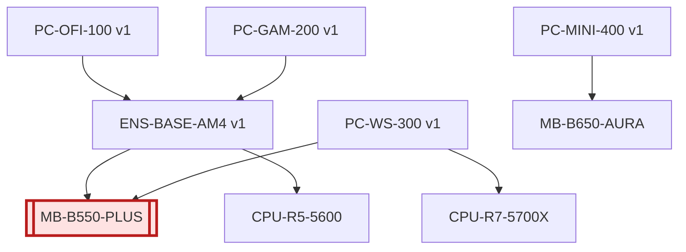

# 8. Escenarios de validación y evidencias

## 8.1 Datos del escenario hipotético

**Componentes (tarjetas madre, categoría `TARJETA_MADRE`):**

| SKU | Socket | Memoria | Factor de forma | PCIe | M.2 | Costo | Entrega | Stock | Estado |
|---|---|---|---|---|---|---|---|---|---|
| `MB-B550-PLUS` | AM4 | DDR4 | ATX | 4 | 2 | 2 300 | 6 d | 12 | Activo → **Descontinuado** |
| `MB-B550-PRO` | AM4 | DDR4 | ATX | 4 | 2 | 2 450 | 5 d | 40 | Activo |
| `MB-X570-ELITE` | AM4 | DDR4 | ATX | 4 | 3 | 3 600 | 7 d | 10 | Activo |
| `MB-B550-LEGACY` | AM4 | DDR4 | ATX | 4 | 2 | 2 200 | 10 d | 60 | Próximo a descontinuar |
| `MB-A520M-LITE` | AM4 | DDR4 | mATX | 3 | 1 | 1 500 | 4 d | 80 | Activo |
| `MB-B650-AURA` | AM5 | DDR5 | ATX | 4 | 2 | 3 100 | 5 d | 25 | Activo |

**Estructura de BOM activas:**



**Órdenes:** OF-1001 (30 × PC-OFI-100, PLANIFICADA), OF-1002 (10 × PC-WS-300, PLANIFICADA), OF-0990 (5 × PC-GAM-200, EN_PROCESO), OF-0950 (8 × PC-MINI-400, PLANIFICADA, no afectada), OF-0900 (TERMINADA).

**Pedido para el MRP:** 30 PC-OFI-100 + 10 PC-WS-300.

## 8.2 Escenarios de validación

Cada escenario indica la regla o el requisito que valida, el resultado esperado, el obtenido y su evidencia automatizada.

| ID | Escenario | Valida | Resultado esperado | Resultado obtenido | Evidencia |
|---|---|---|---|---|---|
| EV-01 | MRP sin gestión del ciclo de vida | Problema P2 (AS-IS) | Recomienda comprar 28 `MB-B550-PLUS` | 28 recomendadas; 25 % inválidas | `test_mrp_as_is_recomienda_comprar_descontinuado` |
| EV-02 | Intentar reactivar un descontinuado | RN-01 | Error de transición | `ErrorDeProceso` | `test_transicion_invalida_desde_descontinuado` |
| EV-03 | Estado de ciclo de vida inexistente | RN-01 | Error | `ErrorDeProceso` | `test_estado_desconocido_rechazado` |
| EV-04 | Descontinuar `MB-B550-PLUS` | RN-04, RF-03 | 4 BOM: 2 de nivel 1 y 2 de nivel 2; PC-MINI-400 no se incluye | Coincide | `test_where_used_multinivel`; SQL "BOM afectadas" |
| EV-05 | Prioridad de la alerta | RN-10 | CRITICA (3 órdenes, cobertura 12/45 = 27 %) | CRITICA | `test_alerta_critica_con_ordenes_y_cobertura_insuficiente` |
| EV-06 | Componente sin uso pasa a EOL | RN-10 | Alerta BAJA sin BOM | BAJA | `test_componente_sin_uso_genera_alerta_baja` |
| EV-07 | Recomendación de sustitutos | RN-05, RF-07 | PRO > LEGACY > X570; A520M y B650 descartadas con su motivo | Coincide | `test_recomendacion_ordenada_y_filtrada`; SQL "Candidatos" |
| EV-08 | Candidato con EOL anunciado | RN-05 | Se penaliza su ciclo de vida | `ciclo_vida = 0.3` | `test_proximo_a_descontinuar_penalizado` |
| EV-09 | MRP con la sustitución pendiente | RN-02, RN-03 | Sin compra; consume 12; 28 bloqueadas | Coincide | `test_mrp_no_compra_descontinuado_y_usa_stock` |
| EV-10 | Uso de stock no autorizado | RN-03 | No consume stock; 40 bloqueadas | Coincide | `test_mrp_sin_uso_de_stock_autorizado` |
| EV-11 | Insertar en BD una compra ordinaria del descontinuado | RN-02 (BD) | El trigger rechaza la inserción | `NOTICE OK RN-02` | `escenario_y_consultas.sql` §3.4 |
| EV-12 | Autorización por un rol distinto | RN-06 | Rechazada | `ErrorDeProceso` | `test_solo_responsable_tecnico_autoriza` |
| EV-13 | Aprobar un sustituto incompatible (AM5) | RN-05 | Rechazada | `ErrorDeProceso` | `test_no_se_autoriza_sustituto_incompatible` |
| EV-14 | Aplicar una sustitución rechazada | RN-06 | Rechazada (aplicación y BD) | `ErrorDeProceso`; `NOTICE OK RN-06` | `test_no_se_aplica_sin_autorizacion_aprobada`; SQL §3.5 |
| EV-15 | Aplicar la sustitución aprobada | RN-07, RN-08 | ENS-BASE-AM4 v2 y PC-WS-300 v2; v1 OBSOLETO sin cambios; OF-0990 se conserva; OF-1001/1002 se replanifican | Coincide | `test_sustitucion_crea_revision_y_conserva_historial`; SQL "Historial" y "Evaluación de órdenes" |
| EV-16 | Borrar el historial de sustituciones | RN-08 (BD) | El trigger rechaza la operación | `NOTICE OK RN-08` | SQL §3.7 |
| EV-17 | MRP recalculado | RF-12 | Consume 12 PLUS + 28 PRO del stock; sin compras de MB | Coincide | `test_escenario_completo_kpis` |
| EV-18 | KPIs del proceso | RF-13 | Detección 0.25 h, sustitución 24 h, 0 % BOM, 0 % inválidas, 0 % órdenes, 100 % de éxito | Coincide en Python y SQL | `test_escenario_completo_kpis`; SQL §4 |

## 8.3 Evidencias de ejecución

| Archivo | Contenido | Cómo reproducir |
|---|---|---|
| [evidencias/salida_simulacion.txt](evidencias/salida_simulacion.txt) | Recorrido completo AS-IS → TO-BE: alerta, BOM afectadas, ranking, MRP bloqueado, autorización, sustitución, MRP final y KPIs | `python BOM/Descontinuados_181914/gestor_descontinuados.py` |
| [evidencias/salida_pytest.txt](evidencias/salida_pytest.txt) | 16 pruebas unitarias aprobadas | `pytest tests/test_descontinuados_181914.py` |
| [evidencias/salida_sql_pglite.txt](evidencias/salida_sql_pglite.txt) | Ejecución de `schema.sql` + `schema_descontinuados.sql` + `escenario_y_consultas.sql` en PostgreSQL 17 (PGlite): alerta generada por trigger, where-used, candidatos, reglas RN-02/06/08 y KPIs | Ver el workflow de CI |
| `.github/workflows/descontinuados_bom_181914.yml` | CI que ejecuta los tres scripts SQL en PostgreSQL 16 con `ON_ERROR_STOP`, la simulación y las pruebas | Pestaña *Actions* → "BOM - Componentes descontinuados (181914)" |

### Extracto: salida de la simulación

```text
=== TO-BE: alerta generada ===
  Componente MB-B550-PLUS | prioridad CRITICA | existencias 12 | demanda abierta 45 | cobertura 27%
  BOM afectada nivel 1: ENS-BASE-AM4-v1  ruta ENS-BASE-AM4 > MB-B550-PLUS
  BOM afectada nivel 1: PC-WS-300-v1     ruta PC-WS-300 > MB-B550-PLUS
  BOM afectada nivel 2: PC-OFI-100-v1    ruta PC-OFI-100 > ENS-BASE-AM4 > MB-B550-PLUS
  BOM afectada nivel 2: PC-GAM-200-v1    ruta PC-GAM-200 > ENS-BASE-AM4 > MB-B550-PLUS

=== Recomendaciones del agente ===
  1. MB-B550-PRO     puntuación 0.9620
  2. MB-B550-LEGACY  puntuación 0.8800
  3. MB-X570-ELITE   puntuación 0.6578
  Descartado MB-A520M-LITE   form_factor: mATX != ATX; pcie_gen: 3 < 4; ranuras_m2: 1 < 2
  Descartado MB-B650-AURA    socket: AM5 != AM4; tipo_memoria: DDR5 != DDR4
```

### Extracto: reglas aplicadas por PostgreSQL

```text
NOTICE OK RN-02 -> RN-02: MB-B550-PLUS está descontinuado; no se permiten compras ordinarias
NOTICE OK RN-06 -> RN-06: la sustitución requiere una autorización APROBADA
NOTICE OK RN-08 -> RN-08: sustituciones_bom es un registro histórico y no puede modificarse
```

## 8.4 Limitaciones

- El escenario es **hipotético**: costos, existencias y tiempos son ilustrativos y no provienen de una empresa real.
- Los valores AS-IS de los KPIs 1 y 2 son estimaciones, porque el proceso actual no deja registros que permitan medirlos.
- El trigger SQL calcula una prioridad **preliminar** sin la cobertura de inventario, que requiere explotar las cantidades. El agente la recalcula con la cobertura (`ERP.priorizar`).
- La aplicación de la sustitución en SQL (§3.6) es un bloque `DO` de demostración. En producción se implementaría como un procedimiento almacenado con parámetros (autorización, política y fecha efectiva).
