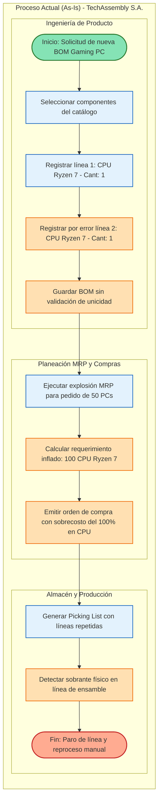
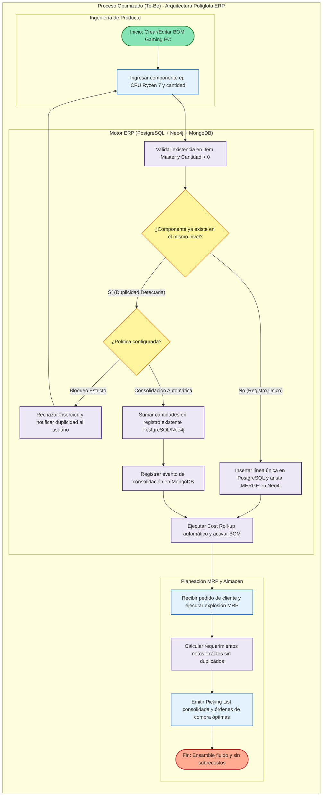

# Análisis del proceso empresarial - BOM

**Matrícula:** 179761 | **Issues:** #244 

##  Contexto

**TechAssembly S.A.** es una organización dedicada al ensamble de hardware y equipos de cómputo de alto rendimiento. Como parte de su transformación digital, la empresa está implementando un sistema **MRP (Material Requirements Planning)**.

El módulo de **Bill of Materials (BOM)** define la receta exacta de componentes necesarios para ensamblar cada equipo. La exactitud de esta estructura determina directamente la precisión de las compras a proveedores, el cálculo de costos de manufactura (*Cost Roll-up*) y el surtimiento de materiales en planta.

---

## Problemática a Solucionar

Durante la creación o edición de una BOM, el sistema actual carece de validaciones de unicidad por nivel jerárquico, permitiendo que un analista de ingeniería registre **dos o más veces el mismo componente bajo un mismo producto padre**.

Esta duplicidad resulta en fallos operativos como:

1.**Explosión MRP inflada:** Al recibir un pedido, el MRP calcula una demanda bruta detonando órdenes de compra excedentes e inmovilizando capital.
2.**Distorsión del Cost Roll-up:** El costo estándar de producción resulta elevado y erróneo.
* **Errores en piso (*Picking List*):** Almacén recibe y surte componentes duplicados a la línea de ensamble.

---

## Proceso Empresarial: Gestión de BOM 

El proceso empresarial abarca desde la definición del BOM hasta la explosión de materiales en el MRP, operando en cuatro etapas:

1. **Captura y Estructuración:**
El analista selecciona el producto padre y comienza a asociar los componentes requeridos desde el Maestro de Artículos (*Item Master*), indicando cantidad y unidad de medida.
2. **Validación de Integridad y Control de Duplicidad:**
Antes de persistir cada línea, el sistema valida la existencia del componente, que la cantidad sea mayor a cero y verifica la llave compuesta `(ID_Padre, ID_Componente, Nivel)`:
* Si el componente **no existe** en ese nivel, se inserta normalmente.
* Si el componente **ya existe** el sistema intercepta la operación: **bloquea la fila duplicada** o **consolida automáticamente las cantidades** en un único registro ($\text{Cantidad Total} = \text{Cantidad Previa} + \text{Cantidad Nueva}$), registrando el evento

3. **Cálculo de Costos y Liberación:**
Con la estructura libre de duplicados, el sistema ejecuta el *Cost Roll-up* sumando los precios unitarios de los componentes validados y marca la BOM como *Activa*.
4. **Explosión de Materiales y Abastecimiento (Planeación MRP y Almacén):**
Al ingresar una orden de venta el motor MRP recorre el grafo en Neo4j, multiplica la demanda por las cantidades únicas de la BOM, contrasta contra el inventario disponible y genera órdenes de compra netas o listas de surtimiento (*Picking Lists*) exactas para producción.

---

### 4. Diagramas BPMN del Proceso Empresarial

#### A. Diagrama BPMN del Proceso Actual (Con Falla por Duplicidad)

#### B. Diagrama BPMN del Proceso Mejorado (Detección / Consolidación y MRP)

---

### Objetivo

Implementar un control integral de validación y gobierno de datos dentro del módulo **Bill of Materials (BOM)** del ERP de **TechAssembly S.A.** que **erradique la duplicidad de componentes por nivel jerárquico** mediante detección temprana o consolidación automática de cantidades. Con ello, se busca asegurar la integridad de la estructura de fabricación, garantizar la exactitud en el cálculo de costos (*Cost Roll-up*) y optimizar la explosión de requerimientos del **MRP**, eliminando compras excedentes, paros en la línea de ensamble y discrepancias en el inventario.
