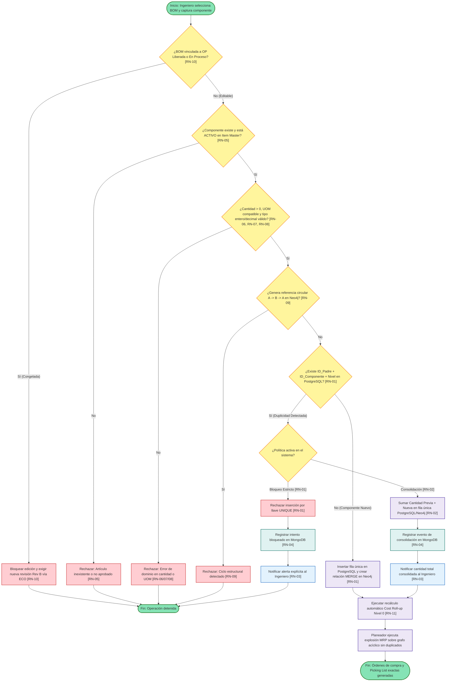

# Especificación de Actores, Casos de Uso y Reglas de Negocio (Módulo BOM)

## 1. Actores Implicados en el Uso del Sistema

Los actores que interactúan directa o indirectamente con el módulo **BOM** y el motor **MRP** dentro del ERP de **TechAssembly S.A.** son:

| Actor | Interacción con el Sistema |
| :--- | :--- |
| **Ingeniero / Analista de Producto**  | Crea, edita y clona las estructuras BOM. Interactúa directamente con el formulario de captura y recibe las alertas de duplicidad o confirmación de consolidación. |
| **Planeador de Materiales (MRP)**  | Ejecuta las corridas de explosión de materiales a partir de los pedidos de clientes, consumiendo las estructuras BOM validadas para calcular necesidades netas de compra. |
| **Comprador (Abastecimiento)** | Gestiona órdenes de compra hacia proveedores cuando el MRP detecta déficit de inventario en componentes críticos.|
| **Almacen** | Administra el Maestro de Artículos (*Item Master*), define las unidades de medida base (UOM) y consulta las listas de surtimiento (*Picking Lists*) consolidadas. |
| **Producción (Línea de Ensamble)** | Ejecuta las Órdenes de Producción (OP) ensamblando los componentes conforme a la revisión congelada de la BOM.
| **Cliente** | Detona la cadena de suministro mediante pedidos de unidades
| **Finanzas**  | Consulta el cálculo acumulado de costos (*Cost Roll-up*) y audita que no existan sobrecostos por componentes duplicados. |
| **Auditor / Administrador ERP**  | Supervisa las bitácoras de auditoría en MongoDB (historial de consolidaciones y cambios) y verifica la integridad referencial entre PostgreSQL y Neo4j. |

---

## 2. Casos de Uso (Interacción Actor – Sistema)

### Resumen de Casos de Uso

| ID | Caso de Uso | Actor Principal | Objetivo |
| :--- | :--- | :--- | :--- |
| **CU-01** | Agregar Componente a BOM | Ingeniero de Producto | Asociar un componente del catálogo validando su unicidad. |
| **CU-02** | Bloquear Fila Duplicada en BOM | Ingeniero de Producto / Sistema | Impedir la creación de un segundo registro en el mismo nivel cuando opera la política de rechazo estricto. |
| **CU-03** | Consolidar Cantidades Duplicadas | Ingeniero de Producto / Sistema | Unificar automáticamente dos registros del mismo componente en una sola fila sumando sus cantidades y auditando el cambio. |
| **CU-04** | Ejecutar Explosión de Materiales (MRP) | Planeador de Materiales | Calcular requerimientos exactos de compra y surtimiento a partir de una BOM libre de duplicados. |
| **CU-05** | Auditar Historial de Consolidaciones | Auditor / Analista de Costos | Consultar en la bitácora documental qué componentes fueron consolidados, por quién y su impacto en el costo total. |

---

### Especificación Detallada de Interacciones Críticas

#### CU-01: Agregar Componente a BOM (Con Detección de Duplicidad)
* **Actor Principal:** Ingeniero de Producto.
* **Precondiciones:** El producto padre (*Gaming PC*) y el componente (*CPU Ryzen 7*, *RAM 16GB DDR5*, etc.) existen y están activos en el Maestro de Artículos.
* **Flujo Principal (Componente Único):**
  1. El actor selecciona la BOM de la *Gaming PC* e ingresa el SKU `CPU Ryzen 7`, cantidad `1` y nivel `1`.
  2. El sistema consulta **PostgreSQL** y **Neo4j** para verificar si ya existe la combinación `(ID_Padre, ID_Componente, Nivel)`.
  3. Al confirmar que no existe duplicidad, el sistema inserta el registro en PostgreSQL, crea la relación en Neo4j, recalcula el *Cost Roll-up* y confirma el guardado al usuario.
* **Flujo Alterno A (Política de Bloqueo Estricto – CU-02):**
  1. En el paso 2, el sistema detecta que `CPU Ryzen 7` ya está registrado en el nivel `1` de la *Gaming PC*.
  2. PostgreSQL rechaza la inserción mediante la restricción de unicidad.
  3. El sistema muestra una alerta en pantalla: *"El componente CPU Ryzen 7 ya existe en este nivel. Edite la línea existente si desea modificar la cantidad"*, y registra el intento fallido en **MongoDB**.
* **Flujo Alterno B (Política de Consolidación Automática – CU-03):**
  1. En el paso 2, el sistema detecta que `RAM 16GB DDR5` ya existe con cantidad `1` y el usuario intenta agregar otra fila con cantidad `1`.
  2. El sistema intercepta la operación, suma ambas cantidades ($1 + 1 = 2$) y actualiza la fila única en PostgreSQL y la propiedad `cantidad` de la arista en Neo4j.
  3. El sistema guarda un documento de auditoría en **MongoDB** con el detalle de la consolidación, recalcula el *Cost Roll-up* y notifica al actor: *"Componente existente: se consolidó la cantidad total a 2 unidades"*.

#### CU-04: Ejecutar Explosión de Materiales (MRP)
* **Actor Principal:** Planeador de Materiales (MRP).
* **Precondiciones:** La BOM de la *Gaming PC* está activa y libre de duplicados.
* **Flujo Principal:**
  1. El actor ingresa un pedido de producción por `50 unidades` de *Gaming PC*.
  2. El motor MRP recorre el grafo acíclico en **Neo4j** leyendo las relaciones únicas de cada componente.
  3. El sistema multiplica la demanda por la cantidad consolidada de cada SKU, descuenta el inventario disponible en PostgreSQL y genera las órdenes de compra y la *Picking List* exacta.

---

## 3. Reglas de Negocio

A continuación se definen las reglas de negocio formales que gobiernan la integridad de la BOM y resuelven la problemática de duplicidad en **TechAssembly S.A.**:

### Reglas de Control de Duplicidad y Consolidación
* **RN-01 (Unicidad de Componente por Nivel Jerárquico):** Queda estrictamente prohibido almacenar dos o más filas con el mismo identificador de componente bajo un mismo producto padre y nivel. A nivel técnico, esta regla se aplica mediante una llave única compuesta (`UNIQUE`) en PostgreSQL y relaciones únicas (`MERGE`) en Neo4j.
* **RN-02 (Consolidación Automática de Cantidades):** Cuando la política de captura incremental esté activa y un usuario intente ingresar un componente ya existente en el mismo nivel, el sistema deberá unificar ambos registros en una sola línea sumando sus cantidades, evitando la creación de filas redundantes.
* **RN-03 (Notificación Explícita al Usuario):** Ante cualquier intento de duplicidad, el sistema nunca debe omitir el registro en silencio; debe informar explícitamente al actor si la operación fue rechazada por duplicidad (RN-01) o si las cantidades fueron consolidadas automáticamente (RN-02).
* **RN-04 (Auditoría Obligatoria de Consolidaciones):** Toda consolidación de cantidades o bloqueo por duplicidad debe registrar automáticamente un evento en **MongoDB** conteniendo: usuario, marca de tiempo, ID de la BOM, SKU afectado, cantidad anterior, cantidad agregada y cantidad resultante.

### Reglas de Dominio, Catálogo e Integridad Estructural
* **RN-05 (Validación de Existencia y Vigencia en Item Master):** Ningún componente (*CPU Ryzen 7*, *Motherboard B650*, *SSD 1TB NVMe*, *Power Supply 750W*, *Graphics Card RTX*) puede agregarse a una BOM si no existe previamente en el Maestro de Artículos con estatus `ACTIVO` y aprobado por calidad.
* **RN-06 (Cantidades Estrictamente Positivas):** Toda línea registrada o consolidada en la BOM debe tener una cantidad mayor a cero (`CHECK (cantidad > 0)`). No se permiten valores cero ni negativos para intentar "restar" líneas duplicadas.
* **RN-07 (Indivisibilidad de Hardware Discreto):** Los componentes físicos individuales (procesadores, tarjetas madre, módulos RAM, discos SSD, fuentes de poder y tarjetas gráficas) solo admiten cantidades enteras. Los valores decimales se permiten únicamente en insumos consumibles (ej. gramos de pasta térmica).
* **RN-08 (Compatibilidad de Unidad de Medida - UOM):** La unidad de medida utilizada al agregar o consolidar un componente en la BOM debe coincidir exactamente con la unidad base configurada en el inventario del artículo (ej. `Pieza / Unidad`).
* **RN-09 (Prevención de Referencias Circulares):** La estructura de la BOM debe comportarse como un grafo dirigido acíclico; el sistema debe validar recursivamente que ningún componente agregado contenga directa o indirectamente a su propio producto padre ($A \rightarrow B \rightarrow A$).
* **RN-10 (Inmutabilidad por Órdenes de Producción Activas - Control ECO):** Si una BOM está vinculada a una Orden de Producción en estado *Liberada* o *En Proceso*, queda bloqueada para nuevas inserciones o consolidaciones de cantidad. Cualquier ajuste requiere crear una nueva revisión (`Rev B`) mediante una Orden de Cambio de Ingeniería (ECO).
* **RN-11 (Recálculo Automático de Costos - Cost Roll-up):** Cada vez que se inserta un componente único o se consolida la cantidad de uno existente, el sistema debe recalcular de forma inmediata el costo estándar acumulado del producto padre (Nivel 0).

## 4. Flujo utilizando reglas de negocio

