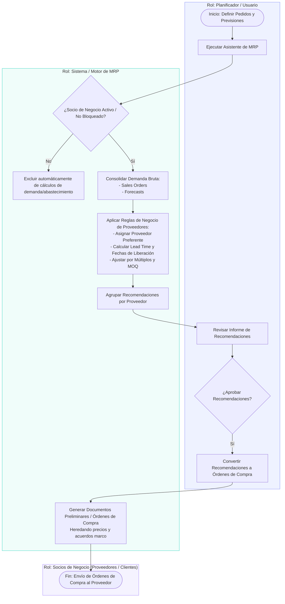

# Proceso MRP y Socios de Negocio (BPMN)

Este diagrama representa el flujo de interacción entre los **Socios de Negocio**, el **Motor de MRP** y el **Planificador**, basado en la notación BPMN (*Business Process Model and Notation*).

---
### Resumen del Flujo
1. **Validación:** Se filtran automáticamente los Socios de Negocio bloqueados o inactivos.
2. **Cálculo y Reglas:** Se consolidan *Sales Orders* y *Forecasts*, aplicando *Lead Time*, *MOQ* y proveedor preferente.
3. **Generación:** Al aprobar las recomendaciones, se emiten las Órdenes de Compra correspondientes heredando las condiciones comerciales.

## Validación de socios antes de crear órdenes

En el escenario de Business Partners, el validador consulta el estado del socio antes de autorizar una orden simulada. Para compras requiere un proveedor activo y habilitado para compras. Para ventas requiere un cliente activo, habilitado para ventas y con crédito disponible. En ambos casos verifica la moneda y registra el motivo de cada rechazo.

- [Guía de requisitos y escenarios](CristianGodinez_BusinessPartners.md)
- [Catálogo de 22 eventos de socios](CristianGodinez_BP_events.json)
- [Validador en Python](CristianGodinez/business_partner_events_cristian.py), [demo en Neo4j](CristianGodinez/neo4j_business_partners_cristian.py) y [pruebas](CristianGodinez/tests)

Para aplicar esta validación a las [recomendaciones de MRP](sql/mrp_recommendations.sql), queda pendiente vincular `supplier_code` con el `CardCode` del socio antes de convertir una recomendación en orden de compra.
