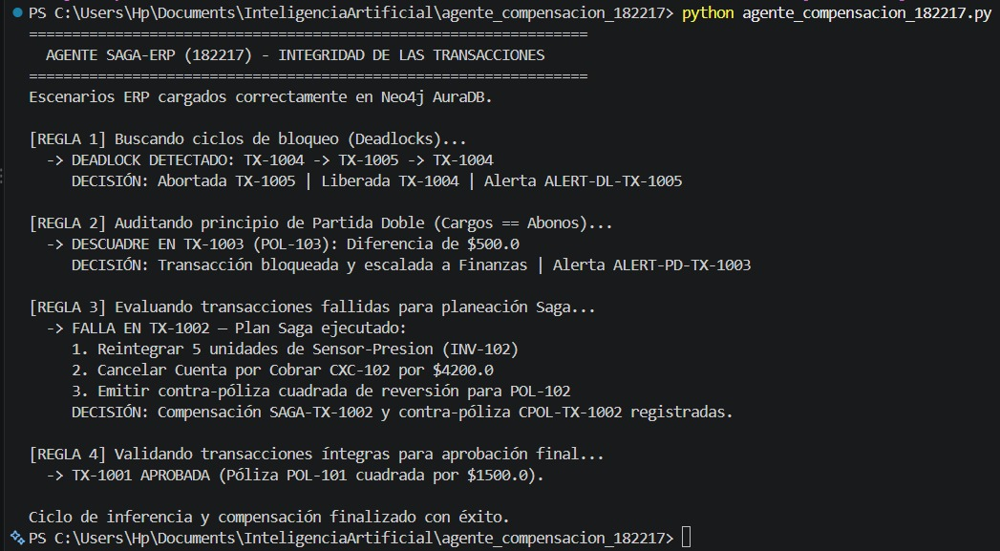

# Agente de Compensación Transaccional y Detección de Deadlocks (Saga-ERP)

- **Alumno:** Diego Osvaldo Hernández Fernández
- **Matrícula:** `182217`
- **Rama de trabajo:** `feature/182217`
- **Módulo asignado:** `Integridad_de_las_transacciones`
- **Issue asociado:** `#210`

## 1. Descripción del Agente
Este agente evoluciona el gestor previo en PostgreSQL (`GestorCompensacionERP`) hacia una arquitectura basada en **Knowledge Graphs (Neo4j)**, **Sistema Experto (motor de reglas)** y **Planeación de Compensaciones (Patrón Saga)** en Python.

Su objetivo es monitorear transacciones comerciales y contables del ERP para detectar bloqueos mutuos, auditar el principio de partida doble y ejecutar planes ordenados de reversión cuando una operación falla a mitad de flujo, preservando trazabilidad inmutable.

## 2. Reglas de Inferencia y Planeación
1. **Regla 1 — Detección y Resolución de Deadlocks:** Identifica ciclos `(:Transaccion)-[:BLOQUEA*2..5]->(:Transaccion)`, aborta la transacción más reciente para liberar los recursos bloqueados y registra un nodo `:AlertaIntegridad` de severidad crítica.
2. **Regla 2 — Auditoría de Partida Doble:** Valida que toda póliza contable cumpla `|Cargos - Abonos| <= 0.01`. Ante descuadres, bloquea la transacción y escala una alerta a Finanzas.
3. **Regla 3 — Planeación y Compensación (Patrón Saga):** Ante transacciones en estado `FALLIDA`, planifica y ejecuta la secuencia inversa:
   - Reintegrar unidades de inventario (`estado = 'REINTEGRADO'`).
   - Cancelar la cuenta por cobrar (`estado = 'CANCELADA'`).
   - Emitir una contra-póliza cuadrada (`tipo = 'CONTRA_POLIZA'`) ligada a un nodo `:Compensacion`.
4. **Regla 4 — Aprobación de Transacciones Íntegras:** Aprueba automáticamente las operaciones completadas cuya póliza esté cuadrada y no presenten bloqueos ni alertas activas.

## 3. Estructura de Archivos
- `agente_compensacion_182217.py`: Código principal del agente (conexión segura por variables de entorno, carga del grafo y motor de reglas/planeación).
- `modelo_grafo.cypher`: Script Cypher con restricciones de unicidad, carga de escenarios y consultas analíticas.
- `pruebas_agente.py`: Suite de pruebas automatizadas sobre los 4 escenarios de integridad.
- `requirements.txt`: Dependencias de Python (`neo4j`, `python-dotenv`).
- `.env.example`: Plantilla de variables de entorno requeridas (sin credenciales expuestas).
- `evidencias/`: Capturas de ejecución en consola, pruebas automatizadas y visualización del grafo/tablas en Neo4j AuraDB.

## 4. Instrucciones de Ejecución
1. Instalar dependencias:
   ```bash
   pip install -r requirements.txt
   ```
2. Copiar `.env.example` a `.env` y configurar las credenciales de Neo4j (`NEO4J_URI`, `NEO4J_USER`, `NEO4J_PASSWORD`).
3. Ejecutar el agente completo:
   ```bash
   python agente_compensacion_182217.py
   ```
4. Ejecutar las pruebas automatizadas:
   ```bash
   python pruebas_agente.py
   ```

## 5. Evidencias




