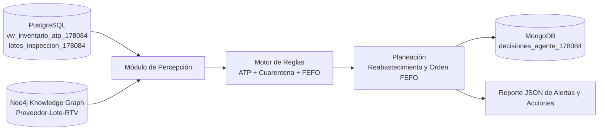

# Agente Inteligente de Disponibilidad ATP y Priorización FEFO (`InventoryFEFOAgent`)

- **Alumno:** Francisco Javier Hernández Mondragón
- **Matrícula:** `178084`
- **Materia:** Inteligencia Artificial
- **Tema Asignado:** Inventario
- **Issue Asociado:** `#306`

---

## 1. Descripción del Agente

`InventoryFEFOAgent` es un agente inteligente híbrido (Sistema Experto basado en reglas + Planeación operativa + Knowledge Graphs) diseñado para prevenir quiebres de inventario y mermas por caducidad. Opera sobre el esquema de **Recibos y Entregas (`#305`)**, integrando **PostgreSQL**, **Neo4j** y **MongoDB**.

## 2. Arquitectura del Agente



## 3. Reglas del Sistema Experto Implementadas

1. **Regla ATP — Quiebre / Backorder (`CRITICO`):** Si `ATP < 0`, calcula la cantidad urgente a solicitar (`stock_minimo - ATP`) y consulta el Knowledge Graph en Neo4j para recomendar al proveedor con mayor tasa de aprobación histórica para ese SKU, advirtiendo sobre proveedores por debajo del 80%.
2. **Regla ATP + Cuarentena (`ADVERTENCIA`):** Si `0 <= ATP < stock_minimo` pero `ATP + stock_cuarentena >= stock_minimo`, evita una compra innecesaria y escala una alerta prioritaria al área de Calidad para liberar el material retenido.
3. **Regla FEFO — Bloqueo de Vencidos (`CRITICO`):** Detecta cualquier lote disponible con `dias_restantes < 0`, lo excluye del plan de despacho y emite la acción `BLOQUEAR_LOTE_VENCIDO`.
4. **Regla FEFO — Priorización por Caducidad (`ADVERTENCIA` / `INFO`):** Ordena los lotes vigentes por `fecha_caducidad` ascendente (*First Expired, First Out*) y marca como `PRIORIZAR_DESPACHO_FEFO` aquellos con `<= 30` días de vida útil.
5. **Trazabilidad en MongoDB:** Cada ejecución guarda el diagnóstico completo, reglas activadas y recomendaciones en la colección `decisiones_agente_178084`.

## 4. Escenarios Validados Automáticamente (`pytest`)

- **`SKU-BAT02` (Batería CMOS CR2032):** Detecta `QUIEBRE_BACKORDER` (`ATP = -5`), calcula compra de `35` unidades, selecciona en Neo4j a `PROV-01` (`TechComponents MX`, 100% cumplimiento) frente a `PROV-02` (75%) y `PROV-03` (50%), bloquea el lote vencido `LOT-BAT-EXP` y ordena `LOT-BAT-01` antes que `LOT-BAT-00`.
- **`SKU-SSD03` (SSD NVMe 1TB Gen4):** Detecta `BAJO_MINIMO_CON_CUARENTENA` (`ATP = 5 < 15`, con `25` en cuarentena) y escala a Calidad sin emitir orden de compra.
- **`SKU-PT01` (Pasta Térmica Pro 5g):** Estado ATP saludable (`45 >= 20`), priorizando `LOT-PT-01` (12 días) antes que `LOT-PT-02` (180 días).
- **Persistencia MongoDB:** Verifica la inserción del documento de decisión en `decisiones_agente_178084`.

## 5. Ejecución (vía GitHub Actions o entorno con servicios activos)

```bash
# 1. Inicializar bases de datos (PostgreSQL, Neo4j, MongoDB)
python Recibos_y_entregas/178084_cuarentena_rtv/db_pipeline_178084.py

# 2. Ejecutar el agente inteligente
python Inventario/178084_agente_atp_fefo/agente_atp_fefo_178084.py

# 3. Correr pruebas automatizadas
pytest -vv Inventario/178084_agente_atp_fefo/test_proyecto_178084.py
```
