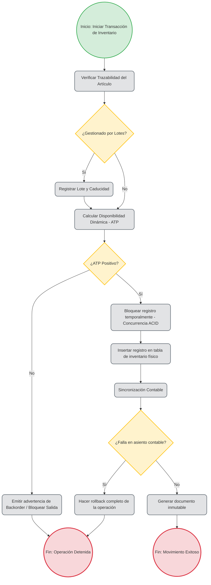

Lista de requerimientos funcionales para un módulo de Inventario 
en un ERP 
• Gestión de Datos Maestros de Artículos: Capacidad de registrar cada producto y definir su 
comportamiento central (clasificarlos como artículos de venta, de compra o de inventario 
interno). 
• Múltiples Almacenes y Ubicaciones (Bin Locations): Soporte para dividir el stock en 
diferentes almacenes físicos o lógicos, incluyendo áreas de tránsito, ubicaciones 
temporales de recepción y almacenes virtuales de envío directo (Drop Ship). 
• Grupos de Unidades de Medida (UoM): Sistema para automatizar conversiones 
matemáticas; por ejemplo, si compras un producto en cajas de 50, pero lo controlas en el 
almacén y lo vendes por pieza individual. 
• Control de Trazabilidad (Lotes y Series): Exigir y registrar la asignación de números de 
serie (para artículos individuales de alto valor) o números de lote (para control de 
caducidades) en cada entrada, salida o devolución. 
• Cálculo Dinámico de Disponibilidad (ATP): Un motor que calcule en tiempo real la 
cantidad disponible para venta usando la fórmula estándar: Stock físico actual + 
Cantidades pedidas a proveedores - Cantidades comprometidas en pedidos de clientes. 
• Valuación de Costos de Inventario: Soporte para costear los artículos mediante métodos 
contables automatizados como FIFO (primeras entradas, primeras salidas), Costo 
Promedio Móvil o Costo Estándar. 
• Listas de Precios Dinámicas y Descuentos: Capacidad de vincular un mismo artículo a 
múltiples listas de precios y grupos de descuentos, con la opción de que se actualicen en 
cascada mediante un factor numérico. 
Desgloce de requerimientos usando: Proceso de Control de Stock y Disponibilidad 
(ATP) 
2) Descripción de las Reglas de Negocio que aplican 
RN01 (Fórmula ATP): La disponibilidad se calcula estrictamente como: Stock Físico (En Almacén) + 
Cantidad Pedida (Órdenes de Compra) - Cantidad Comprometida (Pedidos de Venta). 
RN02 (Trazabilidad): Si un artículo está marcado en el maestro como "Gestionado por Lotes", es 
obligatorio registrar el número de lote y su fecha de caducidad antes de guardar cualquier entrada 
al almacén. 
RN03 (Inmutabilidad): Todo movimiento que afecte el inventario físico genera un documento 
inmutable; no puede ser editado ni eliminado una vez creado, solo cancelado mediante un 
documento de reversión. 
3) Pruebas Unitarias 
PU01: Ejecutar la función calcularATP(ItemCode) con un stock de 10, compras de 5 y ventas de 3. 
Verificar que el valor de retorno sea exactamente 12. 
PU02: Enviar un POST al endpoint de salidas de inventario con un número de lote inexistente; 
verificar que el backend retorne un código HTTP 400 Bad Request y la excepción 
InvalidBatchNumber. 
PU03: Validar que la función de conversión de Unidades de Medida multiplique correctamente el 
factor (Ej. 1 Caja = 50 piezas) sin pérdida de decimales. 
4) Pruebas Funcionales 
PF01: Iniciar sesión como usuario estándar. Crear un "Pedido de Venta" por 5 unidades de un 
artículo que tiene 0 stock físico pero 10 en orden de compra. Validar que el sistema permita 
guardarlo (porque el ATP es positivo) y emita una advertencia de backorder. 
PF02: Intentar guardar una "Entrada de Mercancías" de un artículo seriado dejando el campo de 
"Número de Serie" en blanco. Comprobar que la interfaz gráfica detenga la acción, resalte el 
campo en rojo y muestre el mensaje "Asignación de serie requerida". 
5) Integridad de los Datos 
ID01 (Integridad Referencial): Todos los movimientos de inventario en la tabla transaccional 
deben tener una llave foránea válida hacia un ItemCode existente en la tabla del Maestro de 
Artículos. 
ID02 (Transacciones ACID): Las salidas de inventario deben ejecutarse bloqueando el registro 
temporalmente (concurrencia) para evitar que dos usuarios descuenten la última pieza disponible 
al mismo milisegundo. 
ID03 (Sincronización Contable): Todo movimiento de entrada o salida debe insertar 
simultáneamente un registro en la tabla de inventario físico y en la tabla de Asientos Contables 
(Journal Entries). Si uno de los dos falla, se debe hacer un rollback completo de la operación.

