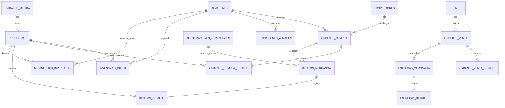

# Evidencias Técnicas y Pruebas — Módulo Compras, Recibos y Entregas (177576)

**Alumno:** Raziel Alejandro Marin Ojeda (`RamoES12`)  
**Matrícula:** `177576`  
**Rama:** `feature/177576`

---

## 1. Modelo Entidad-Relación Normalizado (3FN)



---

## 2. Relación con los Agentes Inteligentes del ERP

La infraestructura implementada provee tablas normalizadas (PostgreSQL), colecciones validadas (MongoDB) y un Knowledge Graph sincronizado (Neo4j) que alimentan directamente a los agentes inteligentes en `Recibos_y_entregas/`:

| Agente Inteligente | Fuente / Consulta Utilizada | Decisión Soportada |
| :--- | :--- | :--- |
| `agente_trazabilidad_185122.py` | Tablas `productos`, `ubicaciones_almacen`, `recibos_detalle` (lote, caducidad) y `CYPHER_TRAZABILIDAD_PRODUCTO` | Validar que el SKU exista activo, verificar lote/caducidad y confirmar ubicación válida antes de aprobar el putaway. |
| `agente_pedidos_184661.py` | Procedimiento `sp_reservar_stock_picking`, tabla `inventario_stock` y consulta `SQL_INVENTARIOS_CRITICOS` | Decidir si se reserva inventario (`RESERVAR`) o se rechaza el despacho (`RECHAZAR`) por stock insuficiente o lote vencido. |
| `agente_despacho_grafo_183435.py` | Procedimiento `sp_confirmar_entrega_salida`, trigger `trg_confirmar_entrega_inventario` y `vw_cuadre_inventario` | Garantizar transacción ACID en salida (`RF-08`), emitir `numero_nota_salida` y bloquear cierres inconsistentes. |
| Agente de Compras / Reabastecimiento | Consulta `Q1` (inventarios bajo `stock_minimo`) y `CYPHER_PROVEEDORES_CONFIABLES` | Generar orden de compra automática seleccionando al proveedor activo con mayor porcentaje de cumplimiento. |

---

## 3. Evidencia de Ejecución de Pruebas

Comando ejecutado en entorno offline (usando `InMemoryDatabase` para MongoDB, `FakeNeo4jDriver` / `FakeSyncNeo4jDriver` para Neo4j y `FakePGConnection` para PostgreSQL):

```bash
python -B -m unittest tests/test_recibos_entregas_177576.py -v
```

Resultado observado:

```text
test_sql_y_cypher_contienen_reglas_clave (tests.test_recibos_entregas_177576.TestArtefactosSQLyCypher.test_sql_y_cypher_contienen_reglas_clave) ... ok
test_pu01_suma_inventario_aislada (tests.test_recibos_entregas_177576.TestComponentesUnitarios.test_pu01_suma_inventario_aislada) ... ok
test_pu02_resta_inventario_aislada_y_bloqueo (tests.test_recibos_entregas_177576.TestComponentesUnitarios.test_pu02_resta_inventario_aislada_y_bloqueo) ... ok
test_pu03_calculo_peso_paquete (tests.test_recibos_entregas_177576.TestComponentesUnitarios.test_pu03_calculo_peso_paquete) ... ok
test_pu04_clasificacion_recepcion_exacta_faltante_danada (tests.test_recibos_entregas_177576.TestComponentesUnitarios.test_pu04_clasificacion_recepcion_exacta_faltante_danada) ... ok
test_pu05_json_schema_rechaza_cantidad_negativa (tests.test_recibos_entregas_177576.TestComponentesUnitarios.test_pu05_json_schema_rechaza_cantidad_negativa) ... ok
test_pf01_ciclo_completo_recibo_actualiza_stock_y_oc (tests.test_recibos_entregas_177576.TestFlujoFuncionalMongoDB.test_pf01_ciclo_completo_recibo_actualiza_stock_y_oc) ... ok
test_pf02_bloqueo_proveedor_suspendido_o_baja (tests.test_recibos_entregas_177576.TestFlujoFuncionalMongoDB.test_pf02_bloqueo_proveedor_suspendido_o_baja) ... ok
test_pf03_no_recibir_de_mas_sin_y_con_autorizacion_gerencial (tests.test_recibos_entregas_177576.TestFlujoFuncionalMongoDB.test_pf03_no_recibir_de_mas_sin_y_con_autorizacion_gerencial) ... ok
test_pf04_entregas_validan_pago_stock_y_generan_nota_salida (tests.test_recibos_entregas_177576.TestFlujoFuncionalMongoDB.test_pf04_entregas_validan_pago_stock_y_generan_nota_salida) ... ok
test_pi01_inmutabilidad_registros_cerrados_y_kardex (tests.test_recibos_entregas_177576.TestFlujoFuncionalMongoDB.test_pi01_inmutabilidad_registros_cerrados_y_kardex) ... ok
test_neo4j_bloquea_exceso_y_stock_insuficiente (tests.test_recibos_entregas_177576.TestGrafoNeo4j.test_neo4j_bloquea_exceso_y_stock_insuficiente) ... ok
test_neo4j_flujo_completo_y_seguridad_cypher (tests.test_recibos_entregas_177576.TestGrafoNeo4j.test_neo4j_flujo_completo_y_seguridad_cypher) ... ok
test_inventarios_criticos_y_sync_neo4j (tests.test_recibos_entregas_177576.TestIntegracionPGNeo4j.test_inventarios_criticos_y_sync_neo4j) ... ok

----------------------------------------------------------------------
Ran 14 tests in 0.020s

OK
```
