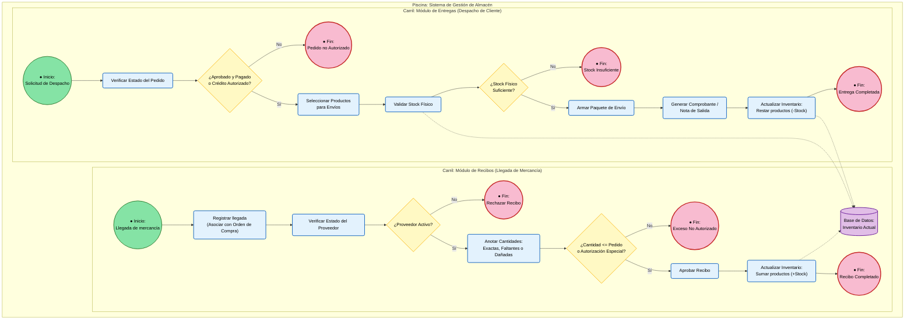

UNIVERSIDAD POLITÉCNICA DE SAN LUIS POTOSÍ
Sistemas ERP  
3er Parcial
Alumno: Domínguez Hernández Ailton Israel (182234)
Profesor: Jesús Alberto Revilla
Fecha de entrega: Martes, 3 de noviembre de 2026
---
1. Definición de requerimientos funcionales
Para el módulo de Recibos:
El sistema debe permitir registrar la llegada de mercancía relacionándola con una orden de compra previa.
El sistema debe permitir anotar si llegó la cantidad exacta, si faltaron piezas o si llegó producto dañado.
El sistema debe actualizar automáticamente el inventario sumando los nuevos productos recibidos en cuanto se apruebe el recibo.
Para el módulo de Entregas:
El sistema debe permitir seleccionar los productos que un cliente compró para armar su paquete de envío.
El sistema debe generar un comprobante o nota de salida de la mercancía que sale del almacén.
El sistema debe actualizar automáticamente el inventario restando los productos que ya fueron entregados.
---
2. Descripción de las reglas de negocio que aplican
Reglas para Recibos:
No recibir de más: No se puede aceptar en el almacén más cantidad de la que se pidió originalmente en la orden de compra (a menos que haya una autorización especial del gerente).
Proveedor activo: No se puede registrar un recibo de mercancía si el proveedor está dado de baja o suspendido en el sistema.
Reglas para Entregas:
Validación de inventario: No se puede confirmar una entrega si el almacén no cuenta con la cantidad física suficiente del producto (evitar vender lo que no hay).
Estado del pedido: Solo se pueden despachar productos de pedidos que estén previamente aprobados y pagados (o con crédito autorizado).
---
3. Pruebas unitarias
Probar componentes individuales aislados (ej. validar que la función de suma en inventarios o el cálculo de pesos funcione correctamente por separado).
---
4. Pruebas funcionales
Simular el proceso completo de principio a fin como lo haría un usuario (ej. desde registrar la llegada de una compra hasta ver reflejado el aumento en el inventario).
---
5. Integridad de los datos
Garantizar que los números cuadren ($\text{Entradas} - \text{Salidas} = \text{Stock actual}$) y que los registros cerrados no se puedan borrar ni alterar.

