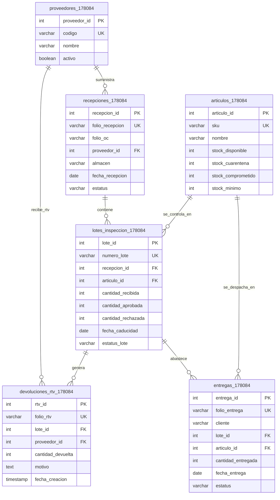

# Módulo de Base de Datos: Control de Calidad en Recepción (Cuarentena), Validación de Lotes y Devoluciones RTV

- **Alumno:** Francisco Javier Hernández Mondragón
- **Matrícula:** `178084`
- **Materia:** Base de Datos
- **Tema General:** Recibos y Entregas
- **Issue Asociado:** `#305`

---

## 1. Descripción del Componente

Componente de base de datos políglota (**PostgreSQL**, **Neo4j** y **MongoDB**) que controla el ciclo de recepción de mercancía bajo cuarentena obligatoria, dictamen de inspección de calidad por lote, generación automática de Devoluciones a Proveedor (**RTV**) y validación estricta de entregas a clientes (impidiendo despachos de lotes en cuarentena, rechazados, vencidos o sin stock disponible).

## 2. Modelo Entidad-Relación (PostgreSQL)



## 3. Objetos Implementados

- **Tablas (6):** `proveedores_178084`, `articulos_178084`, `recepciones_178084`, `lotes_inspeccion_178084`, `devoluciones_rtv_178084`, `entregas_178084`.
- **Vistas (2):**
  - `vw_inventario_atp_178084`: calcula `atp = stock_disponible - stock_comprometido`, separa `stock_cuarentena` y marca artículos bajo mínimo.
  - `vw_ranking_proveedores_178084`: calcula el porcentaje de cumplimiento y total de devoluciones RTV por proveedor.
- **Índices (4):** `idx_recepciones_proveedor_178084`, `idx_lotes_fefo_178084`, `idx_rtv_proveedor_178084`, `idx_entregas_lote_178084`.
- **Triggers (3):**
  - `trg_ingreso_cuarentena_178084`: suma automáticamente la cantidad recibida al `stock_cuarentena` al registrar un lote.
  - `trg_validar_entrega_178084`: bloquea entregas de lotes en `CUARENTENA`, `RECHAZADO`, vencidos (`fecha_caducidad < CURRENT_DATE`) o con `stock_disponible` insuficiente.
  - `trg_descontar_stock_entrega_178084`: descuenta automáticamente `stock_disponible` al confirmar una entrega.
- **Procedimiento Almacenado (1):** `sp_dictaminar_lote(lote_id, aprobada, rechazada, motivo)` — traslada unidades aprobadas de cuarentena a stock disponible, crea automáticamente el documento en `devoluciones_rtv_178084` si existen rechazos y cierra la recepción al terminar todos sus lotes.
- **Knowledge Graph (Neo4j):** Nodos `Proveedor`, `Recepcion`, `Lote`, `Articulo`, `DevolucionRTV` y `Entrega` (etiquetados con `proyecto: '178084'`) sincronizados vía `db_pipeline_178084.py` y consultados en `neo4j_178084.cypher`.
- **Bitácora Documental (MongoDB):** Colección `inspecciones_calidad_178084` con checklists de inspección y motivos de rechazo en JSON.

## 4. Relación con el Agente Inteligente (`#306`)

| Fuente de Datos | Consulta / Objeto | Decisión Soportada en `InventoryFEFOAgent` |
|---|---|---|
| PostgreSQL | `SELECT * FROM vw_inventario_atp_178084` | Detecta quiebres (`ATP < 0`) o si el stock en cuarentena cubre el déficit antes de comprar. |
| PostgreSQL | `lotes_inspeccion_178084` (índice FEFO) | Prioriza despachos *First Expired, First Out* y alerta sobre lotes vencidos o próximos a vencer. |
| Neo4j | `neo4j_178084.cypher` (Consulta #3 por SKU) | Selecciona al proveedor con mayor tasa de aprobación (menos RTV) para emitir la orden de compra. |
| MongoDB | `inspecciones_calidad_178084` | Provee contexto de incidencias de calidad registradas por lote. |

## 5. Archivos y Ejecución (vía GitHub Actions o entorno con servicios activos)

- `schema_178084.sql` — DDL completo (tablas, vistas, índices, triggers y procedimiento).
- `seed_178084.sql` — Datos semilla y ejecución de `sp_dictaminar_lote`.
- `consultas_178084.sql` — Consultas analíticas SQL.
- `neo4j_178084.cypher` — Consultas Cypher de trazabilidad y confiabilidad.
- `db_pipeline_178084.py` — Carga y sincronización automática PostgreSQL → Neo4j → MongoDB.

```bash
python Recibos_y_entregas/178084_cuarentena_rtv/db_pipeline_178084.py
pytest -vv Inventario/178084_agente_atp_fefo/test_proyecto_178084.py
```
