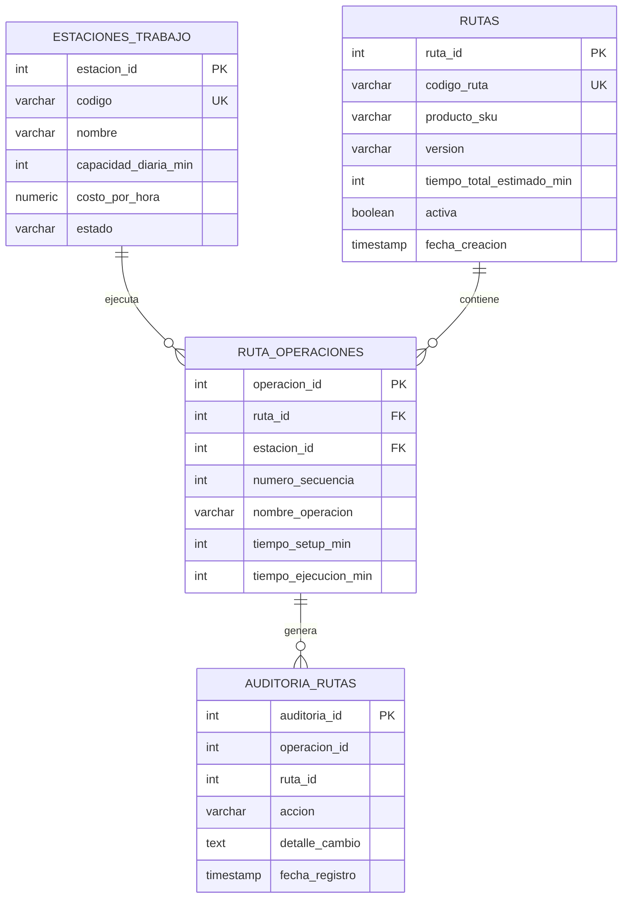
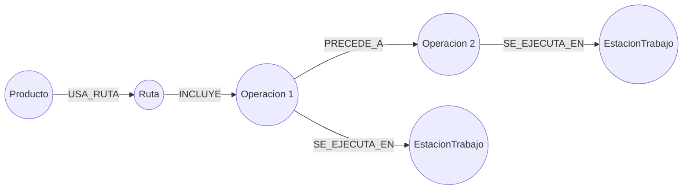

# Modelo Relacional y Knowledge Graph de Rutas Operativas

* **Matrícula:** 183636
* **Issue Asociado:** #249
* **Rama de trabajo:** `feature/183636`
* **Tecnologías:** PostgreSQL 15, Neo4j 5 (Cypher), Docker, GitHub Actions

---

## 1. Descripción Técnica de la Solución

Este componente implementa una infraestructura híbrida de datos para el módulo de **Rutas** del ERP:

1. **Capa Relacional (PostgreSQL):** Garantiza integridad referencial, control transaccional de tiempos estándar, cálculo automático de costos por ruta, detección de saturación en estaciones de trabajo y trazabilidad completa de cambios mediante triggers.
2. **Capa de Grafos (Neo4j / Cypher):** Modela las dependencias secuenciales entre productos, rutas, operaciones y estaciones de trabajo, permitiendo análisis de impacto ante fallos y búsqueda inmediata de rutas alternativas.

---

## 2. Arquitectura y Modelos

### Modelo Entidad-Relación (PostgreSQL)



### Modelo de Knowledge Graph (Neo4j)



---

## 3. Objetos Implementados

| Tipo | Objeto | Archivo | Propósito |
| :--- | :--- | :--- | :--- |
| **Tablas** | `estaciones_trabajo`, `rutas`, `ruta_operaciones`, `auditoria_rutas` | `sql/01_schema_rutas.sql` | Almacenamiento normalizado con restricciones `CHECK` y `UNIQUE`. |
| **Índices** | `idx_ruta_operaciones_ruta`, `idx_ruta_operaciones_estacion`, `idx_rutas_producto` | `sql/01_schema_rutas.sql` | Optimización de consultas de filtrado y agregación. |
| **Trigger** | `trg_auditar_ruta_operaciones` (`fn_auditar_ruta_operaciones`) | `sql/02_logic_rutas.sql` | Bitácora automática ante eventos `INSERT`, `UPDATE` y `DELETE`. |
| **Procedimiento** | `sp_registrar_operacion_ruta` | `sql/02_logic_rutas.sql` | Valida que la estación esté `ACTIVA`, inserta la operación y recalcula el tiempo total de la ruta. |
| **Vistas** | `vw_resumen_rutas`, `vw_carga_estaciones` | `sql/02_logic_rutas.sql` | Cálculo consolidado de costos, tiempos y porcentaje de ocupación por estación. |
| **Grafo (Cypher)** | Nodos y relaciones de rutas operativas | `cypher/04_knowledge_graph_rutas.cypher` | Carga idempotente (`MERGE`) y consultas de impacto/rutas alternas. |

---

## 4. Relación con los Agentes Inteligentes del ERP

* **Componente:** Modelo Relacional y Knowledge Graph de Rutas Operativas.
* **Consulta SQL (Detección de cuellos de botella):**

```sql
SELECT codigo, nombre, porcentaje_ocupacion
FROM vw_carga_estaciones
WHERE porcentaje_ocupacion > 80 OR estado <> 'ACTIVA';
```

* **Consulta Cypher (Búsqueda de ruta alternativa ante fallo en estación):**

```cypher
MATCH (p:Producto {sku: 'SKU-1001'})-[:USA_RUTA]->(r:Ruta)-[:INCLUYE]->(op:Operacion)
WHERE NOT EXISTS {
    MATCH (r)-[:INCLUYE]->(:Operacion)-[:SE_EJECUTA_EN]->(:EstacionTrabajo {codigo: 'EST-SOLD'})
}
RETURN r.codigo AS RutaAlternativa, SUM(op.tiempo_min) AS TiempoTotalMin
ORDER BY TiempoTotalMin ASC;
```

* **Decisión Soportada:** Cuando un agente de monitoreo detecta saturación (>80%) o indisponibilidad de una estación en PostgreSQL, consulta el Knowledge Graph en Neo4j para identificar qué productos quedan bloqueados y reasignar automáticamente las órdenes de producción hacia la ruta alternativa de menor tiempo total.

---

## 5. Validación Automatizada (CI/CD)

La ejecución y validación de todos los scripts SQL y Cypher se automatiza mediante el workflow `.github/workflows/rutas_db_183636.yml`, el cual levanta instancias efímeras de **PostgreSQL 15** y **Neo4j 5** en Docker, aplica el esquema, ejecuta las pruebas de integridad y muestra los resultados tabulares en la consola de GitHub Actions.