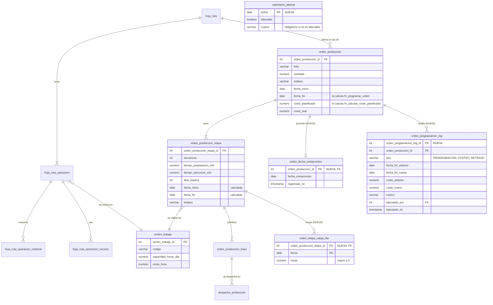
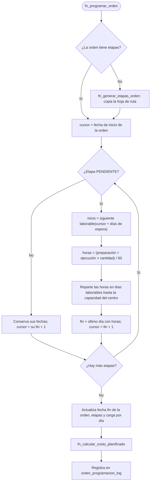
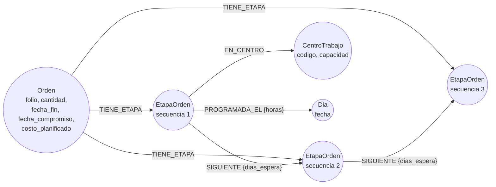

# Modelo de datos · Programación y Costeo de Órdenes por Ruta (184814)

Diagramas del componente del Issue #300. GitHub dibuja los bloques Mermaid directamente.

## 1. Modelo entidad-relación (PostgreSQL)

Las tablas marcadas con **NUEVA** son de este componente. Las demás ya existen en `Rutas/Scheme.sql` y solo se leen o actualizan a través de las funciones; su estructura no cambia.

## 2. Funciones, vistas y triggers nuevos

| Objeto | Tipo | Qué hace |
|---|---|---|
| `fn_es_laborable(fecha)` | Función | Consulta `calendario_laboral`; si la fecha no está, lunes a viernes son laborables. |
| `fn_siguiente_laborable(fecha)` | Función | Primer día laborable igual o posterior a la fecha. |
| `fn_generar_etapas_orden(orden)` | Función | Copia las operaciones, materiales y recursos de la hoja de ruta a la orden. |
| `fn_programar_orden(orden, motivo, usuario)` | Función | Calcula las fechas de cada etapa, la carga por día y el costo, y registra la bitácora. |
| `fn_calcular_costo_planificado(orden, ...)` | Función | Material + recurso + centro de trabajo; actualiza `costo_planificado`. |
| `fn_registrar_retraso(etapa, días, motivo, usuario)` | Función | Recorre el fin de una etapa y reprograma las siguientes. |
| `fn_reenumerar_secuencia(hoja, desde)` | Función | Abre un hueco en la secuencia de una hoja en borrador o en revisión. |
| `tr_bitacora_inmutable` | Trigger | Impide modificar o borrar la bitácora. |
| `vw_programa_ordenes` | Vista | Etapas con fechas, días laborables y holgura contra el compromiso. |
| `vw_carga_centro_dia` | Vista | Horas por centro y día contra su capacidad. |
| `vw_desviacion_costos` | Vista | Costo estándar contra real de lo despachado, por orden y por etapa. |
| `ix_carga_dia_fecha`, `ix_programacion_log_orden`, `ix_op_etapa_centro_fechas` | Índices | Aceleran las vistas de carga y la bitácora. |

## 3. Cálculo de fechas

## 4. Modelo del grafo (Neo4j)

El grafo está a nivel de **orden programada**. El de rutas maestras con estaciones y rutas alternativas pertenece al Issue #249.

Todos los nodos llevan `fuente = 'rutas_184814'`, para no mezclarse con los grafos de otros compañeros si comparten la misma base de Neo4j.
