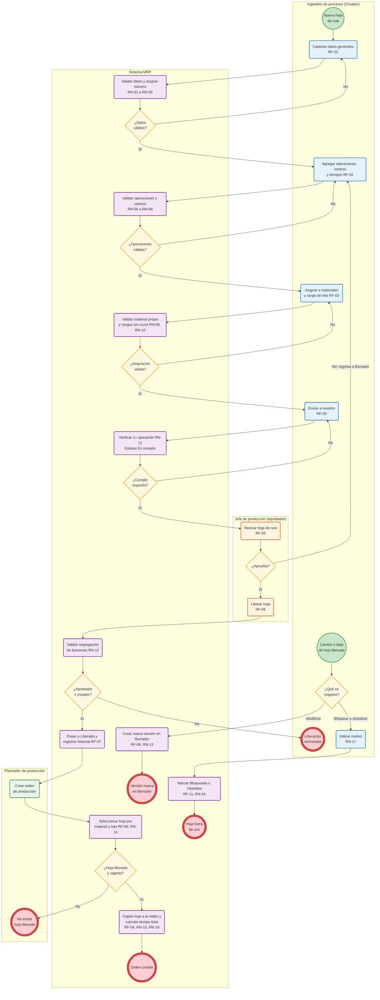

# BPMN – Hojas de ruta (MRP)

Diagrama del proceso de hojas de ruta del proyecto integrador MRP, basado en el documento de definición inicial de requerimientos (RF, RN, PU, PF y DI). GitHub renderiza el bloque Mermaid directamente.

## Diagrama

> Versión con carriles fijos: [`hojas_de_ruta_bpmn.svg`](hojas_de_ruta_bpmn.svg)

## Leyenda

| Símbolo | Significado |
|---|---|
| Círculo verde | Evento de inicio |
| Círculo rojo (borde grueso) | Evento de fin |
| Rectángulo redondeado | Tarea (usuario o sistema) |
| Rombo | Compuerta exclusiva (decisión) |
| Subgrafo | Carril (rol responsable) |

## Trazabilidad

| Etapa | Requerimientos | Reglas de negocio |
|---|---|---|
| Captura y validación de datos generales | RF-01 | RN-01 a RN-05 |
| Operaciones y centros de trabajo | RF-02 | RN-06 a RN-08 |
| Asignación a materiales y lotes | RF-03 | RN-09, RN-10 |
| Envío a revisión | RF-05 | RN-11 |
| Liberación (segregación de funciones) | RF-05, RF-07 | RN-12 |
| Selección de hoja y cálculo de tiempo | RF-04, RF-08 | RN-14, RN-15, RN-18 |
| Nueva versión | RF-06 | RN-13, RN-15 |
| Bloqueo u obsolescencia | RF-11 | RN-16, RN-17 |
