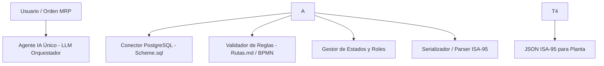

# Agente para el Módulo de Rutas

Descripción de la arquitectura de **agente único** para el módulo [**Rutas**](https://github.com/jesusrevilla/ERP-simulator/tree/development/Rutas) del simulador [**ERP-simulator**](https://github.com/jesusrevilla/ERP-simulator) (*TechAssembly S.A.*).

## 1\. Propósito del Agente

El **Agente Orquestador de Hojas de Ruta** automatiza la creación, validación, versionado y exportación a planta de las rutas de ensamble (por ejemplo, de una *Gaming PC*).

Combina un **modelo de lenguaje (LLM)** —para interpretar instrucciones en lenguaje natural, planificar acciones y resolver errores— con **herramientas deterministas** en Python y SQL para evitar alucinaciones en inventarios, tiempos o permisos.

## 2\. Arquitectura General

## 3\. Componentes y Herramientas (*Tools*)

|Componente|Función principal|Archivos / Tablas relacionadas|
|-|-|-|
|**Núcleo LLM**|Interpreta peticiones, decide qué herramientas usar y replanifica si falla una regla.|Prompts de sistema y contexto|
|**Conector PostgreSQL**|Lee y escribe rutas, etapas, recursos, centros de trabajo y existencias.|`Scheme.sql` (`hoja\_ruta`, `etapa\_ruta`, `recurso`, `existencia`)|
|**Validador de Reglas**|Verifica secuencia correlativa de etapas, cálculo de *Total Run Time*, fechas y stock.|`Rutas.md`, `README\_BPMN\_hojas\_de\_ruta.md`|
|**Gestor de Gobernanza**|Valida permisos por `rol` y controla estados (`BORRADOR` → `EN REVISION` → `LIBERADA` → `OBSOLETA`) y versiones.|`Scheme.sql` (`usuario`, `rol`, `hoja\_ruta`)|
|**Traductor ISA-95**|Convierte rutas liberadas a JSON estándar de planta y lee reportes reales de ejecución.|`172122\_gaming\_pc\_ruta\_isa95.json`, `178218PcGaming.json`|

## 4\. Flujo de Funcionamiento

1. **Entrada:** El agente recibe una orden de producción o instrucción en lenguaje natural.
2. **Consulta:** Revisa en PostgreSQL los materiales disponibles, centros de trabajo y el rol del usuario.
3. **Armado y validación:** Genera la secuencia de etapas en estado `BORRADOR` y ejecuta el validador de reglas. Si falta stock o hay un salto en la numeración, corrige o informa el problema.
4. **Aprobación:** Si el usuario tiene permisos, actualiza la versión y cambia el estado a `LIBERADA`.
5. **Salida ISA-95:** Genera el JSON (`OperationsResponse` / `SegmentResponse`) listo para ejecutarse en planta.

