```mermaid
flowchart TD
    %% Definición de estilos estándar BPMN
    classDef startEvent fill:#d4edda,stroke:#28a745,stroke-width:2px,color:#000;
    classDef endEvent fill:#f8d7da,stroke:#dc3545,stroke-width:3px,color:#000;
    classDef task fill:#e7f1ff,stroke:#0d6efd,stroke-width:1.5px,rx:8,ry:8,color:#000;
    classDef gateway fill:#fff3cd,stroke:#ffc107,stroke-width:2px,color:#000;
    classDef alert fill:#ffe5d0,stroke:#fd7e14,stroke-width:1.5px,stroke-dasharray: 5 5,color:#000;

    %% CARRILES BPMN (POOLS / LANES)
    subgraph MRP ["1. Motor de Planificación (MRP)"]
        direction TB
        E_Inicio((Inicio: Demanda<br/>Registrada)):::startEvent
        G_Candado{¿Proceso MRP<br/>en ejecución?}:::gateway
        E_FinCandado(((Fin: Ejecución<br/>Bloqueada))):::endEvent
        T_BOM(Explosión BOM y<br/>Validación sin Ciclos):::task
        T_CalculoNeto(Cálculo Req. Neto,<br/>Merma y Lead Time):::task
        G_CambioDemanda{¿Baja demanda en<br/>OC ya Enviada?}:::gateway
        T_AlertaComprador(Generar Alerta a Comprador<br/>RN-OC-05 Horizonte Fijo):::alert
        G_TipoOrden{¿Requiere Compra<br/>o Producción?}:::gateway
    end

    subgraph COMPRAS ["2. Submódulo de Órdenes de Compra (OC)"]
        direction TB
        T_CrearOC(Generar Propuesta OC<br/>Estado: Borrador):::task
        G_Proveedor{¿Proveedor Activo<br/>y Homologado?<br/>RN-OC-02}:::gateway
        E_RechazoProv(((Error: Proveedor<br/>Bloqueado))):::endEvent
        T_AjusteLote(Ajustar Cantidad por<br/>MOQ y Múltiplo MPQ<br/>RN-OC-01):::task
        G_AprobacionOC{¿Supera Monto y<br/>es Aprobada?<br/>RF-07}:::gateway
        T_EnviarOC(Cambiar a Aprobada/Enviada<br/>y Notificar Proveedor):::task
    end

    subgraph ALMACEN ["3. Almacén y Control de Inventario"]
        direction TB
        T_RecibirOC(Intento de Recepción<br/>de Mercancía RF-08):::task
        G_Tolerancia{¿Cant. <= Pedida<br/>+ % Tolerancia?<br/>RN-OC-03}:::gateway
        E_RechazoTol(((Rechazar Exceso<br/>de Recepción))):::endEvent
        T_ActualizarKardex(Entrada a Almacén, Cuadre Kardex<br/>e Inmutabilidad RN-OC-04):::task
        G_RecepcionTotal{¿Entrega<br/>Completa?}:::gateway
        T_OCParcial(Estado OC:<br/>Recibida Parcial):::task
        T_OCTotal(Estado OC:<br/>Recibida Total / Cerrada):::task
    end

    subgraph PRODUCCION ["4. Submódulo de Órdenes de Producción (OP)"]
        direction TB
        G_ValidaBOM{¿Tiene BOM y<br/>Ruta Activa?<br/>RN-OP-01}:::gateway
        E_ErrorBOM(((Error: Sin BOM<br/>o Ruta Activa))):::endEvent
        T_CrearOP(Crear OP Planificada y<br/>Congelar Snapshot BOM):::task
        G_StockCritico{¿Stock Libre Suficiente?<br/>Row-Level Locking<br/>RN-OP-02}:::gateway
        T_LiberarOP(Cambiar OP a Liberada y<br/>Reservar Materiales RF-11):::task
        T_Consumo(Ejecutar Operaciones en Secuencia<br/>y Consumir/Backflush sin Saldo Negativo<br/>RN-OP-04 / RN-OP-05):::task
        G_CierreValido{¿Entregas y Consumos<br/>Completos?<br/>RN-OP-06}:::gateway
        T_CierreACID(Transacción ACID: Entrada PT,<br/>Registro Merma, Bitácora y Cierre OP):::task
        E_FinProceso(((Fin: Proceso ERP<br/>Completado))):::endEvent
    end

    %% CONEXIONES DEL FLUJO
    E_Inicio --> G_Candado
    G_Candado -->|"Sí"| E_FinCandado
    G_Candado -->|"No (Bloquea)"| T_BOM
    T_BOM --> T_CalculoNeto
    T_CalculoNeto --> G_CambioDemanda
    G_CambioDemanda -->|"Sí"| T_AlertaComprador
    G_CambioDemanda -->|"No"| G_TipoOrden
    T_AlertaComprador --> G_TipoOrden

    %% Flujo hacia Compras
    G_TipoOrden -->|"Faltan Materias Primas"| T_CrearOC
    T_CrearOC --> G_Proveedor
    G_Proveedor -->|"No"| E_RechazoProv
    G_Proveedor -->|"Sí"| T_AjusteLote
    T_AjusteLote --> G_AprobacionOC
    G_AprobacionOC -->|"No / Espera"| T_CrearOC
    G_AprobacionOC -->|"Sí"| T_EnviarOC

    %% Flujo hacia Almacén
    T_EnviarOC --> T_RecibirOC
    T_RecibirOC --> G_Tolerancia
    G_Tolerancia -->|"No (Excede)"| E_RechazoTol
    G_Tolerancia -->|"Sí"| T_ActualizarKardex
    T_ActualizarKardex --> G_RecepcionTotal
    G_RecepcionTotal -->|"No"| T_OCParcial
    T_OCParcial -.-> T_RecibirOC
    G_RecepcionTotal -->|"Sí"| T_OCTotal

    %% Flujo hacia Producción
    G_TipoOrden -->|"Demanda Producto Terminado"| G_ValidaBOM
    G_ValidaBOM -->|"No"| E_ErrorBOM
    G_ValidaBOM -->|"Sí"| T_CrearOP
    T_CrearOP --> G_StockCritico
    T_ActualizarKardex -.->|"Surte Stock"| G_StockCritico
    G_StockCritico -->|"No (Bloquea y Espera)"| T_CrearOC
    G_StockCritico -->|"Sí"| T_LiberarOP
    T_LiberarOP --> T_Consumo
    T_Consumo --> G_CierreValido
    G_CierreValido -->|"No"| T_Consumo
    G_CierreValido -->|"Sí"| T_CierreACID
    T_CierreACID --> E_FinProceso
```

Documento de Especificación para 
Desarrollo ERP: Módulo MRP (Órdenes 
de Compra y Órdenes de Producción) 
Este documento define la lógica funcional, reglas de negocio, pruebas unitarias, pruebas 
funcionales y controles de integridad de datos para desarrollar los submódulos de Órdenes de 
Compra (OC) y Órdenes de Producción (OP) dentro de un sistema ERP con motor MRP. 
1. Definición de Requerimientos Funcionales 
El objetivo del módulo dentro del ERP es transformar las necesidades de materiales calculadas 
por el MRP en documentos ejecutables de compra (aprovisionamiento externo) y de producción 
(manufactura interna), controlando su ciclo de vida de principio a fin. 
1.1 Motor Base de Planificación (MRP) 
● RF-01 Explosión de Materiales (BOM): El sistema debe desglosar la lista de materiales de 
cada producto a fabricar para calcular la cantidad bruta necesaria de cada materia prima o 
subensamble. 
● RF-02 Cálculo de Requerimiento Neto: El sistema debe restar al requerimiento bruto el 
inventario disponible actual y las órdenes de compra o producción que ya están en camino, 
sumando el stock de seguridad configurado. 
● RF-03 Cálculo de Fechas por Tiempo de Entrega (Lead Time): El sistema debe calcular 
la fecha en que se debe colocar la Orden de Compra o iniciar la Orden de Producción 
restando los días de entrega o fabricación a la fecha en que se necesita el material. 
1.2 Submódulo de Órdenes de Compra (OC) 
● RF-04 Generación de OC desde el MRP: El sistema debe permitir convertir las 
sugerencias de compra del MRP en Órdenes de Compra reales en estado Borrador o 
Pendiente de Aprobación. 
● RF-05 Asignación y Validación de Proveedor: Toda OC debe asociarse a un proveedor 
activo del catálogo, cargando automáticamente sus precios pactados, moneda, condiciones 
de pago y tiempos de entrega. 
● RF-06 Ajuste por Cantidades Mínimas y Múltiplos: Al crear la OC, el sistema debe 
ajustar automáticamente la cantidad a pedir para que cumpla con el mínimo de compra 
(MOQ) y los múltiplos de empaque del proveedor. 
● RF-07 Flujo de Autorización de OC: El sistema debe contar con estados para la OC 
(Borrador, Por Aprobar, Aprobada, Enviada, Recibida Parcial, Recibida Total, Cancelada, 
Cerrada) y requerir aprobación según el monto total. 
Jorge Alejandro Cabrera Meza - 181591  
● RF-08 Recepción de Mercancía en Almacén: El sistema debe permitir registrar entradas 
de almacén referenciadas a una OC aprobada, actualizando en tiempo real la cantidad 
recibida, el saldo pendiente por entregar y el inventario físico. 
1.3 Submódulo de Órdenes de Producción (OP) 
● RF-09 Creación de Orden de Producción: El sistema debe generar la OP indicando el 
artículo a fabricar, cantidad planeada, fecha de inicio, fecha fin, almacén destino y copiando 
la versión vigente de su Lista de Materiales (BOM) y Ruta de operaciones. 
● RF-10 Verificación de Disponibilidad de Materiales: Antes de liberar una OP a planta, el 
sistema debe validar si existe inventario suficiente de todos los componentes requeridos 
para fabricar el lote. 
● RF-11 Reserva de Materiales (Apartado): Al cambiar el estado de la OP a Liberada, el 
sistema debe comprometer (apartar) las materias primas en el almacén para que no sean 
utilizadas por otra orden. 
● RF-12 Consumo de Materia Prima: El sistema debe permitir descontar del inventario los 
materiales utilizados en la OP, ya sea mediante surtido manual desde almacén o descuento 
automático (Backflush) al reportar piezas terminadas. 
● RF-13 Registro de Avance, Merma y Entrada de Producto Terminado: El sistema debe 
permitir capturar las piezas buenas producidas y el desperdicio (scrap), dando entrada 
automática al producto terminado en el almacén correspondiente y cerrando la OP. 
2. Descripción de las Reglas de Negocio que Aplican 
Las reglas de negocio son las validaciones lógicas que el código del ERP debe hacer cumplir 
de forma obligatoria en el backend antes de guardar o cambiar el estado de cualquier registro. 
2.1 Reglas de Negocio para Órdenes de Compra (OC) 
● RN-OC-01 Lote Mínimo (MOQ) y Múltiplo de Empaque (MPQ): Si la necesidad neta es 
menor al mínimo de compra del proveedor, la OC se debe generar por la cantidad mínima. 
Si es mayor, debe redondearse hacia arriba al múltiplo de empaque más cercano (ejemplo: 
si se necesitan 130 piezas, el mínimo es 100 y se vende en cajas de 25, la orden debe 
generarse por 150 piezas). 
● RN-OC-02 Bloqueo de Proveedores Inactivos o No Homologados: El sistema no debe 
permitir aprobar ni emitir una OC si el proveedor tiene estatus Inactivo, Bloqueado por 
Calidad o Suspendido. 
● RN-OC-03 Límite de Tolerancia en Recepción: Al recibir material de una OC, no se puede 
ingresar una cantidad mayor a la solicitada más el porcentaje de tolerancia permitido en el 
catálogo del artículo (ejemplo: máximo 5% adicional). Si se intenta recibir más, el sistema 
debe rechazar el movimiento. 
● RN-OC-04 Inmutabilidad de OC con Recepciones: Una vez que una Orden de Compra 
tiene al menos una recepción parcial en almacén, no se puede eliminar ni cambiar de 
proveedor, ni reducir la cantidad pedida por debajo de lo que ya fue recibido. 
● RN-OC-05 Horizonte Fijo de Reprogramación: El motor MRP no puede cancelar ni 
modificar automáticamente una OC que ya fue enviada al proveedor; únicamente debe 
generar una alerta o notificación para que el comprador gestione el cambio. 
Jorge Alejandro Cabrera Meza - 181591  
2.2 Reglas de Negocio para Órdenes de Producción (OP) 
● RN-OP-01 Obligatoriedad de BOM y Ruta Activa: No se puede crear ni liberar una OP 
para un artículo de manufactura si éste no cuenta con una Lista de Materiales (BOM) activa 
y al menos una operación de ruta definida. 
● RN-OP-02 Bloqueo de Liberación por Falta de Material Crítico: Una OP no puede pasar 
de estado Planificada a Liberada si alguno de sus componentes marcados como críticos no 
tiene stock libre suficiente para cubrir la orden. 
● RN-OP-03 Cálculo de Merma Planeada (Scrap): Si un componente o ensamble tiene un 
porcentaje de merma estándar configurado en la BOM, el sistema debe incrementar la 
cantidad requerida según la fórmula: Cantidad Total = Cantidad Requerida / (1 - Porcentaje 
de Merma). 
● RN-OP-04 Prohibición de Inventario Negativo en Consumos: Al consumir materiales 
para la OP (manual o por Backflush), el sistema no puede descontar más cantidad de la 
que existe físicamente en el almacén o ubicación de piso de planta. 
● RN-OP-05 Secuencia de Operaciones: Si la OP lleva control por operaciones (por 
ejemplo: Corte, luego Doblez, luego Pintura), no se permite reportar como terminadas en 
una operación posterior más piezas de las que fueron aprobadas en la operación inmediata 
anterior. 
● RN-OP-06 Condición de Cierre de OP: Una OP no puede cambiarse a estatus Cerrada si 
tiene entregas de producto terminado pendientes, consumos de material en borrador o si no 
se ha registrado la producción real frente a la planeada. 
3. Pruebas Unitarias (Unit Testing) 
Las pruebas unitarias se programan para probar directamente las funciones y métodos del 
backend del ERP de forma aislada, asegurando que los cálculos matemáticos y las 
validaciones devuelvan el resultado correcto. 
● Prueba Unitaria 1 - Cálculo de Requerimiento Neto: Se ejecuta la función de cálculo neto 
enviando como parámetros: Requerimiento Bruto = 500, Stock Actual = 120, Recepciones 
en Camino = 80, Stock Reservado = 30 y Stock de Seguridad = 50. El método debe retornar 
exactamente 380 unidades. 
● Prueba Unitaria 2 - Redondeo por MOQ y Múltiplo de Compra: Se prueba la función de 
dimensionamiento de lote enviando Necesidad = 130, MOQ = 100 y Múltiplo = 25. El 
método debe devolver exactamente 150. Se prueba también con Necesidad = 40, MOQ = 
100 y Múltiplo = 25, debiendo devolver 100. 
● Prueba Unitaria 3 - Incremento por Porcentaje de Merma: Se prueba el método de 
cálculo de producción enviando Cantidad Neta = 900 piezas y Merma = 10% (0.10). El 
método debe retornar 1,000 piezas a producir. Además, si se envía una merma inválida de 
100%, debe lanzar una excepción controlada de división por cero. 
● Prueba Unitaria 4 - Cálculo de Fecha de Liberación con Días Inhábiles: Se prueba la 
función de calendario enviando una fecha de entrega requerida en día Lunes, con un Lead 
Time de 5 días hábiles y considerando Sábado y Domingo como inhábiles. La función debe 
retornar como fecha de inicio el Lunes de la semana anterior. 
Jorge Alejandro Cabrera Meza - 181591  
● Prueba Unitaria 5 - Validador de Proveedor Bloqueado en OC: Se invoca el método 
validador de creación de Orden de Compra pasando un objeto Proveedor con estatus 
'Bloqueado'. La función debe retornar Falso y el mensaje de error correspondiente sin 
permitir guardar. 
● Prueba Unitaria 6 - Validador de Tolerancia de Sobre-Recepción en OC: Se prueba la 
función de recepción enviando Cantidad Pedida = 1,000, Cantidad Recibida Previa = 900, 
Nueva Recepción = 160 y Tolerancia = 5%. Como el total (1,060) supera el máximo 
permitido (1,050), el método debe lanzar una excepción de límite excedido. 
● Prueba Unitaria 7 - Validador de Disponibilidad de Componentes en OP: Se ejecuta el 
método de liberación de OP simulando un componente requerido de 200 piezas cuando el 
stock libre es de 150 piezas. El método debe rechazar el cambio de estatus y devolver el 
faltante exacto de 50 piezas. 
● Prueba Unitaria 8 - Cálculo de Consumo Proporcional (Backflush): Se prueba la 
función de descuento automático enviando: Piezas Buenas = 45, Piezas Merma = 5, y 
Factor de consumo en BOM = 2.5 unidades de materia prima por pieza. El método debe 
calcular un descuento exacto de 125 unidades. 
● Prueba Unitaria 9 - Detección de Referencia Circular en BOM: Se prueba el validador de 
estructura de materiales simulando que el Producto A lleva como componente al 
Subensamble B, y el Subensamble B intenta agregar como componente al Producto A. El 
método debe detectar el ciclo y arrojar error para evitar que el motor MRP entre en un bucle 
infinito. 
4. Pruebas Funcionales 
Las pruebas funcionales validan el flujo completo dentro del sistema ERP simulando la 
operación real de los usuarios entre los módulos de Planeación, Compras, Almacén y 
Producción. 
● Prueba Funcional 1 - Flujo Completo de Explosión MRP a OC y OP: Registrar una 
demanda de 100 unidades de un Producto Terminado sin stock. Ejecutar el proceso MRP y 
verificar que el sistema cree automáticamente una propuesta de Orden de Producción por 
las 100 unidades del producto padre y, al mismo tiempo, genere las propuestas de Orden 
de Compra para las materias primas faltantes respetando sus tiempos de entrega. 
● Prueba Funcional 2 - Flujo de Aprobación y Recepción Parcial de Orden de Compra: 
Crear una OC que supere el monto mínimo de autorización. Verificar que el sistema impida 
enviarla o recibirla en almacén mientras no sea aprobada. Aprobar la OC con un usuario 
con permisos, registrar una entrada parcial en almacén por el 60% del material y comprobar 
que el inventario suba y la OC cambie a estatus 'Recibida Parcial' dejando el 40% 
pendiente. 
● Prueba Funcional 3 - Liberación, Reserva de Stock y Cierre de Orden de Producción: 
Tomar una OP planificada con materiales suficientes en almacén y cambiarla a estado 
'Liberada'. Comprobar en la consulta de inventario que las materias primas aparezcan como 
'Comprometidas/Reservadas'. Registrar la producción del 100% de las piezas y verificar 
que el sistema descuente las materias primas, sume el producto terminado al almacén y 
cambie la OP a 'Cerrada'. 
Jorge Alejandro Cabrera Meza - 181591  
● Prueba Funcional 4 - Intento de Liberación de OP sin Stock Suficiente: Crear dos 
Órdenes de Producción que utilicen la misma materia prima, donde el inventario actual sólo 
alcance para cubrir una de ellas. Liberar la primera OP (que apartará el material) e intentar 
liberar inmediatamente la segunda OP. Verificar que el sistema bloquee la segunda 
liberación mostrando en pantalla qué material falta. 
● Prueba Funcional 5 - Generación de Alertas ante Cambio en la Demanda: Tener una 
Orden de Compra ya aprobada y enviada para cubrir una Orden de Producción futura. 
Cancelar o disminuir la cantidad de la Orden de Producción y volver a correr el MRP. 
Verificar que el sistema no borre la OC enviada, sino que muestre un mensaje de alerta al 
comprador indicando que existe material pedido en exceso. 
5. Integridad de Datos 
Para que el módulo MRP del ERP sea confiable y no presente descuadres de inventario ni 
errores en base de datos, se deben implementar los siguientes controles técnicos de integridad: 
5.1 Integridad Referencial y de Catálogos 
● Eliminación Lógica (Soft Delete): No se debe permitir el borrado físico (DELETE en base 
de datos) de artículos, proveedores, listas de materiales (BOM), Órdenes de Compra u 
Órdenes de Producción que ya tengan movimientos históricos. Sólo se deben marcar como 
inactivos o cancelados mediante un campo de estatus. 
● Congelamiento de Materiales en la OP (Snapshot): Cuando se crea y libera una Orden 
de Producción, la lista de materiales y cantidades a consumir debe copiarse y guardarse en 
una tabla propia de detalle de esa OP. Así, si más adelante se modifica la BOM general del 
producto, las órdenes de producción históricas o en proceso no alteran sus datos ni sus 
costos. 
● Llaves Foráneas Estrictas (Foreign Keys): Toda línea de detalle de OC o de OP debe 
tener restricción de llave foránea hacia la cabecera de la orden, hacia el maestro de 
artículos y hacia la tabla de unidades de medida, impidiendo registros huérfanos. 
5.2 Integridad Transaccional (ACID) y Concurrencia 
● Transacciones Atómicas en Movimientos de Almacén y Producción: Al registrar el 
cierre o avance de una OP (donde se descuenta materia prima, se suma producto 
terminado y se actualiza el estatus de la orden), todas las operaciones de base de datos 
deben ejecutarse dentro de una sola transacción (BEGIN TRAN / COMMIT / ROLLBACK). 
Si falla un paso, se deshace todo para evitar que se sume el producto terminado sin haber 
descontado la materia prima. 
● Control de Concurrencia al Reservar o Consumir Inventario: Si dos usuarios intentan 
liberar dos Órdenes de Producción o surtir material al mismo segundo tomando las últimas 
piezas del mismo artículo, la base de datos debe aplicar bloqueo de fila (Row-Level Locking 
o control de versión optimista) sobre el registro de saldo del almacén para procesar primero 
una transacción y rechazar la segunda si ya no queda stock. 
● Bloqueo de Ejecución Simultánea del Proceso MRP: El sistema debe contar con un 
candado lógico en base de datos para impedir que dos usuarios ejecuten el cálculo general 
Jorge Alejandro Cabrera Meza - 181591  
del MRP al mismo tiempo, evitando que se dupliquen las sugerencias de compra y de 
producción. 
5.3 Reglas de Consistencia y Auditoría 
● Restricción contra Saldos Negativos en Base de Datos: La tabla de existencias por 
almacén debe tener una restricción (CHECK constraint) donde la existencia física sea 
siempre mayor o igual a cero, y la cantidad reservada nunca sea mayor a la existencia 
física. 
● Cuadre entre Kardex de Movimientos y Saldo Actual: La suma de todas las entradas 
menos todas las salidas registradas en la tabla histórica de movimientos de inventario 
(Kardex) de cualquier artículo debe coincidir exactamente con el campo de existencia actual 
en la tabla de saldos por almacén. 
● Bitácora de Auditoría (Audit Log): Cualquier cambio de estatus, modificación de 
cantidades o precios en una OC, o ajuste de materiales en una OP, debe guardar un 
registro automático en bitácora indicando qué usuario hizo el cambio, fecha y hora exacta, 
valor anterior y valor nuevo.
