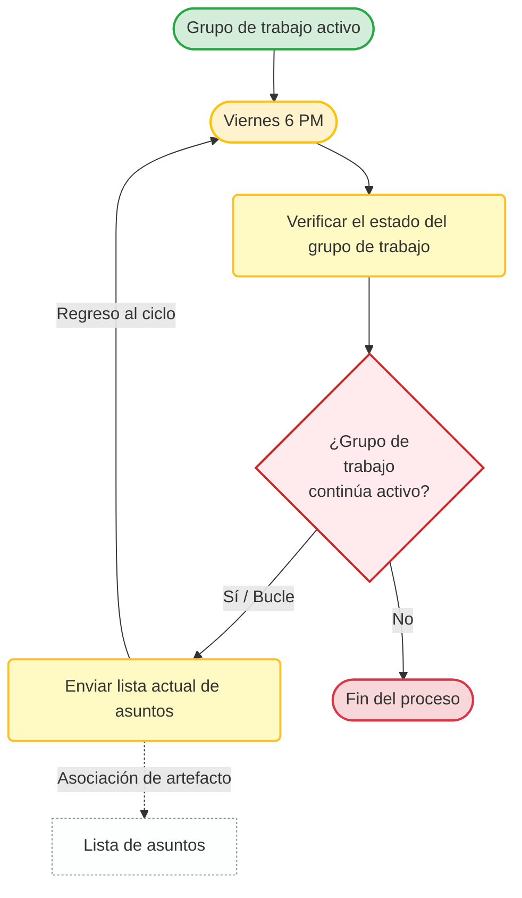

# Proyecto Simulador-ERP

**Fecha:** 03/11/2026  
**Materia:** Sistemas ERP  
**Institución:** Universidad Politécnica de San Luis Potosí  
**Carrera:** Ingeniería en Tecnologías de la Información  
**Alumno:** Daniel Alejandro Venegas Rivera  
**Matrícula:** 177603  
**Docente:** Mtro. Jesús Alberto Revilla Silva  

---

## Documento de Requerimientos

### Sistemas Virtuales: Recibos y las entregas

#### 1. Definición de requerimientos funcionales

* **Recepción de Mercancía (Recibos):**
  * **a.** El sistema debe permitir registrar la entrada de productos asociada a una Orden de Compra previa.
  * **b.** El sistema debe permitir ingresar la cantidad física recibida de cada producto.
  * **c.** El sistema debe actualizar automáticamente el inventario (aumentando el stock) al confirmar el recibo.

* **Entrega de Mercancía (Entregas):**
  * **a.** El sistema debe permitir registrar la salida de productos asociada a una Orden de Venta o Pedido.
  * **b.** El sistema debe verificar la disponibilidad de stock antes de autorizar la salida.
  * **c.** El sistema debe actualizar automáticamente el inventario (disminuyendo el stock) al confirmar la entrega.

#### 2. Descripción de las reglas de negocio que aplican

* **Reglas para Recibos:**
  * **a.** No se puede recibir mercancía si no existe una Orden de Compra previa aprobada.
  * **b.** El sistema debe alertar si la cantidad recibida es mayor a la solicitada en la Orden de Compra (exceso de mercancía).

* **Reglas para Entregas:**
  * **a. Stock insuficiente:** No se puede confirmar una entrega si el inventario actual es menor a la cantidad solicitada en el pedido.
  * **b.** Una vez confirmada la entrega, el inventario se descuenta de forma inmediata y el registro ya no se puede modificar libremente (requiere cancelación o nota de crédito).

#### 3. Pruebas unitarias

* **Prueba de actualización de stock por recepción:**  
  Verificar que se sume correctamente la cantidad al stock actual.
* **Prueba de validación de stock disponible:**  
  Verificar si hay suficiente stock.
* **Prueba de actualización de stock por entrega:**  
  Verificar que se reste correctamente la cantidad del stock actual.

#### 4. Pruebas funcionales

* **Flujo de Recepción Exitosa:**
  * **a.** Crear una Orden de Compra de 10 piezas del producto "Lápiz".
  * **b.** Ir al módulo de Recibos, seleccionar la Orden de Compra y registrar la recepción de las 10 piezas.

* **Flujo de Bloqueo por Stock Insuficiente (Entrega):**
  * **a.** Intentar registrar una entrega de 50 piezas de un producto del cual solo hay 5 en inventario.

#### 5. Integridad de los datos

* **Relaciones:** Un recibo o una entrega siempre debe estar ligado obligatoriamente a una orden de compra o venta existente.
* **Restricciones de valores:** Las cantidades de los productos en recibos, entregas e inventarios nunca pueden ser negativas.
* **Transaccionalidad:** Si al registrar una entrega ocurre un error de red o de sistema a mitad del proceso, la base de datos debe revertir todo para evitar que se descuente el inventario sin que se haya generado correctamente el comprobante de entrega.

---

## Diagrama de Flujo (Mermaid)

