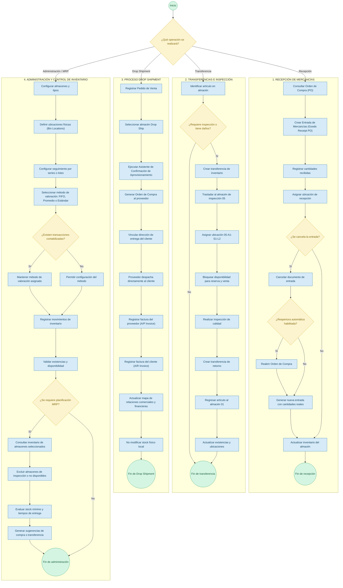

# ERP-Simulator
## Primera Entrega de Proyecto

**Alumno:** Juan Pablo Moreno Rivera - 181549  
**Materia:** Sistemas ERP  
**Institución:** Universidad Politécnica de San Luis Potosí  
**Profesor:** Jesús Alberto Revilla

---

# 1. Especificación de Requerimientos y Diseño Funcional ERP

## 1.1 Definición de Requerimientos Funcionales

Los requerimientos funcionales especifican el comportamiento esperado del sistema para administrar y controlar los inventarios físicos y lógicos en los almacenes.

| ID | Requerimiento | Descripción |
|---|---|---|
| RF-01 | Gestión Master de Almacenes | Permitir la creación, actualización y parametrización de almacenes de distintos tipos: general, respaldo, consignación, inspección/calidad y Drop Shipment. |
| RF-02 | Control de Ubicaciones (Bin Locations) | Permitir activar y estructurar ubicaciones físicas dentro de un almacén mediante subniveles como almacén, zona, pasillo, estante y nivel, para rastrear la posición exacta del stock. |
| RF-03 | Entradas por Recepción (Goods Receipt PO) | Registrar entradas de mercancía vinculadas o independientes a órdenes de compra, permitiendo recepciones parciales, cancelaciones, reapertura automática y asignación a ubicaciones. |
| RF-04 | Transferencias Internas de Inventario | Permitir trasladar artículos entre almacenes o entre ubicaciones dentro del mismo almacén. |
| RF-05 | Trazabilidad por Series y Lotes | Gestionar el rastreo obligatorio u opcional de artículos mediante números de serie o lotes desde la entrada hasta la entrega final o procesos de garantías y servicios. |
| RF-06 | Drop Shipment | Permitir despachar mercancía directamente del proveedor al cliente final, registrando la parte financiera y logística sin afectar el stock físico del almacén local. |
| RF-07 | Valoración de Inventario Continuo | Administrar el costo del inventario a nivel global o por almacén utilizando métodos como Promedio Ponderado, FIFO o Costo Estándar. |

## 1.2 Descripción de las Reglas de Negocio

Las reglas de negocio establecen las restricciones y la lógica bajo la cual debe operar el módulo de almacenes dentro del ERP.

- **RN-01. Reapertura Documental por Cancelación:** Si una entrada de mercancías (Goods Receipt PO) es cancelada, la Orden de Compra (Purchase Order) debe reabrir automáticamente su cantidad pendiente, siempre que la opción correspondiente esté habilitada.

- **RN-02. Transferencia a Ubicaciones de Inspección:** Todo producto que sufra daño físico o requiera control de calidad debe trasladarse a un almacén o ubicación bloqueada/de inspección, impidiendo su reserva o venta mientras permanezca en ese estado.

- **RN-03. Consistencia en Almacenes Drop Ship:** Los artículos asignados a un almacén Drop Shipment no generan contabilización en cuentas de stock físico local. Se vincula directamente la Orden de Compra al proveedor con el Pedido de Venta y la dirección de entrega del cliente.

- **RN-04. Inmutabilidad del Método de Valoración:** En un esquema de Inventario Permanente, una vez realizada la primera transacción contabilizada para un artículo o grupo, el método de valoración asignado no puede modificarse si existen registros vinculados.

- **RN-05. Reserva y Selección de Series:** No se puede completar la entrega o despacho de un artículo gestionado por número de serie si la cantidad seleccionada no coincide exactamente con las series asignadas o reservadas en la orden.

## 1.3 Pruebas Unitarias

Las pruebas unitarias verifican el funcionamiento correcto de componentes y funciones individuales dentro del sistema.

| ID | Módulo / Función | Descripción de la Prueba | Resultado Esperado |
|---|---|---|---|
| PU-01 | Master Data de Artículos | Crear un artículo asignando grupo de unidad de medida (UoM) Paper (Caja = 5 Packs) y definiendo almacén por defecto. | El artículo se guarda correctamente con la conversión de unidades y almacenes asignados sin errores de esquema. |
| PU-02 | Form Settings | Habilitar la visibilidad de las columnas Whse, From Bin Location y To Bin Location en la ventana de transferencias. | Las columnas aparecen disponibles para seleccionar ubicaciones de origen y destino. |
| PU-03 | Asignación de Serie | Seleccionar cuatro números de serie mediante Ctrl + Tab o menú contextual. | La ventana de Selección de Números de Serie valida que la cantidad seleccionada coincida con la cantidad requerida. |
| PU-04 | Registro de Ubicación | Probar la entrada de un artículo directamente a la ubicación física 05-A1-S1-L2. | El sistema asigna el código de ubicación al registro del artículo en el almacén 05. |

## 1.4 Pruebas Funcionales

Las pruebas funcionales evalúan flujos de trabajo completos de extremo a extremo (End-to-End), simulando procesos reales de la empresa.

### PF-01. Recepción, Cancelación y Corrección de Mercancía

**Pasos de ejecución:**

1. Crear una Orden de Compra (PO) por 50 unidades de A00001, 100 de A00002 y 25 de A00003.
2. Copiar la PO a una Entrada de Mercancías (Goods Receipt PO).
3. Cancelar la Entrada de Mercancías mediante clic derecho → Cancelar.
4. Verificar el estado de la PO original.
5. Generar una nueva entrada con cantidades reales: 30, 70 y 20 unidades respectivamente.

**Resultado esperado:** La entrada original queda cancelada, la PO se reabre automáticamente a estado Abierto y la nueva entrada registra únicamente el stock corregido en el Almacén 01.

### PF-02. Reubicación por Inspección y Retorno a Almacén

**Pasos de ejecución:**

1. Crear una Transferencia de Inventario del artículo A00002 (cantidad: 1) del Almacén 01 al Almacén 05, ubicación 05-A1-S1-L2.
2. Verificar el informe de auditoría o stock por ubicaciones.
3. Generar una segunda transferencia de retorno del Almacén 05 / Ubicación 05-A1-S1-L2 al Almacén 01.

**Resultado esperado:** El stock disminuye del Almacén 01 y se refleja temporalmente en la ubicación 05-A1-S1-L2 del Almacén 05. Posterior a la inspección, el stock regresa al Almacén 01 sin discrepancias.

### PF-03. Flujo Completo de Drop Shipment

**Pasos de ejecución:**

1. Registrar un Pedido de Venta para el cliente C40000 del artículo I00010 (cantidad: 4), seleccionando el almacén Drop Ship.
2. Ejecutar el Asistente de Confirmación de Aprovisionamiento para generar la PO al proveedor.
3. Facturar al proveedor (A/P Invoice) y facturar al cliente (A/R Invoice).

**Resultado esperado:** La dirección de envío en la PO toma automáticamente la dirección del cliente C40000. Los inventarios físicos locales no sufren entradas ni salidas y el Mapa de Relaciones vincula todo el proceso comercial y financiero.

## 1.5 Integridad de los Datos

La integridad de los datos garantiza la consistencia, exactitud y validez de la información a lo largo de todas las operaciones del ERP.

- **Integridad Referencial de Tablas Base:** Todos los registros de movimientos en el almacén (entradas, salidas y transferencias) deben vincularse a un código de artículo válido existente en los datos maestros (OITM) y a un código de almacén registrado (OWHS).

- **Consistencia de Inventario Físico vs. Disponible:** El sistema mantiene el cálculo en tiempo real de la ecuación:

  `Disponible = En Stock + Solicitado (PO) - Comprometido (Sales Order)`

  Ninguna transacción de salida puede dejar el inventario físico en valores negativos si la configuración global del ERP prohíbe el stock negativo.

- **Trazabilidad en el Mapa de Relaciones:** Toda transacción derivada de otra conserva la clave primaria/foránea del documento origen, garantizando la trazabilidad histórica de los movimientos.

- **Balance de Cuentas Contables (Perpetual Inventory Audit Trail):** Por cada movimiento físico de entrada o salida de almacén, el ERP genera automáticamente el asiento contable correspondiente en el libro mayor, asegurando que el valor monetario en finanzas coincida con la valoración física del inventario.

## 1.6 Matriz de Trazabilidad de Requerimientos (RTM)

Relaciona los requerimientos funcionales directamente con sus casos de prueba y reglas de negocio asociadas.

| ID Requerimiento | Descripción | Regla de Negocio | Caso de Prueba |
|---|---|---|---|
| RF-02 | Control de Ubicaciones (Bin Locations) | RN-02 | PU-04, PF-02 |
| RF-03 | Entrada por Recepción de Compras | RN-01 | PU-02, PF-01 |
| RF-06 | Proceso de Drop Shipment | RN-03 | PF-03 |
| RF-07 | Valoración de Inventario Continuo | RN-04 | PU-01 |

## 1.7 Arquitectura de Integración con el Módulo MRP

El módulo de almacenes interactúa directamente con el motor de planificación MRP (Material Requirements Planning).

- **Entradas de Datos al MRP:** El motor MRP toma el inventario inicial existente en los almacenes seleccionados en el escenario de planificación.

- **Consideración de Ubicaciones y Almacenes Excluidos:** Los almacenes de calidad/inspección o definidos como no disponibles para MRP son ignorados por el algoritmo para evitar falsas disponibilidades de stock.

- **Generación de Órdenes Sugeridas:** En función del stock mínimo por almacén y los tiempos de entrega (Lead Time) configurados en los datos maestros del artículo, el MRP genera recomendaciones de compra u órdenes de transferencia entre almacenes.

---

# 2. Diagrama de Procesos - BPMN

El siguiente diagrama representa gráficamente los principales procesos del módulo de gestión de almacenes del ERP-Simulator, considerando sus requerimientos funcionales y reglas de negocio.

---

**Fin del documento.**
